# Folio Architecture Reference Manual

Repository baseline: `main` at commit `5791c60` plus the verified Phase 11 and complete Phase 12 implementation
Audit date: 2026-07-28  
Status: current through the Phase 12 final architecture freeze

## Classification protocol

**DOCUMENTED.** This manual uses the four classifications required by the ARM request:

- **IMPLEMENTED** — present in production source, package manifests, or executable configuration at the audited implementation.
- **DOCUMENTED** — stated by project or supplied Phase 11 documentation but absent from production code.
- **PLANNED** — explicitly deferred or reserved for a future phase.
- **UNKNOWN** — not determinable from the audited implementation and documentation.

**DOCUMENTED.** A classification line applies to every statement, table row, list item, and diagram that follows it until another classification line appears. Tables that mix states include a `Class` column. Navigational headings and source-path labels make no architectural claim.

**IMPLEMENTED.** The implementation is authoritative when it contradicts earlier documentation. Contradictions are recorded, not resolved.

---

# Chapter 1 — Executive Summary

## 1.1 Current architecture

**IMPLEMENTED.** Folio is a pnpm TypeScript monorepo containing one Electron desktop application and thirteen workspace packages. The application renderer is React-based, while notebook-page pixels are drawn through imperative Canvas 2D layers. Package boundaries separate notebook aggregates, folder persistence, notebook history, canvas geometry/rendering, ink, document objects, selection, manipulation, editor composition, and reusable UI.

**IMPLEMENTED.** The current production dependency flow is acyclic:

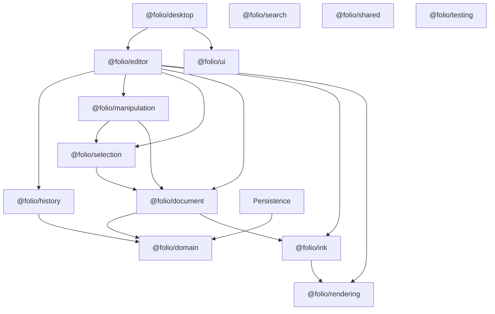

**IMPLEMENTED.** Two distinct object representations coexist:

- `@folio/domain.PageObject` is a JSON-safe record inside the persisted `Notebook` aggregate.
- `@folio/document.PageObject` is a richer session object contract. Its only concrete type is immutable `InkObject`, which owns lifecycle metadata, transformed cached bounds, a translation/rotation/uniform-scale `Transform`, and a finalized `Stroke`.

**IMPLEMENTED.** No production adapter converts between these two object representations. The desktop editor uses the `@folio/document` representation in an in-memory `InkDocumentSession`; persistence and the legacy Phase 5 History surface use `@folio/domain`. The generic Phase 11 History surface is model-neutral and operates on the editor collection through `HistoryDocumentSession<ObjectCollection>`.

**IMPLEMENTED.** Immutability is enforced through frozen plain objects in `@folio/domain`, immutable classes and frozen collections in `@folio/document`, frozen interaction state in selection/manipulation, immutable history entries, and frozen snapshots/results across packages. Successor state is normally created rather than mutating predecessor state.

**IMPLEMENTED.** Principal patterns are:

- factories with injectable clocks/ID generators;
- composition rather than a shared behavioral inheritance hierarchy;
- interface-and-factory boundaries for selection and manipulation;
- immutable aggregate replacement;
- separate command-based notebook compatibility History and generic editor History;
- adapter injection for filesystems, timers, animation frames, resize observation, and coordinates;
- demand-driven rendering with one-shot `requestAnimationFrame`;
- React as lifecycle/composition glue around imperative editor subsystems.

## 1.2 Current integration boundary

**IMPLEMENTED.** The desktop shell mounts `CanvasSurface`, which constructs one `CanvasController`, ink/manipulation-preview/selection overlays, `StrokeRenderer`, `PointerInputController`, `InkDocumentSession`, selection and manipulation subsystems, plus one generic History manager/controller and shortcut adapter. Tool selection routes pointer input without remounting the canvas or recreating History.

**IMPLEMENTED.** A successful continuous manipulation or discrete selected-object action emits a discriminated immutable `ManipulationResult`. An editor-owned exhaustive adapter maps translation, rotation, scale, delete, and duplicate variants to private Move, Rotate, Scale, Delete, and Duplicate commands. The command is submitted through `IHistoryController<ObjectCollection>`, installed through the document session, and reflected into permanent ink and selection state through an immutable notification. Undo and redo use the same path. Finalized ink remains a direct session update and creates no History entry.

**IMPLEMENTED.** The editor remains unconnected to `@folio/domain`, `@folio/persistence`, and `@folio/search`. It imports only the generic public contracts and factories from `@folio/history`.

## 1.3 Product and architectural principles

**DOCUMENTED.** Project volumes describe Folio as Windows-first, offline-first, fixed-page, notebook-centric, writing-first, and file-authoritative. They prescribe Canvas for page content, React for application UI, SQLite only as a rebuildable cache, composition over inheritance, and strict layer separation.

**IMPLEMENTED.** The code embodies the Windows Electron shell, Canvas/React split, fixed render page, package separation, composition, and folder-based JSON persistence.

**DOCUMENTED.** SQLite search/cache, complete notebook/editor stores, native `.folio` archives, and full main/preload persistence IPC are described but absent.

**PLANNED.** Rich text, images, clipboard, search, export, synchronization, and multiple other notebook-object behaviors remain future work.

---

# Chapter 2 — Repository Overview

## 2.1 Repository tree

**IMPLEMENTED.**

```text
folio/
|-- apps/
|   `-- desktop/
|       |-- electron/
|       |   |-- main.ts
|       |   `-- preload.ts
|       `-- src/
|           |-- components/
|           |   |-- dialogs/
|           |   |-- editor/
|           |   |-- notifications/
|           |   |-- shell/
|           |   `-- theme/
|           |-- data/
|           `-- types/
|-- assets/
|-- docs/
|   `-- architecture/
|-- packages/
|   |-- document/
|   |-- domain/
|   |-- editor/
|   |-- history/
|   |-- ink/
|   |-- manipulation/
|   |-- persistence/
|   |-- rendering/
|   |-- search/
|   |-- selection/
|   |-- shared/
|   |-- testing/
|   `-- ui/
|-- scripts/
|-- src/                         # empty repository-level source directory
|-- tests/
|   `-- e2e/
|-- eslint.config.mjs
|-- package.json
|-- playwright.config.ts
|-- pnpm-lock.yaml
|-- pnpm-workspace.yaml
|-- tsconfig.base.json
`-- vitest.config.ts
```

## 2.2 Workspace and build system

**IMPLEMENTED.**

| Concern | Current implementation |
| --- | --- |
| Package manager | pnpm 11; root manifest pins `pnpm@11.9.0` |
| Runtime requirement | Node.js `>=22.12.0` |
| Workspace discovery | `apps/*` and `packages/*` |
| Language | TypeScript 5.9, strict mode |
| Desktop runtime | Electron 43 |
| Renderer | React 19 with Vite 8 |
| Styling | Tailwind CSS 4 through the Vite plugin |
| UI primitives | Radix-based local components in `@folio/ui` |
| Animation | Framer Motion in desktop notifications |
| Formatting | Prettier 3 |
| Linting | ESLint 10 and TypeScript ESLint |
| Unit testing | Vitest 4 |
| End-to-end testing | Playwright 1.62 against Electron |
| Packaging | electron-builder, Windows NSIS configuration |
| Installer/app identity | `com.folio.desktop`, product name `Folio` |

**IMPLEMENTED.** Root commands are `dev`, `build`, `generate:icons`, `package`, `typecheck`, `lint`, `format`, `format:check`, `test`, `test:watch`, and `test:e2e`.

**IMPLEMENTED.** The desktop build type-checks renderer and Electron code separately, builds the renderer to `apps/desktop/dist/renderer`, compiles Electron CommonJS output to `apps/desktop/dist-electron`, and packages into the repository-level `release` directory.

## 2.3 TypeScript and quality configuration

**IMPLEMENTED.** The shared TypeScript configuration targets ES2023, uses ES modules with bundler resolution, enables `strict`, `noUncheckedIndexedAccess`, `exactOptionalPropertyTypes`, `isolatedModules`, and DOM libraries, and disables emission by default.

**IMPLEMENTED.** Electron overrides the target to ES2022, module format to CommonJS, module resolution to Node, disables isolated modules, and enables emission.

**IMPLEMENTED.** ESLint ignores generated output, coverage, dependencies, reports, releases, and test results. React Hooks rules are active. The React-refresh export rule is a warning, while the root lint command allows zero warnings.

**IMPLEMENTED.** Vitest includes tests under `apps/**/*.test.ts` and `packages/**/*.test.ts`. Current unit/integration and Electron counts are recorded by the latest release verification rather than treated as a fixed architectural constraint.

**IMPLEMENTED.** Package public-surface tests exist for document, editor, history, ink, manipulation, persistence, rendering, and selection.

## 2.4 Electron process architecture

**IMPLEMENTED.**

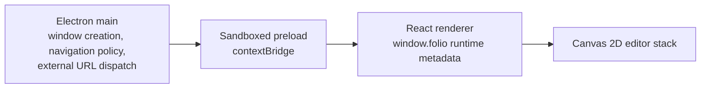

**IMPLEMENTED.** `BrowserWindow` uses `contextIsolation: true`, `nodeIntegration: false`, and `sandbox: true`. New HTTP(S) windows are denied and delegated to the OS browser. Navigation is restricted to the configured development origin or packaged `file://` content.

**IMPLEMENTED.** Preload exposes only `platform` and Electron/Chromium/Node version strings as `window.folio`.

**DOCUMENTED.** Project architecture assigns filesystem, dialogs, validated IPC, and native integration to main/preload.

**IMPLEMENTED.** No filesystem, notebook, dialog, or persistence IPC channel exists.

---

# Chapter 3 — Package Dependency Graph

## 3.1 Production and development graph

**IMPLEMENTED.** Solid edges are production manifest dependencies. Dashed edges are development-only workspace dependencies.

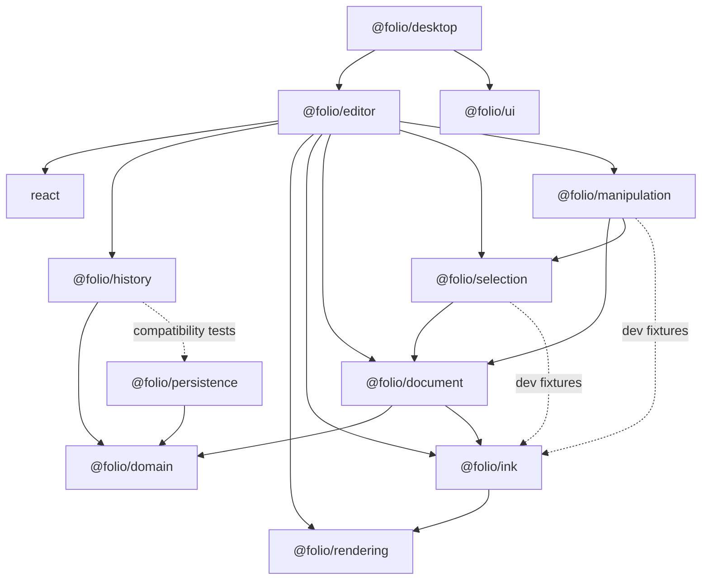

**IMPLEMENTED.** `@folio/rendering`, `@folio/domain`, `@folio/search`, `@folio/shared`, `@folio/testing`, and `@folio/ui` have no production dependency on another Folio workspace package. `@folio/search`, `@folio/shared`, and `@folio/testing` contain only `export {}`.

**IMPLEMENTED.** No production package cycle exists.

## 3.2 Package responsibility matrix

**IMPLEMENTED.**

| Package | Purpose and ownership | Production dependencies | Current dependents | Public boundary | Internal implementation | Existing extension points |
| --- | --- | --- | --- | --- | --- | --- |
| `@folio/domain` | JSON-safe immutable notebook aggregate, factories, operations, capability markers, validation | none | document, history, persistence | star barrel over eight source modules | cloning/freezing and validation collectors | factory clock/ID context; capability record; object discriminants |
| `@folio/document` | immutable session page objects and ordered collection; concrete `InkObject` only | domain, ink | selection, manipulation, editor | deliberate barrel | JSON copying, reindexing, object validation | factory context; serialization interfaces; type/factory branches |
| `@folio/rendering` | Canvas lifecycle, camera, viewport, conversion, base page renderer, overlay renderers | none | ink, editor | deliberate barrel | geometry, dirty accumulator, overlay-layer implementation | animation/resize/DPR adapters, overlay hooks/layers, visual interfaces |
| `@folio/ink` | pointer capture, stroke construction/smoothing, ink rendering and preview visual | rendering | document, editor | deliberate barrel | draw geometry/style helpers and visual implementation | smoothing hooks, pressure curve, texture ID, injected adapters |
| `@folio/selection` | identity-only selection and vector ink hit testing | document | manipulation, editor | interfaces/types plus factories | concrete manager/controller/engine, linear candidate query, geometry | coordinate mapper/object source; internal candidate strategy seam |
| `@folio/manipulation` | translation, center-pivot rotation, uniform-scale sessions, and discrete delete/duplicate results | document, selection | editor | interfaces/types/configuration plus factories | shared continuous manager/controller/session, three calculation engines, result factories, and state builders | manager/controller sources, `onResult`, compatible translation `onCommit`, calculation interfaces, discrete result factories |
| `@folio/editor` | React lifecycle and composition adapter for rendering, ink, document, selection, manipulation, and generic History | document, history, ink, manipulation, rendering, selection, React | desktop | `CanvasSurface` runtime plus type contracts | session object store, coordinate mappers, private Move/Rotate/Scale/Delete/Duplicate commands, History coordinator/shortcuts, orchestration | lifecycle/state/History callbacks, interaction mode, object-lifecycle actions |
| `@folio/persistence` | folder JSON storage, versioning, dirty tracking, autosave, recovery | domain | none in production | deliberate barrel | atomic write, path safety, stable JSON, load/save/recovery pipelines | filesystem, timer, recovery context, compatibility records |
| `@folio/history` | frozen domain-notebook compatibility History plus model-neutral editor History | domain | editor | legacy manager/factories plus generic interfaces/types/errors and two factories | legacy snapshot machinery; private generic manager/controller/stacks/transactions | legacy commands/dirty sink; generic `EditorCommand`, session, controller, transactions |
| `@folio/ui` | reusable React UI primitives | external Radix/CVA/clsx/lucide/tailwind-merge | desktop | root barrel plus component/lib wildcard subpaths | styling compositions around external primitives | component props and variants |
| `@folio/search` | no implemented responsibility beyond an empty package boundary | none | none | empty | none | none in code |
| `@folio/shared` | no implemented responsibility beyond an empty package boundary | none | none | empty | none | none in code |
| `@folio/testing` | no implemented responsibility beyond an empty package boundary | none | none | empty | none | none in code |

## 3.3 Desktop dependencies

**IMPLEMENTED.** `@folio/desktop` consumes `@folio/editor`, `@folio/ui`, React, React DOM, Inter, Framer Motion, Lucide, and declares Zustand. Its build-time dependencies include Electron, electron-builder, Vite, Tailwind, TypeScript types, concurrency helpers, and `wait-on`.

**IMPLEMENTED.** No production source imports Zustand.

## 3.4 Dependency boundary observations

| Class | Observation |
| --- | --- |
| **IMPLEMENTED** | `@folio/history` has no production dependency on `@folio/persistence`; the persistence package is development-only for structural legacy dirty-sink compatibility tests. |
| **IMPLEMENTED** | The generic History subtree has no Folio-package imports. The package-level Domain edge belongs only to the frozen Phase 5 compatibility surface. |
| **IMPLEMENTED** | `@folio/document` declares `@folio/ink` as a production dependency; its source imports stroke contracts as TypeScript types and retains runtime `Stroke` instances provided by callers. |
| **IMPLEMENTED** | The editor legitimately depends on every active interaction/rendering subsystem and is the highest-coupling Folio package below the desktop app. |
| **DOCUMENTED** | Volume 4 shows simple downward UI → services → domain → persistence layering, while current package edges use Editor as the composition boundary across independent peer subsystems. |
| **IMPLEMENTED** | `@folio/ui` exposes wildcard component/lib subpaths in addition to its root barrel, making more module exports public than the root API suggests. |

---

# Chapter 4 — Domain Model

## 4.1 Persistence-facing notebook aggregate

**IMPLEMENTED.** `@folio/domain` owns the immutable notebook aggregate:

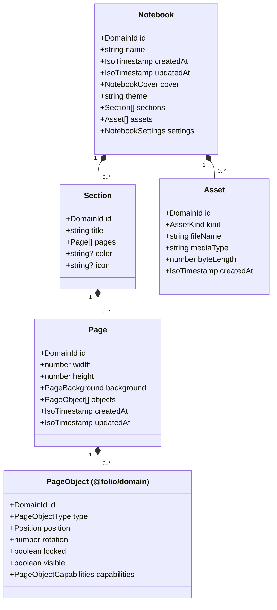

**IMPLEMENTED.** Sections and pages are embedded in arrays rather than referenced as IDs in memory. Ordering is array order. Persistence converts those embedded relationships into metadata/section/page document references.

**IMPLEMENTED.** `PageBackground` is either plain with `color`, or grid/ruled with `color`, `lineColor`, and positive `spacing`.

**IMPLEMENTED.** `NotebookCover` is `null`, a color value, or an asset ID reference. Validation ensures an asset cover references an asset in the same notebook.

**IMPLEMENTED.** Assets are metadata only. The domain model stores no binary data or filesystem path.

## 4.2 Capability model

**IMPLEMENTED.** Domain page objects compose a partial record of `Selectable`, `Movable`, `Resizable`, `Rotatable`, `Editable`, `Serializable`, `Renderable`, `Lockable`, `Groupable`, and `Searchable` markers. Enabled capabilities are represented only by literal `true`.

**IMPLEMENTED.** Every domain page object must be serializable and renderable. A locked object must also declare `lockable`.

**IMPLEMENTED.** Capability markers contain no behavior. Consumers interpret them.

## 4.3 Types and identity

**IMPLEMENTED.** `DomainId` and `IsoTimestamp` are string aliases. Factories use `crypto.randomUUID()` and ISO timestamps by default and accept injected providers for deterministic creation.

**IMPLEMENTED.** Notebook validation enforces nonblank IDs and global uniqueness across notebook, sections, pages, page objects, and assets. Page validation also checks duplicate object IDs, and section validation checks duplicate page IDs.

**IMPLEMENTED.** Domain page-object discriminants are `pen-stroke`, `highlighter-stroke`, `rich-text`, `heading`, `image`, `table`, `sticky-note`, `rectangle`, `circle`, `line`, and `arrow`.

**IMPLEMENTED.** The discriminants do not imply concrete payload fields. Every domain page object currently has only the common identity/transform/state/capability fields.

## 4.4 Factories, validation, and aggregate lifecycle

**IMPLEMENTED.** Factories validate then recursively clone and freeze their results. Arrays and nested objects are frozen. Inputs are not retained as mutable references.

**IMPLEMENTED.** Aggregate operations validate their input, create a successor, validate it, then clone/freeze it. Rename/metadata/section/page changes update the notebook `updatedAt`. Page duplication creates new page and page-object IDs and resets page timestamps.

**IMPLEMENTED.** Reordering an item to the same index returns the same notebook reference. Other aggregate operations generally return a new deeply frozen notebook.

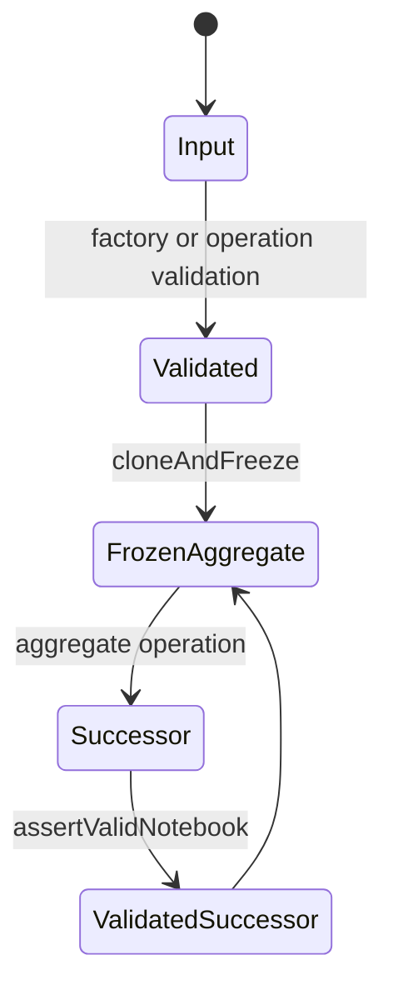

## 4.5 Session document object model

**IMPLEMENTED.** `@folio/document` owns a separate immutable page-object system:

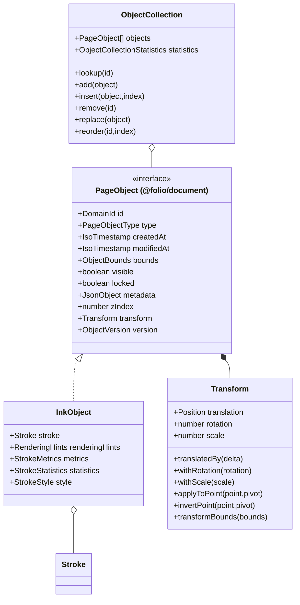

**IMPLEMENTED.** The only `@folio/document.PageObjectType` is `"ink"` and the only version is `1`.

**IMPLEMENTED.** `Transform` accepts finite translation, finite clockwise rotation in radians, and positive finite uniform scale. Rotation and scale use the center of local inflated stroke bounds as a stable pivot. Axis-specific operations preserve the other transform values.

**IMPLEMENTED.** `InkObject` retains one immutable `Stroke` reference. Its cached bounds are the axis-aligned transformed inflated stroke bounds. Translation, rotation, and scale create same-ID replacements with a new `modifiedAt` and retained stroke.

**IMPLEMENTED.** `ObjectCollection` validates the input, normalizes every `zIndex` to array position, constructs a private ID map, calculates statistics/union bounds once, and freezes itself. Add, deterministic positional insert, remove, replace, and reorder return a new collection.

**IMPLEMENTED.** `SerializedPageObject` and `ObjectSerializationContract` define a boundary only. No document-object serializer/deserializer is implemented.

## 4.6 Model coexistence

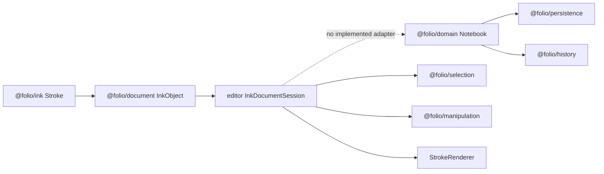

**IMPLEMENTED.** Domain objects and document objects share the name `PageObject` but have incompatible fields and type discriminants.

**UNKNOWN.** The current code does not define which representation will become authoritative for a persisted editor page or how migration between them will occur.

---

# Chapter 5 — Editor Architecture

## 5.1 Ownership and public boundary

**IMPLEMENTED.** `@folio/editor` exports one runtime component, `CanvasSurface`. It owns composition and lifecycle, not reusable business data. Its public interaction modes are `select`, `move`, `rotate`, `scale`, `ink`, and `disabled`.

**IMPLEMENTED.** `CanvasSurface` accepts optional callbacks for renderer readiness, selection-controller readiness, manipulation-controller readiness, object-lifecycle-action readiness, selection changes, manipulation changes, diagnostics, and errors.

**IMPLEMENTED.** React owns the host `<div>` and effect lifetime. The imperative packages own canvases, input, geometry, state, and drawing.

## 5.2 Composition

**IMPLEMENTED.**

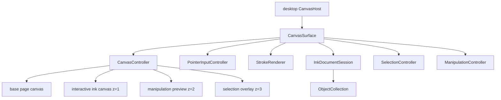

**IMPLEMENTED.** The base canvas is pointer-transparent. The ink overlay is the single interactive canvas. Selection and manipulation-preview overlays are pointer-transparent.

**IMPLEMENTED.** `InkDocumentSession` owns an `ObjectFactory` and current `ObjectCollection`. It converts finalized strokes to `InkObject`, replaces translated objects, exposes a diagnostic snapshot, and clears the collection on teardown.

## 5.3 Session lifecycle

**IMPLEMENTED.**

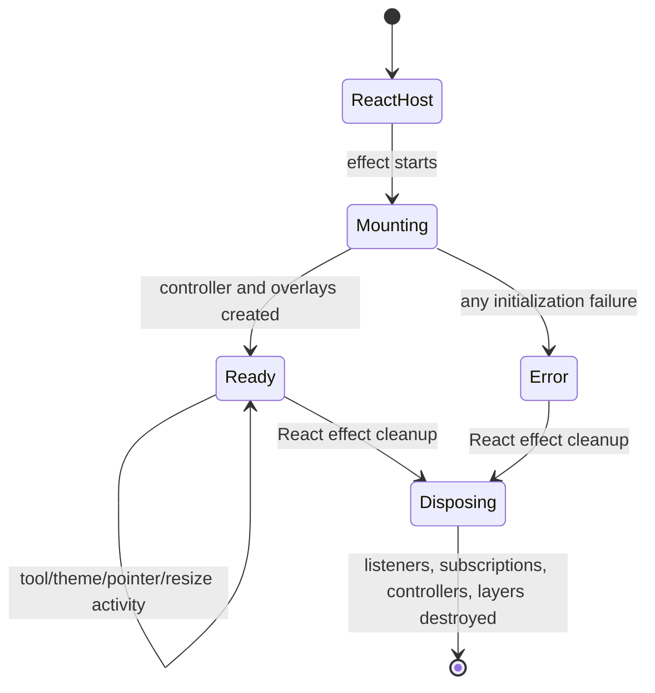

**IMPLEMENTED.** Mount creates all editor subsystems once. Changing the active tool updates a ref and does not remount the controller. Leaving any transform mode cancels manipulation and releases pointer capture.

**IMPLEMENTED.** Cleanup removes editor pointer and History shortcut listeners, unsubscribes selection/manipulation/History observers, cancels manipulation, releases pointer capture, destroys the History coordinator/controller, selection, and ink input, clears the document session, destroys overlay renderers/layers, and destroys the base controller.

## 5.4 Input routing

**IMPLEMENTED.** Editor pointer listeners run in capture phase on the ink canvas:

- Ink mode returns immediately, allowing `PointerInputController` to consume the browser event.
- Select mode prevents default behavior, stops immediate propagation, converts the event to normalized selection input, and may capture the pointer.
- Move, Rotate, and Scale modes prevent default behavior, stop immediate propagation, map screen to page, forward normalized manipulation input with the corresponding discriminator, and capture the pointer only when a session owns interaction.
- Disabled and nonmatching modes perform no editing action.

**IMPLEMENTED.** `PageSelectionCoordinateMapper` rejects points outside the page. `PageManipulationCoordinateMapper` rejects out-of-page starts but permits out-of-page movement once a manipulation session is active.

## 5.5 Commit and rendering coordination

**IMPLEMENTED.** During continuous manipulation, editor state is converted into a cached `StrokeVisual` and supplied to `TransformPreviewRenderer`. On successful commit, Manipulation emits the concrete translation, rotation, or scale result; the private Editor command adapter maps that result to Move, Rotate, or Scale command, and `EditorHistoryCoordinator` submits it through the session's `IHistoryController<ObjectCollection>`. The command creates a same-ID immutable object/collection successor, History installs it through `InkDocumentSession`, and the controller notification causes permanent ink, selection bounds, and diagnostics to refresh. The preview is cleared as Manipulation reaches terminal phases.

**IMPLEMENTED.** Delete and duplicate are discrete selection-scoped actions, not pointer manipulation modes. `CanvasSurface` creates immutable lifecycle results and routes them through the same adapter/coordinator. Delete retains the exact object and index for deterministic undo; duplicate calls the Document clone factory once, inserts adjacent to the source, and reuses that identity and position for redo. Removed selections are cleared, and a newly duplicated object becomes selected, entirely within Editor synchronization.

**IMPLEMENTED.** Undo and redo follow the same History notification and editor synchronization path. Transform paths do not call direct document-session helpers and do not involve Persistence.

**IMPLEMENTED.** Selection state changes are resolved back to current document objects, converted to `{objectId, bounds}`, and sent to `SelectionOverlayRenderer`.

## 5.6 Theme integration

**IMPLEMENTED.** `readTheme()` converts CSS custom properties and the document theme marker into a frozen `RenderTheme`. A `MutationObserver` watches root `data-theme`, `style`, and `class` changes and calls `CanvasController.setTheme`.

## 5.7 State boundaries

**IMPLEMENTED.** The desktop application separately owns shell UI state (`sidebarExpanded`, `activeSection`) and editor toolbar state (`activeTool`) through React hooks. `CanvasSurface` owns imperative editor-session objects inside one effect.

**DOCUMENTED.** Volume 4 specifies Zustand Notebook, Editor, UI, Settings, and Search stores.

**IMPLEMENTED.** Those stores do not exist. Zustand is declared only as an unused desktop dependency.

---

# Chapter 6 — History Architecture

## 6.1 Scope and current status

**IMPLEMENTED.** `@folio/history` is a framework-independent, session-only package with two isolated surfaces. The frozen Phase 5 compatibility surface operates on immutable `@folio/domain.Notebook` aggregates. The Phase 11 surface is generic over `TDocument`, is integrated with the editor's `ObjectCollection`, and retains no whole-document reversal snapshots.

**IMPLEMENTED.** The package's only production Folio dependency is `@folio/domain`, used exclusively by legacy modules. `@folio/persistence` is development-only for compatibility tests. The generic `src/editor-history` subtree imports no Folio package.

## 6.2 Legacy Phase 5 command model

**IMPLEMENTED.**

```ts
interface Command {
  readonly id: string;
  readonly timestamp: string;
  readonly description: string;
  readonly category: "notebook" | "page" | "section" | "transaction";
  readonly affectedTargets: readonly HistoryChangeTarget[];
  readonly execute: (notebook: Notebook) => Notebook;
  readonly undo: (notebook: Notebook) => Notebook;
  readonly redo: (notebook: Notebook) => Notebook;
}
```

**IMPLEMENTED.** Commands are frozen objects. Their target array and target records must also be frozen. A command identifies persistence effects as metadata, section, or page targets.

**IMPLEMENTED.** Public factories create commands for:

- notebook rename and metadata update;
- section add, delete, rename, and reorder;
- page add, delete, duplicate, and reorder.

**IMPLEMENTED.** Object commands do not exist on the legacy notebook surface.

**IMPLEMENTED.** Every supplied factory computes the successor notebook at command-creation time using a domain aggregate operation. The factory captures exact `before` and `after` references in closures. Execute accepts only the captured predecessor, undo only the captured successor, and redo only the captured predecessor. A different reference produces `COMMAND_STATE_MISMATCH`.

## 6.3 Legacy manager state and history entries

**IMPLEMENTED.** `HistoryManager` is a public concrete class. One instance owns:

- current notebook reference;
- save-point notebook reference;
- bounded undo array;
- redo array;
- optional active transaction;
- monotonic revision;
- configured positive safe-integer limit;
- optional structurally compatible `LegacyHistoryDirtySink`;
- a `WeakSet` of notebook references already validated as deep-frozen.

**IMPLEMENTED.** The private `HistoryEntry` record contains `{command, before, after}`. Stack entries therefore retain the command and two immutable notebook references.

**IMPLEMENTED.** The default limit is 100. Pushing beyond the limit removes the oldest complete entries from the front of the undo array. Redo depth is not separately bounded, but it can contain only entries previously moved from the bounded undo stack.

## 6.4 Execute algorithm

**IMPLEMENTED.**

```mermaid
sequenceDiagram
    participant Caller
    participant Manager as HistoryManager
    participant Command
    participant Domain
    participant Dirty as LegacyHistoryDirtySink
    Caller->>Manager: execute(frozen Command)
    Manager->>Manager: validate command structure
    Manager->>Command: execute(current notebook)
    Command-->>Manager: captured after reference
    Manager->>Domain: assertValidNotebook(after)
    Manager->>Manager: verify deep freeze
    alt same reference
        Manager-->>Caller: unchanged snapshot
    else transaction active
        Manager->>Manager: append private entry; revision++
    else no transaction
        Manager->>Manager: push bounded undo; clear redo; revision++
        Manager->>Dirty: mark unique affected targets if supplied
    end
    Manager-->>Caller: frozen HistorySnapshot
```

**IMPLEMENTED.** Command execution occurs before manager state mutation. If command execution or result validation throws, stacks/current notebook/revision remain unchanged.

**IMPLEMENTED.** A same-reference result is a no-op: it consumes no stack entry, does not clear redo, does not increment revision, and does not change dirty state.

## 6.5 Undo algorithm

**IMPLEMENTED.**

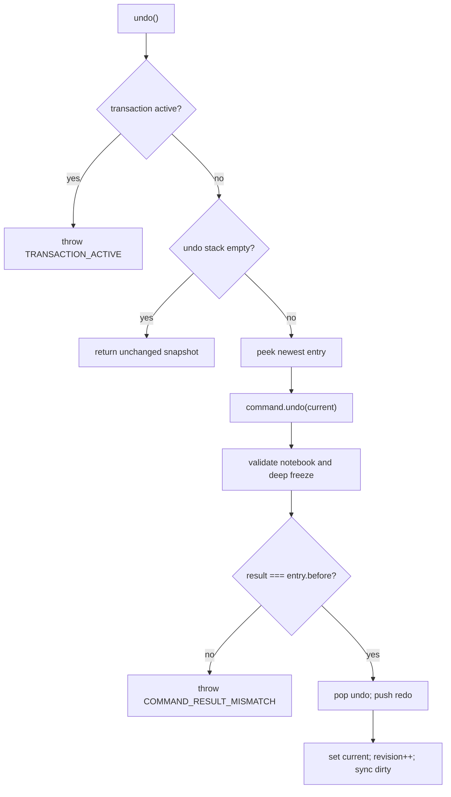

**IMPLEMENTED.** Undo restores the exact predecessor reference captured in the entry. It does not calculate or clone a new successor. Stack movement occurs only after result validation and reference comparison.

## 6.6 Redo algorithm

**IMPLEMENTED.**

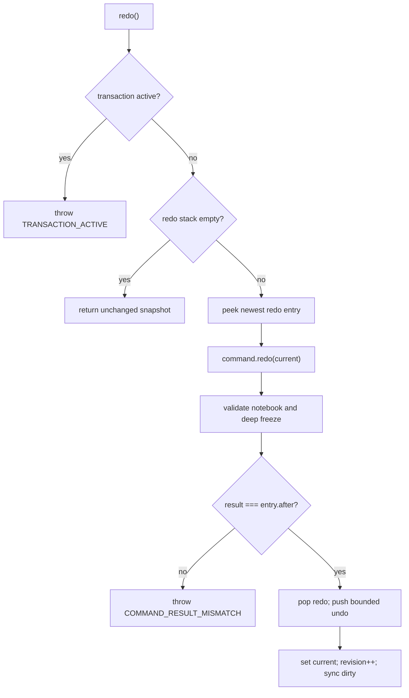

**IMPLEMENTED.** Executing a new non-no-op command outside a transaction invalidates the complete redo stack.

## 6.7 Snapshot strategies

**IMPLEMENTED.** `HistorySnapshot` is lightweight and contains only the current notebook reference and revision.

**IMPLEMENTED.** Every history entry retains exact before/after notebook references. The internal command implementation is named `createSnapshotCommand`; all built-in commands use it.

**IMPLEMENTED.** Transaction commit creates a new internal snapshot command that transitions directly between the transaction's starting notebook and final notebook.

**IMPLEMENTED.** The Phase 11 generic surface instead stores only commands and immutable metadata. Its undo/redo methods ask commands to create immutable successors and never retain complete before/after document aggregates. The two strategies coexist only to preserve Phase 5 compatibility.

## 6.8 Transactions

**IMPLEMENTED.** Transactions are non-nested. `beginTransaction` captures ID, timestamp, description, starting notebook, and an initially empty child-entry array.

**IMPLEMENTED.** Commands execute normally and increment the manager revision while a transaction is active, but entries are appended to the transaction instead of the undo stack. Redo is not cleared and dirty targets are not marked until commit.

**IMPLEMENTED.** `commitTransaction`:

1. requires an active transaction;
2. removes active transaction ownership;
3. returns unchanged if no entries exist or final reference equals the starting reference;
4. deduplicates all child affected targets;
5. creates one transaction-category snapshot command;
6. pushes one history entry, clears redo, and synchronizes dirty targets.

**IMPLEMENTED.** `rollbackTransaction` calls child `undo` functions in reverse order using a local notebook variable, validates exact child predecessor references, assigns the restored notebook only after the loop, clears the transaction, and increments revision once when child entries existed. It does not change undo/redo stacks or persistence dirty targets.

**IMPLEMENTED.** Undo, redo, clear, and save-point changes throw while a transaction is active. Commit/rollback without a transaction throw `TRANSACTION_NOT_ACTIVE`.

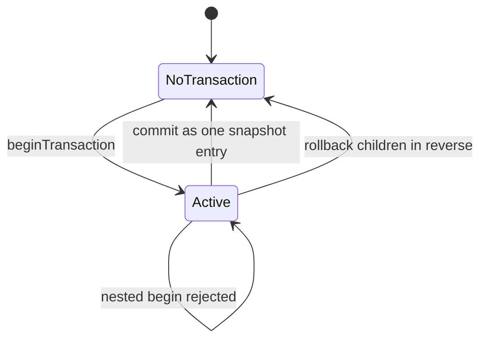

## 6.9 Dirty state and persistence coordination

**IMPLEMENTED.** History dirtiness is reference identity: `currentNotebook !== savePointNotebook`.

**IMPLEMENTED.** Construction sets the initial notebook as save point and clears a supplied `LegacyHistoryDirtySink`. The existing Persistence `DirtyTracker` satisfies that interface structurally. `markSavePoint` accepts any valid deeply frozen notebook, sets it as the save point, and clears the sink only if that reference is also current.

**IMPLEMENTED.** Execute, undo, and redo synchronize unique command targets. Metadata targets call `markMetadata`; section targets call `markSection`; page targets call `markPage(pageId, sectionId)`. Returning exactly to the save point clears all dirty targets.

**IMPLEMENTED.** `clear()` clears undo and redo only. It does not change current notebook, save point, revision, or dirty tracker.

**IMPLEMENTED.** Save itself remains caller-owned. The package README demonstrates capturing the submitted notebook, awaiting `saveNotebook`, then calling `markSavePoint(savedReference)`.

**IMPLEMENTED.** The generic History surface has no save-point or Persistence integration. Persistence coordination remains outside History.

## 6.10 Validation and failure consistency

**IMPLEMENTED.** History validates command structure, frozen command metadata/targets, supported category, valid timestamp, and callable lifecycle functions. It validates command result notebooks with domain validation and recursive frozen-state inspection.

**IMPLEMENTED.** Those domain and affected-target checks belong only to the legacy manager. The generic manager validates immutable command metadata/functions, lifecycle, stacks, transactions, and successor installation. Concrete editor commands own document rules.

**IMPLEMENTED.** The generic manager exposes immutable `idle`, `executing`, `undoing`, `redoing`, and `completed` state through `IHistoryState`. A private controller implementation publishes immutable success/failure notifications and isolates listener failures. Both implementations are constructed through public factories.

## 6.11 Public interfaces

**IMPLEMENTED.** Legacy public runtime:

- `HistoryManager`;
- `HistoryError`, `isHistoryError`;
- ten concrete command factories.

**IMPLEMENTED.** Legacy public types:

- `Command`, `CommandCategory`, `CommandFactoryOptions`;
- `HistoryChangeTarget`, `HistoryContext`;
- `DuplicatePageCommand`;
- `HistoryErrorCode`, `HistoryErrorOptions`;
- `HistoryManagerOptions`;
- `HistorySnapshot`, `HistoryState`, `Transaction`.

**IMPLEMENTED.** `HistoryState` exposes snapshot, undo/redo availability and depth, dirtiness, limit, and active transaction summary. It does not expose stack entries or commands.

**IMPLEMENTED.** Phase 11 public runtime adds only `createEditorHistoryManager()` and `createHistoryController()`. Its public types are `EditorCommand`, `HistoryDocumentSession`, `IHistoryManager`, `IHistoryController`, manager/controller options, command/transaction metadata, immutable notification/listener contracts, `IHistoryState`, and the discriminated execution/transaction state types. The exact inventory appears in Chapter 18 and `PHASE11_HISTORY_ARCHITECTURE.md`.

## 6.12 Internal implementation

**IMPLEMENTED.** Internal symbols include `HistoryEntry`, `ActiveTransaction`, `ResolvedCommandMetadata`, `SnapshotCommandInput`, `resolveCommandMetadata`, `createSnapshotCommand`, transition/reference guards, command validation, result-mismatch creation, transaction snapshot construction, target deduplication/keying, and deep-freeze inspection.

**IMPLEMENTED.** Concrete notebook/section/page commands are not classes. They are frozen command objects produced by public factories around the internal snapshot-command function.

**IMPLEMENTED.** Generic internals include a private manager/controller, bounded stack, command-integrity validation, immutable state builders, active transaction record, and transaction command group. None is reachable through the package barrel.

## 6.13 Existing extension points

**IMPLEMENTED.** Legacy callers can supply any frozen `Command` that accepts/returns domain `Notebook`, custom command metadata/context, a history limit, and optional `LegacyHistoryDirtySink`.

**IMPLEMENTED.** This permits more domain-notebook commands without modifying `HistoryManager`, provided they use the exact-reference lifecycle expected by the manager.

**IMPLEMENTED.** Generic callers can implement `EditorCommand<TDocument>` and `HistoryDocumentSession<TDocument>` without changing History. The active editor uses `ObjectCollection` only as its generic argument; History does not import that model.

## 6.14 Current dependency models

**IMPLEMENTED.** Legacy compatibility surface:

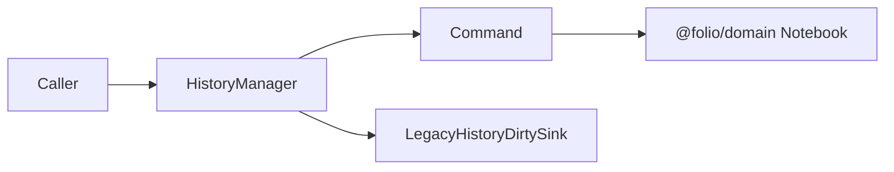

**IMPLEMENTED.** Generic editor surface:

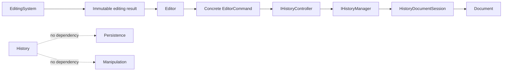

## 6.15 Compatibility decision

**IMPLEMENTED.** The migration is additive, not an in-place generalization. The public Phase 5 class, command factories, snapshot entries, notebook validation, save-point state, and dirty-sink behavior remain unchanged. The new model-neutral interfaces, private implementations, command-only transaction groups, controller notifications, and factories exist beside them. The active editor uses only the Phase 11 surface; neither surface shares state with the other.

---

# Chapter 7 — Persistence Architecture

## 7.1 Scope, ownership, and dependencies

**IMPLEMENTED.** `@folio/persistence` owns folder creation, deterministic JSON conversion, safe path derivation, load/save pipelines, explicit versions, dirty tracking, autosave scheduling, atomic text writes, and crash recovery. It depends on `@folio/domain` and Node filesystem/crypto/path APIs.

**IMPLEMENTED.** It does not depend on React, Electron, editor, document, rendering, history, selection, manipulation, or search. History also has no production dependency on Persistence; Persistence is present in History only as a development compatibility-test dependency.

**IMPLEMENTED.** The desktop Electron renderer cannot consume this package directly because the renderer is sandboxed and the desktop application has no persistence IPC bridge.

## 7.2 Folder storage

**IMPLEMENTED.**

```text
Notebook Folder/
|-- metadata.json
|-- sections/
|   `-- item-<percent-encoded-section-id>.json
|-- pages/
|   `-- item-<percent-encoded-page-id>.json
|-- assets/
|-- thumbnails/
`-- .folio/
    |-- recovery.json                  # present only during recovery work
    |-- <transaction>-NNNNN.next.json  # staged successor
    `-- <transaction>-NNNNN.previous.json
```

**IMPLEMENTED.** Initial save creates all six directories represented by `NotebookPaths`: root, sections, pages, assets, thumbnails, and `.folio`.

**IMPLEMENTED.** Load requires sections, pages, assets, thumbnails, and `.folio` to exist even though binary asset and thumbnail operations are not implemented.

**IMPLEMENTED.** Document filenames are derived from encoded IDs. Relative paths reject blank values, absolute paths, null bytes, empty/dot/dot-dot segments, and resolved paths outside the notebook root.

**DOCUMENTED.** Volume 4 includes `search.db` in the notebook folder.

**IMPLEMENTED.** Persistence creates no `search.db`.

## 7.3 Serialization model

**IMPLEMENTED.** `serializeNotebook` validates a domain notebook, emits one metadata document, one document per section, and one document per page. Every document contains `formatVersion: 1` and a `documentType` discriminator.

**IMPLEMENTED.** Metadata embeds notebook scalars, ordered section IDs, asset metadata, cover, settings, and theme. Section documents embed ordered page IDs. Page documents embed background, timestamps, dimensions, and domain page-object records.

**IMPLEMENTED.** `stableStringify` recursively sorts object keys using English locale ordering, preserves array order, formats with two spaces, and appends one newline.

**IMPLEMENTED.** `deserializeNotebook` validates persistence document shape and exact version, reconstructs data only through domain factories/assertions, and returns a deeply immutable notebook.

**IMPLEMENTED.** Unknown fields from same-version metadata, section, page, page-object, and asset documents are collected in `PersistenceCompatibility` and merged back during serialization. Unknown versions are rejected rather than migrated.

## 7.4 Save pipeline

**IMPLEMENTED.**

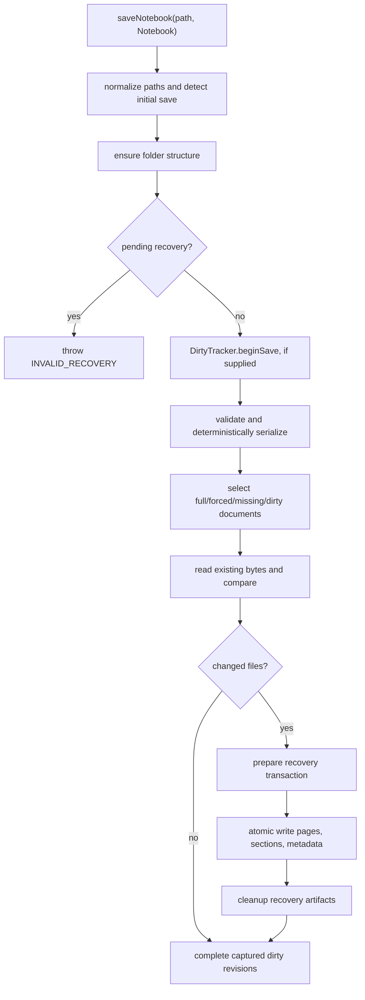

**IMPLEMENTED.** A save is full when forced, initial, or no dirty tracker is supplied. Otherwise selection uses captured dirty target keys; metadata is included whenever any dirty entry exists.

**IMPLEMENTED.** Exact byte comparison suppresses unchanged writes. `SaveNotebookResult` separates written and selected-but-byte-identical skipped paths.

**IMPLEMENTED.** Commit order is page, section, then metadata, with locale-sorted paths within each category.

**IMPLEMENTED.** Files no longer represented by the notebook are not deleted from sections/pages. Load follows references and ignores those unreferenced documents.

## 7.5 Atomic writes

**IMPLEMENTED.**

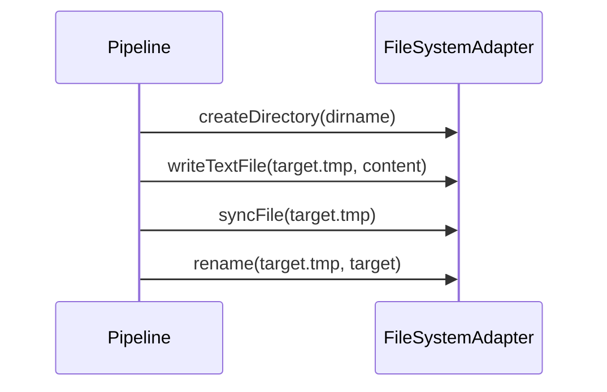

**IMPLEMENTED.** Any failure is wrapped as `ATOMIC_WRITE_FAILED` with target and temporary paths. The adapter does not expose directory synchronization.

## 7.6 Recovery

**IMPLEMENTED.** A recovery transaction writes a `preparing` journal, atomically writes staged successors and backups, then rewrites the journal as `ready`. Each artifact is recorded with SHA-256.

**IMPLEMENTED.**

```mermaid
stateDiagram-v2
    [*] --> None
    None --> Preparing: save has changed documents
    Preparing --> Ready: all staged and backup artifacts written
    Ready --> CanonicalCommit: canonical atomic writes
    CanonicalCommit --> None: cleanup
    Preparing --> Cleaned: next launch loads canonical data and cleans artifacts
    Ready --> Replayed: verify hashes and write staged successors
    Replayed --> None: notebook loads and cleanup succeeds
    Ready --> RolledBack: replay/load fails; restore backups/remove new targets
    RolledBack --> None: rolled-back notebook loads and cleanup succeeds
```

**IMPLEMENTED.** Recovery detection reports a journal or orphan `.tmp`/staging artifacts without modifying storage. A preparing/orphan state loads canonical data and cleans artifacts. A ready state validates metadata, JSON, and hashes, then replays. If replay does not lead to a loadable notebook, rollback restores previous content or removes newly introduced files.

**IMPLEMENTED.** Recovery and notebook formats are independently versioned, both currently `1`.

## 7.7 Load pipeline

**IMPLEMENTED.**

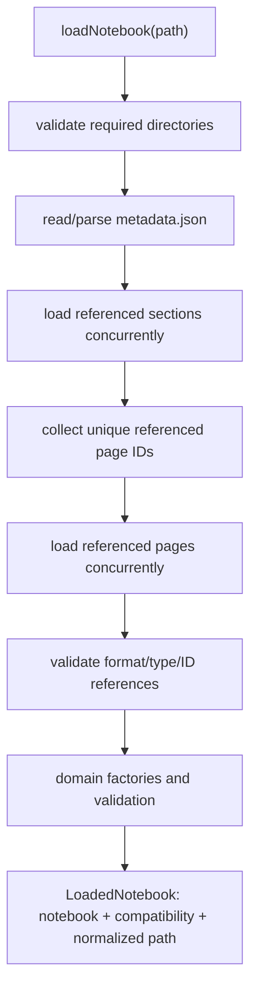

**IMPLEMENTED.** Structured error codes distinguish missing files, corrupt JSON, invalid data, unsupported versions, path errors, recovery errors, atomic write errors, and general I/O.

## 7.8 Dirty tracking

**IMPLEMENTED.** `DirtyTracker` stores the latest revision for each metadata/section/page key. Every mark increments a global revision. Marking a section also marks metadata. Marking a page marks the page, optionally its section, and metadata.

**IMPLEMENTED.** `beginSave` returns a frozen revision snapshot and sets status to `saving`. `completeSave` removes only entries whose current revision still equals the captured revision, preserving edits made during an asynchronous save. `failSave` clears the saving flag but retains entries.

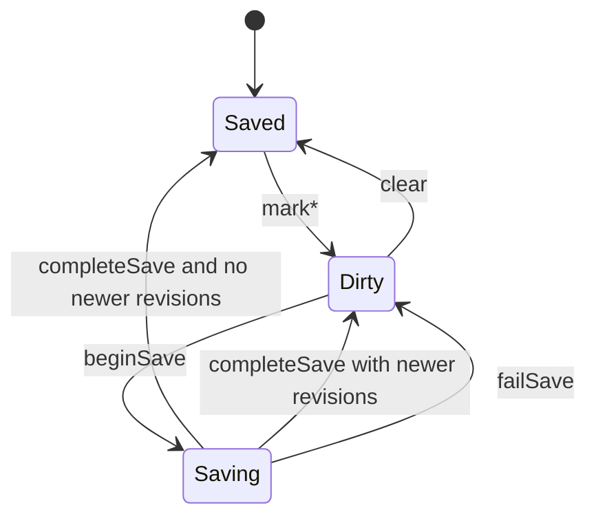

## 7.9 Autosave

**IMPLEMENTED.** `AutosaveScheduler` debounces `notifyActivity`, runs a supplied async save callback, serializes overlapping saves, supports explicit `flush`, reports errors through an optional callback, and can be permanently stopped.

**IMPLEMENTED.**

```mermaid
stateDiagram-v2
    [*] --> Idle
    Idle --> Scheduled: dirty notifyActivity
    Scheduled --> Scheduled: new activity resets timer
    Scheduled --> Saving: timer or flush
    Saving --> Scheduled: activity occurred and tracker remains dirty
    Saving --> Idle: no pending dirty activity
    Idle --> Stopped: stop
    Scheduled --> Stopped: stop
    Saving --> Stopped: stop requested; active promise is not cancelled
```

**IMPLEMENTED.** No desktop production code creates an autosave scheduler or invokes load/save/recovery.

## 7.10 Import and export within Persistence

**IMPLEMENTED.** Pure notebook serialization/deserialization and folder load/save exist.

**PLANNED.** Native `.folio` archive import/export is not implemented. PDF/image export and binary asset copy are not implemented.

## 7.11 Public and internal boundaries

**IMPLEMENTED.** Public APIs are documented exhaustively in Chapter 18. Internal modules include atomic write, constants, stable JSON helpers, folder structure, path helpers beyond the public pair, version validation, dirty target keying, recovery transaction preparation/cleanup, required JSON reads, and save/load selection/order helpers.

---

# Chapter 8 — Rendering Architecture

## 8.1 Ownership and technology

**IMPLEMENTED.** `@folio/rendering` is an imperative Canvas 2D package with no Folio package dependency. It owns base-canvas lifecycle, camera/viewport geometry, coordinate conversion, render scheduling, blank-page rendering, overlay-canvas lifecycle, selection overlay, translation preview, and diagnostics.

**IMPLEMENTED.** It owns no document model, editing decision, hit testing, pointer workflow, notebook persistence, React, or Electron behavior.

**IMPLEMENTED.** Rendering uses `CanvasRenderingContext2D`. No WebGL/WebGPU API, worker, offscreen canvas, or explicit GPU resource exists.

**UNKNOWN.** Browser/OS hardware acceleration of Canvas 2D is outside application control and cannot be determined from source.

## 8.2 Canvas layer tree

**IMPLEMENTED.**

```mermaid
flowchart BT
    Page["Base page canvas<br/>workspace, shadow, paper, border"]
    Ink["Ink overlay z=1<br/>live and finalized session strokes"]
    Preview["Manipulation preview z=2<br/>transient translated visual"]
    Selection["Selection overlay z=3<br/>highlight and outline"]
    Page --> Ink --> Preview --> Selection
```

**IMPLEMENTED.** `CanvasController` owns the base canvas and every overlay created through it. It synchronizes logical size, physical size, and DPR for all layers and destroys them during controller teardown.

## 8.3 Base rendering pipeline

**IMPLEMENTED.**

```mermaid
flowchart LR
    Invalidate["DirtyRegion"] --> Accumulator["DirtyRegionAccumulator"]
    Accumulator --> Scheduler["RenderScheduler"]
    Scheduler --> Input["immutable RenderInput"]
    Input --> Clear["clear logical viewport"]
    Clear --> Clip["viewport clip"]
    Clip --> Workspace["workspace fill"]
    Workspace --> Camera["camera translate/scale"]
    Camera --> Shadow["page shadow"]
    Shadow --> Paper["page fill/background"]
    Paper --> Border["page border"]
    Border --> Hooks["ordered overlay hooks"]
```

**IMPLEMENTED.** Base `Renderer` accepts immutable page/theme inputs and a mutable `Viewport` owner. A render consumes accumulated dirty regions but currently clears and redraws the complete viewport for every nonempty invalidation.

**IMPLEMENTED.** Grid/ruled page backgrounds are rendered as clipped lines. Plain background performs no line work. Shadow blur/offset, border width, and rule width compensate for zoom.

## 8.4 Scheduling and invalidation

**IMPLEMENTED.** `RenderScheduler` permits one pending animation frame. Repeated requests coalesce. `cancelRender` cancels the pending frame; `forceRender` cancels it and executes synchronously. Destroy cancels pending work and permanently rejects future operations.

**IMPLEMENTED.** Public dirty regions are full viewport, full page, or a rectangle in viewport/world/page coordinates. The private accumulator gives viewport priority over page and page priority over rectangles.

**IMPLEMENTED.** Selection and transform-preview renderers maintain their own one-shot schedulers and transparent canvases. They clear old/new affected page bounds, fall back to full clear after a bounded region count, and never continuously repaint.

**IMPLEMENTED.** `StrokeRenderer` owns a separate scheduler and implements incremental live-stroke drawing plus bounded permanent-stroke redraw.

## 8.5 HiDPI and resize

**IMPLEMENTED.** Canvas CSS/logical size remains in CSS pixels. Physical backing dimensions are rounded `logical × devicePixelRatio`. Renderers set the context transform to DPR before logical drawing.

**IMPLEMENTED.** `ResizeObserver` drives controller resize. A media-query/window-resize observer reacts to dynamic DPR changes.

**IMPLEMENTED.** The first nonzero viewport resize calls fit-page. Later resizes preserve zoom but recenter the page. Page replacement optionally fits or centers.

## 8.6 Context lifecycle

**IMPLEMENTED.**

```mermaid
stateDiagram-v2
    [*] --> Idle
    Idle --> Mounted: mount(container)
    Mounted --> ContextLost: contextlost
    ContextLost --> Mounted: contextrestored and context reacquired
    Idle --> Destroyed: destroy
    Mounted --> Destroyed: destroy
    ContextLost --> Destroyed: destroy
```

**IMPLEMENTED.** Context loss destroys scheduler/renderer, increments diagnostics, reports structured error, and retains canvas/container/viewport for restoration. Restoration recreates renderer/scheduler and resizes or invalidates. A destroyed controller cannot be remounted.

## 8.7 Diagnostics and caching

**IMPLEMENTED.** Diagnostics count frames, actual renders, invalidations, context losses, last/average/max frame duration, viewport/logical/physical size, and DPR.

**IMPLEMENTED.** The base renderer has no object cache or render tree. It retains page/theme and dirty regions. Selection retains one target. Translation preview retains one target/visual. Ink retains finalized stroke references and one live-stroke state. Editor caches `StrokeVisual` by object ID for the session.

**IMPLEMENTED.** DOM `data-*` diagnostics expose render counts, page geometry, sizes, DPR, ink/document/selection/manipulation status for tests and inspection.

## 8.8 Rendering state ownership

**IMPLEMENTED.** Camera and viewport are mutable class instances owned by `CanvasController`. Renderer owns current page/theme and dirty accumulator. Specialized overlay renderers own transient targets and render counters. Editor owns mapping from interaction/document state to minimal render targets.

---

# Chapter 9 — Selection Architecture

## 9.1 Ownership and dependencies

**IMPLEMENTED.** `@folio/selection` owns click interpretation, read-only vector hit testing, identity-only selection state, and selection-change notification. Its only production dependency is `@folio/document`.

**IMPLEMENTED.** It has no production dependency on rendering, ink, React, Electron, history, persistence, manipulation, or UI. `@folio/ink` is development-only for fixtures.

## 9.2 Public composition

**IMPLEMENTED.**

```mermaid
flowchart TD
    Controller["SelectionController interface"] --> Mapper["SelectionCoordinateMapper interface"]
    Controller --> Engine["HitTestEngine interface"]
    Controller --> Manager["SelectionManager interface"]
    Controller --> Source["SelectionObjectSource interface"]
    Engine --> Source
    Manager --> State["immutable SelectionState"]
    Factories["three public factories"] --> Controller
    Factories --> Engine
    Factories --> Manager
```

**IMPLEMENTED.** Concrete controller, manager, engine, candidate strategy, and state factory are not exported from the package barrel.

## 9.3 Selection state

**IMPLEMENTED.** `SelectionState` contains selected object ID, frozen zero-or-one ID array, object type, timestamp, and monotonic version. It never stores a document object.

**IMPLEMENTED.** Selecting the same ID/type returns the exact current state reference and emits no notification. Clearing an already empty selection does the same. Listeners receive new and previous immutable states only on logical replacement.

**IMPLEMENTED.**

```mermaid
stateDiagram-v2
    [*] --> Empty
    Empty --> Selected: select valid identity
    Empty --> Empty: clear/no hit
    Selected --> Selected: different identity
    Selected --> Selected: same identity returns same reference
    Selected --> Empty: clear or empty-space click
```

## 9.4 Pointer lifecycle

**IMPLEMENTED.** The controller accepts normalized down/move/up/cancel events in screen coordinates. It tracks one active primary left-button pointer and an origin. Movement beyond a configurable default four-screen-pixel threshold suppresses click selection.

**IMPLEMENTED.** A completed click maps screen to page, performs a hit test, and replaces or clears selection. Cancel, secondary button, non-primary pointer, mismatched pointer ID, or drag produces no selection.

## 9.5 Hit testing

**IMPLEMENTED.**

```mermaid
flowchart LR
    PagePoint --> Linear["linear candidate scan"]
    Linear --> Visible["visible objects only"]
    Visible --> Bounds["expanded cached bounds"]
    Bounds --> InkGeometry["ink vector geometry"]
    InkGeometry --> Tolerance["distance <= tolerance (default 6 page units)"]
    Tolerance --> Z["highest zIndex, ID tie-break"]
    Z --> Result["frozen HitTestResult"]
```

**IMPLEMENTED.** Hit testing supports only document objects of type `ink`. Locked objects remain selectable; invisible objects do not.

**IMPLEMENTED.** Geometry transforms the query into un-translated stroke space, measures point/segment distance, subtracts the rendered pressure-derived radius, and handles single-point/zero-length segments.

**IMPLEMENTED.** `hitTest` allocates only the final result. `queryNearby` returns all qualifying results topmost-first in a frozen array.

## 9.6 Selection events and rendering

**IMPLEMENTED.** Selection notifies subscribed editor code. It does not render. Editor resolves the current object and supplies ID/bounds to `SelectionOverlayRenderer`.

**IMPLEMENTED.** Selection state is session-only and is discarded on editor teardown. It is not persisted and does not enter History.

## 9.7 Extension points

**IMPLEMENTED.** Public seams are the injected object source, coordinate mapper, manager/engine/controller interfaces, query radius, and hit-test tolerance. The candidate strategy is a private internal interface; replacing the linear strategy requires an internal package change but no public API change.

**PLANNED.** Multi-selection, lasso/region selection, handles, additional geometry types, and a spatial index are not implemented.

---

# Chapter 10 — Manipulation Architecture

## 10.1 Ownership and dependencies

**IMPLEMENTED.** `@folio/manipulation` owns translation, center-pivot rotation, and center-pivot uniform-scale interaction sessions, pointer ownership, drag threshold, deterministic origin-relative math, immutable state, result creation, cancellation, and subscriptions. It also owns immutable delete and duplicate result factories for discrete editor actions. It depends only on Selection and Document.

**IMPLEMENTED.** It does not render, mutate/own objects, capture browser pointers, calculate viewport coordinates, or depend on history/persistence/UI.

## 10.2 Session model

**IMPLEMENTED.** Continuous `ManipulationState` contains a manipulation discriminator, phase, session/object/pointer IDs, origin/current page points, object center, initial values, the translation/rotation/scale calculation models, absolute final values, timestamp, and version. Delete and duplicate deliberately do not create synthetic pointer sessions or state-machine entries.

**IMPLEMENTED.** State never stores a document object or stroke.

**IMPLEMENTED.**

```mermaid
stateDiagram-v2
    [*] --> Idle
    Idle --> Preparing: valid selected visible unlocked object
    Preparing --> Preparing: distance <= threshold
    Preparing --> Dragging: distance > threshold
    Dragging --> Dragging: pointer updates
    Dragging --> Committing: editor accepts commit
    Committing --> Idle: manager releases session
    Preparing --> Cancelling: cancel or release before drag
    Dragging --> Cancelling: cancel/invalid context/rejected commit
    Cancelling --> Idle: manager releases session
```

**IMPLEMENTED.** The default threshold is four page units. Crossing is strict: distance equal to the threshold remains Preparing.

## 10.3 Transform calculations

**IMPLEMENTED.**

```text
translation movement = current pointer - origin pointer
final translation = initial translation + movement

rotation delta = normalized angle(current - center) - angle(origin - center)
final rotation = initial rotation + rotation delta

scale factor = distance(current, center) / distance(origin, center)
final scale = clamp(initial scale × scale factor, configured absolute limits)
```

**IMPLEMENTED.** Every calculation is in page space and recalculates from the immutable origin. Event deltas do not accumulate. Rotation is expressed as clockwise canvas radians. Scale is uniform and positive. Rotation and scale reject an origin at the exact object center.

## 10.4 Pointer and validation lifecycle

**IMPLEMENTED.** The controller accepts normalized page-space inputs and owns no browser classes. Only primary left-button down begins. The initiating pointer ID must match future move/up/cancel events.

**IMPLEMENTED.** Begin resolves current selected identity to a visible, unlocked object. Update and commit revalidate that the same identity remains selected and object remains present, visible, and unlocked. Failure cancels.

**IMPLEMENTED.** Commit creates the matching immutable `TranslationManipulationResult`, `RotationManipulationResult`, or `ScaleManipulationResult`, calls the injected editor `onResult`, and enters Committing only if the callback returns true. The source-compatible `onCommit` callback remains available to translation-only consumers. Rejection or exception cancels; exceptions may be reported through `onError`.

**IMPLEMENTED.** The delete and duplicate factories validate logical session/object identity and timestamps, then return frozen `DeleteManipulationResult` or `DuplicateManipulationResult` values. Editor invokes these factories only for the current selected object; no lifecycle action is added to the pointer controller.

## 10.5 Preview, commit, and cancellation

**IMPLEMENTED.**

```mermaid
sequenceDiagram
    participant Browser
    participant Editor
    participant Manipulation
    participant Preview as TransformPreviewRenderer
    participant Session as InkDocumentSession
    participant Ink as StrokeRenderer
    Browser->>Editor: pointer down/moves/up
    Editor->>Manipulation: normalized page inputs
    Manipulation-->>Editor: immutable Preparing/Dragging state
    Editor->>Preview: visual + complete absolute transform
    Manipulation-->>Editor: discriminated ManipulationResult
    Editor->>Editor: adapt to Move, Rotate, or Scale command
    Editor->>History: execute concrete command
    History->>Session: install immutable same-ID successor
    History-->>Editor: immutable success notification
    Editor->>Ink: setStrokeTransform from current document
    Editor->>Preview: clear at terminal/idle state
```

**IMPLEMENTED.** During preview no document object is changed. Commit creates exactly one replacement in the current implementation. Cancel clears preview and retains the original object.

**IMPLEMENTED.** Mode changes, pointer cancel/capture loss, selection changes, invalid object context, rejected commit, and teardown cancel active interaction and release editor-owned pointer capture.

## 10.6 Extension points

**IMPLEMENTED.** Factories return public interfaces. Callers inject selection/object sources, manager, calculation engines, result callback, clock/session IDs, threshold/scale limits, and error callback.

**IMPLEMENTED.** Translation, rotation, scale, delete, and duplicate are History-backed through editor-owned commands. They share the exhaustive result boundary, command adapter, coordinator, controller, document replacement, rendering synchronization, and selection synchronization. Only the three transform families use the continuous session lifecycle.

**PLANNED.** Resize handles, snapping, multi-object movement, and keyboard movement are not implemented.

---

# Chapter 11 — Viewport Architecture

## 11.1 Camera

**IMPLEMENTED.** `Camera` owns finite world-space position and zoom. Default limits are `0.25` and `8`. It supports set position, pan by delta, set zoom, reset, center page, fit page, and immutable snapshots.

**IMPLEMENTED.** Rotation is exposed as literal `0` only and is not changeable.

**IMPLEMENTED.** Fit-page calculates available viewport after insets, selects the smaller width/height scale, clamps it to limits, and centers the page. If available dimensions are nonpositive, it centers and uses minimum zoom.

## 11.2 Viewport model

**IMPLEMENTED.** `Viewport` owns camera, logical size, current page rectangle, DPR, and world bounds. Default world bounds extend four maximum-page-dimensions around the page.

**IMPLEMENTED.** Derived state includes visible world rectangle and page rectangle in viewport coordinates.

**IMPLEMENTED.**

```mermaid
flowchart LR
    Screen["screen/client"] <--> Canvas["logical canvas"]
    Canvas <--> ViewportSpace["viewport logical"]
    ViewportSpace <--> World["world"]
    World <--> Page["page local"]
```

**IMPLEMENTED.** `CoordinateConverter` is the canonical complete conversion path. Screen/canvas conversion compensates for DOM canvas bounds versus logical viewport size. Canvas and viewport currently have identity conversion. World/page conversion adds/subtracts page origin.

## 11.3 Zoom and pan behavior

**IMPLEMENTED.** `Viewport.zoomAt` preserves the world point beneath a viewport anchor by sampling it before/after zoom and adjusting camera position. `Viewport.panBy` delegates to Camera.

**IMPLEMENTED.** Camera/Viewport APIs do not themselves request a render. A coordinating caller must invalidate after mutation.

**IMPLEMENTED.** The desktop UI does not call `zoomAt`, `panBy`, or camera setters. Toolbar/status show placeholder `100%`.

**DOCUMENTED.** Volume 5 calls for wheel/keyboard/toolbar zoom and middle-mouse/space drag pan.

**IMPLEMENTED.** Those interaction bindings are absent.

## 11.4 Visible region and clipping

**IMPLEMENTED.** The base renderer clips to logical viewport bounds, applies camera transforms, and draws one fixed page. Specialized layers additionally clip to page bounds.

**IMPLEMENTED.** `worldBounds` is stored and exposed but not used to constrain pan or rendering.

**PLANNED.** Multiple pages and rotation are not implemented.

---

# Chapter 12 — Ink Architecture

## 12.1 Implemented scope

**IMPLEMENTED.** `@folio/ink` captures primary mouse, pen, and touch input; converts screen positions to page points through rendering; smooths samples; computes metrics/statistics; produces immutable `Stroke`; draws live/finalized session ink; translates finalized visuals; and creates renderer-compatible stroke previews.

## 12.2 Pointer pipeline

**IMPLEMENTED.**

```mermaid
flowchart LR
    Pointer["PointerEvent + coalesced events"] --> Capture["PointerInputController"]
    Capture --> Normalize["pressure/tilt/twist/buttons/time"]
    Normalize --> Convert["CoordinateConverter.screenToPage"]
    Convert --> Builder["StrokeBuilder"]
    Builder --> Update["StrokeUpdate"]
    Update --> Renderer["StrokeRenderer"]
    Builder --> Stroke["immutable Stroke"]
    Stroke --> Document["InkObject in InkDocumentSession"]
```

**IMPLEMENTED.** Only one primary pointer may draw. Mouse requires primary button and receives pressure `0.5`. Invalid pen/touch pressure is reported and replaced by `0.5`. Coalesced samples are processed in order.

**IMPLEMENTED.** Pointer capture is acquired on down and released on up/cancel. Lost capture or an uncaptured leave cancels. Duplicate up and invalid data produce structured errors.

## 12.3 Builder and stroke

**IMPLEMENTED.** `StrokeBuilder` states are active, finalized, and cancelled. Duplicate consecutive positions are dropped. Reversed timestamps are rejected.

**IMPLEMENTED.** The builder incrementally tracks bounds, length, pressure, velocity, and acceleration. Finalization copies/freezes points into `Stroke` and releases builder buffers. Cancellation returns dirty bounds and releases buffers.

**IMPLEMENTED.** `Stroke` exposes bounds, inflated bounds, length, duration, point count, style, metrics, statistics, and canonical pressure-to-width calculation.

## 12.4 Smoothing and style

**IMPLEMENTED.** `StrokeSmoother` supports `none`, bounded moving `average`, and injected `catmull-rom`/`bezier` hooks. Default mode is average, window three, strength `0.65`.

**IMPLEMENTED.** Default style is black, width two logical page units, opacity one, pressure enabled, round cap/join. Style validation requires nonblank color, positive width, opacity in `(0,1]`, literal round geometry, and callable optional pressure curve.

## 12.5 Ink rendering

**IMPLEMENTED.** `StrokeRenderer` retains ordered finalized visual records keyed independently from immutable stroke identity, one live stroke, pending dirty union, counters, and a one-shot scheduler. Each record carries its complete absolute translation/rotation/scale transform.

**IMPLEMENTED.** Live frames draw only the unrendered tail, clipped to pending dirty bounds and the page. Finalization flushes the last live segment, moves the immutable stroke into finalized state, and avoids a base-page repaint.

**IMPLEMENTED.** Permanent transform updates one retained record and clears/redraws the union of old/new bounds. Editor may replace the complete ordered retained-visual list from an immutable document projection; exact no-op projections schedule no work. Resize performs a full ink-overlay redraw.

**IMPLEMENTED.** `createStrokeVisual` returns an immutable adapter that retains one `Stroke` and shares the same private draw path with translation preview.

## 12.6 Integration limits

**IMPLEMENTED.** Finalized strokes become `@folio/document.InkObject` values in an editor-session collection. They do not become `@folio/domain.PageObject` values.

**IMPLEMENTED.** Ink is not connected to notebook save/load, autosave, recovery, or history. Recreating/unmounting `CanvasSurface` discards it.

**PLANNED.** Highlighter, eraser, palm rejection, texture brushes, persisted strokes, and history commands are absent despite toolbar/domain placeholders.

---

# Chapter 13 — Text Architecture

**IMPLEMENTED.** The domain `PageObjectType` union reserves `rich-text` and `heading`. The desktop toolbar and Insert menu can set the active tool to `Text`, after which `CanvasHost` maps it to disabled editor interaction.

**IMPLEMENTED.** `@folio/document` supports only `"ink"`. No text payload, text object class, text layout, input controller, renderer, selection geometry, command, serializer, or persistence bridge exists.

**DOCUMENTED.** Product/feature/task documents specify rich text, headings, formatting, tables, links, lists, and future text commands.

**PLANNED.** Text implementation remains future work.

**UNKNOWN.** The current implementation does not determine a text engine, editing surface, font measurement strategy, or line-layout architecture.

---

# Chapter 14 — Image Architecture

**IMPLEMENTED.** `@folio/domain` reserves page-object type `image` and asset kind `image`. `Asset` stores ID, filename, media type, byte length, and timestamp. Notebook covers may reference assets.

**IMPLEMENTED.** Persistence serializes asset metadata in `metadata.json` and creates an empty `assets/` directory. It does not read/write asset binary content.

**IMPLEMENTED.** The desktop toolbar and Insert menu can select Image, which maps to disabled editor interaction.

**IMPLEMENTED.** `@folio/document` has no image object. Rendering, selection, manipulation, history, clipboard, and editor contain no image-specific production implementation.

**DOCUMENTED.** Feature documents describe image insertion, resize, crop, rotation, formats, captions, and text wrapping.

**PLANNED.** Image object creation, decoding, asset storage, rendering, editing, persistence, and commands remain future work.

**UNKNOWN.** No implemented choice determines image decoder ownership, cache policy, color management, animation handling, or missing-asset fallback.

---

# Chapter 15 — Clipboard Architecture

**IMPLEMENTED.** The Edit menu exposes Copy and Paste items that only emit informational placeholder notifications. There is no keyboard handler, clipboard service, Electron bridge, serialization contract, clipboard state, or object duplication workflow connected to them.

**DOCUMENTED.** Domain/application architecture describes an Editor Store clipboard and the feature/task documents reserve object copy, paste, and duplicate.

**PLANNED.** Clipboard behavior is future work.

**UNKNOWN.** No implementation determines native clipboard formats, internal payload schema, asset transfer, paste positioning, or history transaction behavior.

---

# Chapter 16 — Import / Export Architecture

**IMPLEMENTED.** Persistence can serialize/deserialize folder documents and save/load a notebook folder. These APIs do not compress archives or render exported pages.

**IMPLEMENTED.** The shell contains Open and Save placeholder dialogs, but no Export menu action or file picker. Main/preload exposes no file operation IPC.

**DOCUMENTED.** Technical and task documents define native `.folio` compression/extraction and PDF/PNG/JPG export.

**PLANNED.** Native archive import/export, PDF export, image export, validation of archives, and UI workflows are not implemented.

**UNKNOWN.** No current code determines archive library, PDF backend, raster resolution policy, page-range model, progress/cancellation protocol, or renderer-to-export adapter.

---

# Chapter 17 — Application State

## 17.1 Ownership map

**IMPLEMENTED.**

| State | Owner | Lifetime | Mutation/publication |
| --- | --- | --- | --- |
| Theme | desktop `ThemeProvider` React state | application renderer mount | context `setTheme`/toggle; DOM attributes/styles |
| Notifications | desktop `NotificationProvider` React state plus timer map | provider mount; each item 4.2 seconds unless dismissed | `notify`, dismiss, Framer Motion render |
| Active shell dialog | desktop `ShellDialogProvider` React state | provider mount | `openDialog`, close, placeholder completion |
| Sidebar/section | `useShellUiState` React hook in `ApplicationShell` | shell mount | setter/toggle |
| Active tool | `useEditorWorkspaceState` React hook | shell mount | setter from menus/toolbar |
| Canvas lifecycle | `CanvasController` | `CanvasSurface` effect | imperative methods/snapshot |
| Camera/viewport | `Viewport`/`Camera` | controller mount | imperative methods/snapshot |
| Ink pointer/builder | `PointerInputController`/`StrokeBuilder` | pointer interaction | callbacks/errors |
| Session document | editor `InkDocumentSession` | `CanvasSurface` effect | immutable collection replacement |
| Selection | `SelectionManagerImplementation` | `CanvasSurface` effect | frozen state and listener publication |
| Manipulation | `ManipulationManagerImplementation` and private session | `CanvasSurface` effect/one drag | frozen state and listener publication |
| Editor History | private generic manager/controller and `EditorHistoryCoordinator` | `CanvasSurface` effect | command execution, undo/redo, transactions, notifications, shortcuts |
| Render overlays | specialized renderer instances | canvas effect | target setters/redraw/snapshots |
| Domain notebook | callers of domain/persistence/history tests and APIs | external session | immutable factory/operation successors |
| Persistence dirty state | `DirtyTracker` | caller-defined | revision marks and save snapshots |
| Autosave | `AutosaveScheduler` | caller-defined | scheduled/saving/stopped state |
| Legacy notebook history | public `HistoryManager` | caller-defined notebook session | execute/undo/redo/transactions/save point |

**IMPLEMENTED.** Desktop styling is not a separate state store. `ThemeProvider` initializes to light, writes `data-theme`, the `dark` class, and `color-scheme` onto the document root, and publishes theme changes through React context. `styles.css` maps light and dark Folio CSS custom properties into Tailwind theme tokens; it also owns the 320-pixel minimum shell width, hidden body overflow, the 1100-pixel sidebar presentation breakpoint used by component classes, and reduced-motion overrides. `index.html` contains only the renderer root and module entry point.

## 17.2 Global state

**IMPLEMENTED.** There is no application singleton store. React providers are scoped to the renderer root, while every package manager/controller is instance-owned.

**IMPLEMENTED.** The legacy `HistoryManager`, `DirtyTracker`, and `AutosaveScheduler` have no production desktop instance. Every mounted `CanvasSurface` owns one private generic History manager/controller pair.

**DOCUMENTED.** Volume 4 specifies multiple Zustand stores.

**IMPLEMENTED.** No such stores are implemented.

## 17.3 State-flow separation

**IMPLEMENTED.**

```mermaid
flowchart TD
    ShellState["React shell/editor-tool state"] --> Surface["CanvasSurface mode prop"]
    Surface --> SessionState["document, selection, manipulation, renderer instances"]
    SessionState --> EditorHistory["generic command History"]
    PersistenceState["domain notebook + dirty/autosave"] -. "not integrated" .-> Surface
    LegacyHistory["domain notebook compatibility History"] -. "not integrated" .-> Surface
```

**IMPLEMENTED.** Opening dialogs and notifications does not remount `CanvasHost`; the canvas lifecycle remains inside the stable workspace component tree.

---

# Chapter 18 — Public API Inventory

## 18.1 Inventory rule

**IMPLEMENTED.** A symbol is public here only when reachable through a package manifest `exports` entry. All packages except UI expose only `src/index.ts`. UI additionally exposes `./components/*` and `./lib/*`.

**IMPLEMENTED.** “No production consumer” means repository production source does not import the symbol; tests may use it.

## 18.2 `@folio/domain`

**IMPLEMENTED.** Owner: Domain. Consumers: Persistence, History, Document, and external package callers.

| Symbol | Kind | Purpose | Current consumers/usage |
| --- | --- | --- | --- |
| `DomainId` | type | String identity alias | All domain models; document identities |
| `IsoTimestamp` | type | String timestamp alias | Domain/document lifecycle values |
| `JsonPrimitive` | type | JSON scalar union | JSON contract composition |
| `JsonValue` | type | Recursive readonly JSON union | settings, metadata, persistence |
| `JsonObject` | type | Readonly JSON object | settings, compatibility, document metadata |
| `Position` | interface | Finite x/y contract | domain/document transforms |
| `Selectable` | interface | `selectable: true` marker | Capability composition |
| `Movable` | interface | `movable: true` marker | Capability composition |
| `Resizable` | interface | `resizable: true` marker | Capability composition |
| `Rotatable` | interface | `rotatable: true` marker | Capability composition |
| `Editable` | interface | `editable: true` marker | Capability composition |
| `Serializable` | interface | `serializable: true` marker | Required object capability |
| `Renderable` | interface | `renderable: true` marker | Required object capability |
| `Lockable` | interface | `lockable: true` marker | Locked-object validation |
| `Groupable` | interface | `groupable: true` marker | Capability composition |
| `Searchable` | interface | `searchable: true` marker | Capability composition |
| `PageObjectCapabilities` | type | Partial composition of capability markers | Domain object model/factory/serializer |
| `PAGE_OBJECT_CAPABILITY_NAMES` | const | Canonical capability-name list | Domain validation |
| `PageObjectCapabilityName` | type | Capability-name union | No production consumer outside Domain |
| `REQUIRED_PAGE_OBJECT_CAPABILITIES` | const | Frozen Serializable+Renderable defaults | `createPageObject` |
| `ValidationCode` | type | Domain issue-code union | Validation contracts |
| `ValidationIssue` | interface | path/code/message record | Domain errors and persistence wrapping |
| `ValidationResult` | interface | valid flag plus issue list | Public validators |
| `DomainValidationError` | class | Aggregated domain-validation error | Domain assertions; Persistence/History |
| `CreatePageObjectInput` | interface | Page-object factory input | `createPageObject`; Persistence |
| `createPageObject` | function | Validate/clone/freeze domain object | Persistence deserialization; callers |
| `CreatePageInput` | interface | Page factory input | `createPage`; callers |
| `createPage` | function | Validate/clone/freeze page | Persistence deserialization; tests |
| `DuplicatePageInput` | interface | Optional duplicate ID | `duplicatePage` |
| `duplicatePage` | function | Deep-identity duplicate page/objects | Domain aggregate duplication |
| `CreateSectionInput` | interface | Section factory input | `createSection`; callers |
| `createSection` | function | Validate/clone/freeze section | Persistence deserialization; tests |
| `CreateAssetInput` | interface | Asset factory input | `createAsset`; callers |
| `createAsset` | function | Validate/clone/freeze asset | Persistence deserialization; tests |
| `CreateNotebookInput` | interface | Notebook factory input | `createNotebook`; callers |
| `createNotebook` | function | Validate/clone/freeze notebook | Persistence deserialization; tests |
| `DomainFactoryContext` | interface | Clock and ID provider | Factories/operations/tests |
| `DomainFactoryContextOverrides` | type | Partial factory context | Every domain factory/operation |
| `resolveFactoryContext` | function | Fill default clock/ID functions | Domain internals; publicly reachable |
| `PAGE_OBJECT_TYPES` | const | Canonical domain discriminants | Validation; public inspection |
| `PageObjectType` | type | Domain object-type union | Domain PageObject and Persistence |
| `PageObject` | type | Common persisted object record | Notebook pages; Persistence |
| `PlainPageBackground` | interface | Plain paper color | Domain page model |
| `PatternedPageBackground` | interface | Grid/ruled colors and spacing | Domain page model |
| `PageBackground` | type | Plain/patterned union | Page factory/model |
| `Page` | interface | Fixed page aggregate | Section, History commands |
| `Section` | interface | Ordered page group | Notebook, History commands |
| `ASSET_KINDS` | const | Canonical asset-kind list | Validation |
| `AssetKind` | type | image/attachment/audio/video union | Asset factory/model |
| `Asset` | interface | Binary-asset metadata | Notebook/Persistence |
| `ColorNotebookCover` | interface | Color cover | Notebook |
| `AssetNotebookCover` | interface | Asset-reference cover | Notebook validation |
| `NotebookCover` | type | Cover union or null | Notebook/history metadata |
| `NotebookSettings` | type | JSON object settings | Notebook/history metadata |
| `Notebook` | interface | Root immutable aggregate | Persistence and History |
| `renameNotebook` | function | Immutable rename successor | Rename command |
| `NotebookMetadataPatch` | interface | cover/theme/settings patch | Metadata command |
| `updateNotebookMetadata` | function | Immutable metadata successor | Metadata command |
| `addSection` | function | Append section successor | Section command |
| `deleteSection` | function | Remove section successor | Section command |
| `renameSection` | function | Rename section successor | Section command |
| `reorderSections` | function | Reorder sections successor | Section command |
| `addPage` | function | Append page to section | Page command |
| `deletePage` | function | Remove page from section | Page command |
| `DuplicatePageResult` | interface | Successor notebook plus duplicated page | Duplicate page command |
| `duplicatePageInSection` | function | Duplicate/insert page successor | Duplicate page command |
| `reorderPages` | function | Reorder section pages | Page command |
| `isJsonSerializable` | function | Recursive JSON-safety/cycle check | Domain validation; Document/Persistence |
| `validatePageObject` | function | Nonthrowing object validation | Public callers/tests |
| `validatePage` | function | Nonthrowing page validation | Public callers/tests |
| `validateSection` | function | Nonthrowing section validation | Public callers/tests |
| `validateAsset` | function | Nonthrowing asset validation | Public callers/tests |
| `validateNotebook` | function | Nonthrowing aggregate validation | Public callers/tests |
| `assertValidPageObject` | function | Throwing object assertion | Factory/Persistence |
| `assertValidPage` | function | Throwing page assertion | Factory/operations |
| `assertValidSection` | function | Throwing section assertion | Factory/operations |
| `assertValidAsset` | function | Throwing asset assertion | Factory/Persistence |
| `assertValidNotebook` | function | Throwing notebook assertion | Domain/Persistence/History |
| `isNotebook` | function | Notebook type guard | No production consumer outside Domain |

## 18.3 `@folio/document`

**IMPLEMENTED.** Owner: Document. Consumers: Editor, Selection, and Manipulation.

| Symbol | Kind | Purpose | Current consumers/usage |
| --- | --- | --- | --- |
| `DocumentObjectError` | class | Structured collection/factory error | Document operations |
| `ObjectValidationError` | class | Frozen validation-issue error | Constructors/assertions |
| `InkObject` | class | Immutable concrete document object | Editor and selection geometry |
| `ObjectCollection` | class | Immutable ordered objects plus ID map/statistics; deterministic insert/remove/reorder | Editor session and lifecycle commands |
| `ObjectFactory` | class | Configurable create/clone/translate/rotate/scale operations | Editor session and commands |
| `cloneObject` | function | Convenience immutable clone via new factory | Public callers/tests; Editor uses `ObjectFactory.cloneObject` directly |
| `createInkObject` | function | Convenience ink-object creation | No production consumer |
| `rotateObject` | function | Convenience immutable rotation | No production consumer |
| `scaleObject` | function | Convenience immutable uniform scale | No production consumer |
| `translateObject` | function | Convenience immutable translation | No production consumer |
| `Transform` | class | Immutable translation/rotation/uniform-scale transform and geometry conversion | Objects/editor manipulation/selection |
| `TransformInput` | interface | Transform constructor input | Public callers |
| `CloneObjectOptions` | interface | Clone overrides | `ObjectFactory.cloneObject` |
| `CreateInkObjectInput` | interface | Ink-object factory input | Editor/factory |
| `InkObjectData` | interface | Complete constructor data | `InkObject`, private helpers |
| `InkObjectView` | interface | Read-only ink object contract | Selection geometry |
| `ObjectBounds` | interface | Cached page-space rectangle | Selection/manipulation/render adapters |
| `ObjectCollectionStatistics` | interface | Cached counts/bounds | Editor diagnostics |
| `ObjectFactoryOptions` | interface | Clock/ID injection | Editor/tests |
| `ObjectMetadata` | type | JSON object metadata | Document objects |
| `ObjectSerializationContract` | interface | Serializer/deserializer seam | No implementation/consumer |
| `ObjectValidationIssue` | interface | path/code/message record | Validators/errors |
| `ObjectValidationResult` | interface | valid flag and issues | Validator APIs |
| `ObjectVersion` | type | Literal version `1` | PageObject |
| `PageObject` | interface | Rich document-object contract | Collection/Selection/Manipulation |
| `PageObjectType` | type | Literal `"ink"` | Selection state/results |
| `RenderingHints` | type | JSON object render hints | `InkObject` |
| `SerializedPageObject` | interface | Generic serialized object envelope | No implementation/consumer |
| `assertValidObject` | function | Throwing object assertion | Factory/collection |
| `assertValidObjectCollection` | function | Throwing collection assertion | Public callers/tests |
| `isObjectBounds` | function | Bounds type guard | Public callers/tests |
| `isObjectMetadata` | function | JSON metadata type guard | Public callers/tests |
| `isPageObject` | function | PageObject type guard | Public callers/tests |
| `validateObject` | function | Nonthrowing object validation | Factory/public tests |
| `validateObjectCollection` | function | Nonthrowing duplicate/object validation | Collection/public tests |

## 18.4 `@folio/history`

**IMPLEMENTED.** Owner: History. Editor constructs the generic surface; the legacy notebook surface remains test/example-facing.

| Symbol | Kind | Purpose | Current consumers/usage |
| --- | --- | --- | --- |
| `Command` | interface | Frozen domain-notebook command contract | Manager/factories/tests |
| `CommandCategory` | type | notebook/page/section/transaction union | Command metadata |
| `CommandFactoryOptions` | interface | ID/time/description/context overrides | All command factories/transactions |
| `HistoryChangeTarget` | type | Persistence dirty-effect union | Commands/manager |
| `HistoryContext` | interface | Command ID/time providers | Factory metadata |
| `LegacyHistoryDirtySink` | interface | Persistence-neutral legacy dirty-marking seam | Legacy manager/compatibility tests |
| `createRenameNotebookCommand` | function | Precomputed rename command | Tests/examples |
| `createUpdateNotebookMetadataCommand` | function | Precomputed metadata command | Tests |
| `createAddPageCommand` | function | Precomputed page-add command | Tests |
| `createDeletePageCommand` | function | Precomputed page-delete command | Tests |
| `createDuplicatePageCommand` | function | Precomputed duplicate-page command | Tests |
| `createReorderPagesCommand` | function | Precomputed page-reorder command | Tests |
| `DuplicatePageCommand` | interface | Command plus duplicated page | Factory callers |
| `createAddSectionCommand` | function | Precomputed section-add command | Tests |
| `createDeleteSectionCommand` | function | Precomputed section-delete command | Tests |
| `createRenameSectionCommand` | function | Precomputed section-rename command | Tests/examples |
| `createReorderSectionsCommand` | function | Precomputed section-reorder command | Tests |
| `HistoryError` | class | Structured history failure | Manager/commands/tests |
| `isHistoryError` | function | HistoryError type guard | Public callers/tests |
| `HistoryErrorCode` | type | Stable history code union | Error contract |
| `HistoryErrorOptions` | interface | cause/details input | Error construction |
| `HistoryManager` | class | Current notebook, stacks, transactions, save point | Tests/examples only |
| `HistoryManagerOptions` | interface | Limit and optional legacy dirty sink | Constructor callers |
| `HistorySnapshot` | interface | Current notebook reference/revision | Manager returns |
| `HistoryState` | interface | Frozen observable history summary | Manager callers |
| `Transaction` | interface | Frozen active-transaction summary | Manager callers |
| `createEditorHistoryManager` | function | Construct private generic manager | Editor coordinator/tests |
| `createHistoryController` | function | Construct sole controller for one generic manager | Editor coordinator/tests |
| `EditorCommand<TDocument>` | interface | Immutable generic reversible command | Editor move command/tests |
| `HistoryDocumentSession<TDocument>` | interface | Read/replace active immutable document | InkDocumentSession/tests |
| `IHistoryManager<TDocument>` | interface | Generic stacks, lifecycle, state, transactions | Controller/tests |
| `IHistoryController<TDocument>` | interface | Editor-facing operations, subscriptions, destruction | Editor/tests |
| `EditorHistoryManagerOptions<TDocument>` | interface | Document session and optional limit | Generic manager factory |
| `EditorHistoryControllerOptions<TDocument>` | interface | Manager supplied to controller factory | Controller factory |
| `HistoryCommandMetadata` | interface | Immutable non-executable command metadata | State/notifications |
| `HistoryOperation` | type | execute/undo/redo union | Lifecycle/notifications |
| `HistoryOperationOutcome` | type | succeeded/failed union | Lifecycle/notifications |
| `HistoryTransactionOptions` | interface | Optional transaction metadata | Manager/controller callers |
| `HistoryNotification` | type | Immutable success/failure notification union | Editor/listeners |
| `HistorySuccessNotification` | interface | Successful operation notification | Editor/listeners |
| `HistoryFailureNotification` | interface | Failed operation notification | Editor/listeners |
| `HistoryListener` | type | Notification observer | Controller subscribers |
| `IHistoryState` | interface | Immutable document-free generic state | Editor/controller callers |
| `HistoryExecutionState` | type | Explicit generic lifecycle-state union | State consumers |
| `HistoryExecutionPhase` | type | idle/executing/undoing/redoing/completed | State consumers |
| `IdleHistoryExecutionState` | interface | Generic idle state | State consumers |
| `ExecutingHistoryExecutionState` | interface | Generic active execute state | State consumers |
| `UndoingHistoryExecutionState` | interface | Generic active undo state | State consumers |
| `RedoingHistoryExecutionState` | interface | Generic active redo state | State consumers |
| `CompletedHistoryExecutionState` | interface | Generic completed operation/outcome | Notifications/state consumers |
| `HistoryTransactionState` | interface | Immutable active transaction summary | State consumers |

## 18.5 `@folio/persistence`

**IMPLEMENTED.** Owner: Persistence. A real `DirtyTracker` is consumed only by History compatibility tests through structural typing; public Persistence APIs have no desktop production consumer.

| Symbol | Kind | Purpose | Current consumers/usage |
| --- | --- | --- | --- |
| `AutosaveScheduler` | class | Debounced serialized save coordination | Tests only |
| `createAutosaveScheduler` | function | Scheduler factory | Tests only |
| `AutosaveSchedulerOptions` | interface | delay/tracker/save/timer callbacks | Scheduler construction |
| `AutosaveStatus` | type | idle/scheduled/saving/stopped | Scheduler state |
| `AutosaveTimerAdapter` | interface | Injectable timeout API | Tests/future hosts |
| `CURRENT_NOTEBOOK_FORMAT_VERSION` | const | Literal current version `1` | Serialization/public inspection |
| `CURRENT_RECOVERY_FORMAT_VERSION` | const | Literal recovery version `1` | Recovery/public inspection |
| `deserializeNotebook` | function | Pure documents-to-domain conversion | Load/tests |
| `DeserializedNotebook` | interface | Notebook plus compatibility | Deserializer callers |
| `DirtyTracker` | class | Revision-based dirty target owner | Persistence and History compatibility tests |
| `DirtySnapshot` | interface | Captured tracker revision/entries | Save coordination |
| `DirtySnapshotEntry` | interface | Target plus captured revision | Dirty snapshots |
| `DirtyStatus` | type | saved/dirty/saving | Tracker status |
| `DirtyTarget` | type | metadata/section/page union | Tracker/tests |
| `PersistenceError` | class | Structured persistence error | All pipelines |
| `isPersistenceError` | function | PersistenceError type guard | Save/tests |
| `PersistenceErrorCode` | type | Stable error-code union | Error contract |
| `PersistenceErrorOptions` | interface | path/cause/details input | Error construction |
| `nodeFileSystem` | const | Node filesystem adapter | Default pipelines |
| `FileSystemAdapter` | interface | Abstract async filesystem | Pipelines/tests |
| `FileSystemDirectoryEntry` | interface | Portable directory-entry record | Adapter/recovery |
| `loadNotebook` | function | Folder-to-immutable-notebook pipeline | Tests only |
| `LoadNotebookOptions` | interface | Filesystem override | Load callers |
| `createNotebookPaths` | function | Normalize and derive canonical paths | Pipelines/public callers |
| `normalizeNotebookPath` | function | Validate and resolve root path | Paths/recovery/public callers |
| `NotebookPaths` | interface | All canonical notebook paths | Path consumers |
| `detectRecovery` | function | Nonmutating recovery detection | Save/recovery/tests |
| `readRecoveryMetadata` | function | Parse/validate recovery journal | Detection/tests |
| `recoverNotebook` | function | Clean/replay/rollback then load | Tests only |
| `RecoveryContext` | interface | Transaction ID/time injection | Save/recovery tests |
| `RecoveryDetection` | interface | required flag/metadata/artifacts | Detection callers |
| `RecoveryFileRecord` | interface | Staged/backup path/hash record | Journal contract |
| `RecoveryMetadata` | interface | Versioned transaction journal | Recovery callers |
| `RecoveryOutcome` | type | none/cleaned/recovered/rolled-back | Recovery result |
| `RecoveryResult` | interface | Loaded notebook plus outcome | Recovery callers |
| `RecoveryTransactionStatus` | type | preparing/ready | Journal state |
| `saveNotebook` | function | Deterministic incremental atomic save | Tests/README example |
| `SaveNotebookOptions` | interface | FS/compatibility/tracker/force/recovery context | Save callers |
| `SaveNotebookResult` | interface | path/version/written/skipped result | Autosave/callers |
| `serializeNotebook` | function | Pure domain-to-document conversion | Save/tests |
| `LoadedNotebook` | interface | Notebook/compatibility/normalized path | Load/recovery |
| `NotebookDocumentSet` | interface | Metadata/section/page JSON maps | Deserializer/tests |
| `PersistenceCompatibility` | interface | Unknown same-version fields | Load/save round trip |
| `SerializedFileKind` | type | metadata/page/section | Serializer/save |
| `SerializedNotebook` | interface | Frozen serialized file list | Serializer callers |
| `SerializedNotebookFile` | interface | Kind/ID/path/content record | Save pipeline |

## 18.6 `@folio/rendering`

**IMPLEMENTED.** Owner: Rendering. Consumers: Ink and Editor.

| Symbol | Kind | Purpose | Current consumers/usage |
| --- | --- | --- | --- |
| `Camera` | class | Pan/zoom/fit/center owner | `Viewport`; tests |
| `CameraOptions` | interface | Initial position/zoom/limits | Camera callers |
| `CanvasController` | class | Canvas/layer/resize/DPR/context lifecycle | `CanvasSurface` |
| `CoordinateConverter` | class | Canonical coordinate transformations | Editor mappers; Ink |
| `Diagnostics` | class | Frame/invalidation/size metrics | `CanvasController`; tests |
| `RenderingError` | class | Structured rendering error | Rendering classes; editor error callback |
| `RenderingErrorCode` | type | Stable rendering-code union | Error contract |
| `Renderer` | class | Base workspace/page Canvas 2D renderer | `CanvasController`; tests |
| `RendererOptions` | interface | Context/viewport/page/theme/hooks | Controller/tests |
| `RenderScheduler` | class | Coalesced one-shot frame scheduling | Base and overlay renderers; Ink |
| `SelectionOverlayRenderer` | class | Demand-driven selection visuals | Editor |
| `SelectionOverlayRendererOptions` | interface | Context/viewport/style/frame adapter | Editor/tests |
| `SelectionOverlayRendererSnapshot` | interface | Target/render diagnostics | Tests/public callers |
| `SelectionOverlayStyle` | interface | Outline/highlight dimensions/colors | Optional callers |
| `SelectionOverlayTarget` | interface | ID and cached bounds | Editor |
| `TransformPreviewRenderer` | class | Demand-driven translated/rotated/scaled visual preview | Editor |
| `TransformPreviewRendererOptions` | interface | Context/viewport/style/frame adapter | Editor/tests |
| `TransformPreviewRendererSnapshot` | interface | Target/transform/render diagnostics | Tests/public callers |
| `TransformPreviewStyle` | interface | Opacity and clear padding | Optional callers |
| `TransformPreviewTarget` | interface | ID/bounds/transform/visual | Editor |
| `TransformPreviewValue` | interface | Absolute translation/rotation/scale | Editor |
| `TransformPreviewVisual` | interface | Injected `draw(context)` contract | Ink `StrokeVisual` |
| `TranslationPreviewRenderer` | class | Demand-driven translated visual preview | Editor |
| `TranslationPreviewRendererOptions` | interface | Context/viewport/style/frame adapter | Editor/tests |
| `TranslationPreviewRendererSnapshot` | interface | Target/translation/render diagnostics | Tests/public callers |
| `TranslationPreviewStyle` | interface | Opacity and clear padding | Optional callers |
| `TranslationPreviewTarget` | interface | ID/bounds/translation/visual | Editor |
| `TranslationPreviewVisual` | interface | Injected `draw(context)` contract | Ink `StrokeVisual` |
| `DEFAULT_FIT_PADDING` | const | Frozen page-fit insets | CanvasController default |
| `DEFAULT_PAGE` | const | 794×1123 plain page | CanvasController default |
| `DEFAULT_RENDER_THEME` | const | Default workspace/paper colors | CanvasController default |
| `AnimationFrameAdapter` | interface | request/cancel frame injection | Scheduler/tests |
| `CameraSnapshot` | interface | Frozen position/zoom/rotation | Viewport snapshots |
| `CanvasBounds` | type | Rect alias for DOM canvas bounds | Converter/Ink/Editor |
| `CanvasControllerOptions` | interface | Factories/adapters/page/theme/hooks/errors | Editor/tests |
| `CanvasControllerSnapshot` | interface | status/viewport/diagnostics | Editor callback/tests |
| `CanvasOverlayLayer` | interface | Owned overlay canvas/context API | Editor/Ink layers |
| `CanvasOverlayLayerOptions` | interface | name/interactivity/ARIA | Editor |
| `DirtyRegion` | type | viewport/page/rect invalidation union | Controller/Renderer |
| `Insets` | interface | top/right/bottom/left | Fit APIs |
| `OverlayRenderHook` | type | Base-render callback | Canvas options |
| `PageBackground` | type | plain/grid/ruled render strategy | RenderPage |
| `Point` | interface | Geometry point | Ink/viewport/converters |
| `Rect` | interface | Point plus Size | Rendering/Ink/overlays |
| `RenderDiagnosticsSnapshot` | interface | Frozen diagnostic record | Controller snapshot |
| `RenderInput` | interface | Immutable frame input | Renderer/hooks |
| `RenderPage` | interface | Page rect/background | Canvas/Renderer |
| `RenderTheme` | interface | Workspace/page visual colors | Editor theme adapter |
| `ResizeObserverAdapter` | interface | observe/disconnect abstraction | Controller tests/hosts |
| `ResizeObserverFactory` | type | Resize observer constructor seam | Controller options |
| `Size` | interface | Width/height geometry | Viewport/canvases |
| `ViewportSnapshot` | interface | Frozen camera/size/rect/DPR/world data | All renderers |
| `Viewport` | class | Camera/page/visible geometry and conversion | Controller/Ink/overlays/editor |
| `ViewportOptions` | interface | Initial viewport construction | Controller/tests |

## 18.7 `@folio/ink`

**IMPLEMENTED.** Owner: Ink. Consumers: Document and Editor.

| Symbol | Kind | Purpose | Current consumers/usage |
| --- | --- | --- | --- |
| `InkError` | class | Structured ink error | Ink pipeline/editor callback |
| `InkErrorCode` | type | Stable ink-code union | Error contract |
| `PointerInputController` | class | Browser pointer capture/normalization | Editor |
| `Stroke` | class | Immutable finalized stroke aggregate | Document/Renderer/Editor |
| `StrokeData` | interface | Complete Stroke constructor data | Builder/tests |
| `StrokeBuilder` | class | Incremental samples/metrics/finalization | Pointer controller/tests |
| `StrokeRenderer` | class | Live/finalized transparent ink rendering | Editor |
| `StrokeSmoother` | class | Smoothing strategy wrapper | Builder/public callers |
| `createStrokeVisual` | function | Immutable transform-preview visual | Editor |
| `FinalizedStrokeVisual` | interface | Retained visual identity, immutable stroke, and transform | Editor document projection |
| `StrokeVisual` | interface | Bounds plus drawing visual | Editor cache |
| `DEFAULT_STROKE_STYLE` | const | Frozen default brush style | Style resolver/public callers |
| `InkErrorLike` | interface | Error callback boundary | Pointer options |
| `InkPointerType` | type | mouse/pen/touch union | Input samples/controller |
| `PointerInputCallbacks` | interface | Stroke lifecycle callbacks | Controller options |
| `PointerInputControllerOptions` | interface | Converter/bounds/style/hooks/callbacks | Editor |
| `PressureCurve` | type | Pressure remapping function | StrokeStyle |
| `SmoothingHook` | interface | Named interpolation hook | StrokeSmoother |
| `StrokeBounds` | interface | Rect plus center | Stroke metrics |
| `StrokeBuilderOptions` | interface | ID/time/style/smoother injection | Pointer/tests |
| `StrokeCancellation` | interface | ID/reason/dirty bounds | Editor callback |
| `StrokeMetrics` | interface | Bounds/dirty/length/duration | Stroke/Document |
| `StrokePoint` | interface | Input plus delta/velocity/acceleration | Stroke/rendering |
| `StrokePointInput` | interface | Raw normalized page sample | Builder |
| `StrokeRendererOptions` | interface | Context/viewport/canvas/frame/invalidation | Editor/tests |
| `StrokeRendererSnapshot` | interface | Ink counts/render diagnostics | Tests/public callers |
| `StrokeSmootherOptions` | interface | Mode/window/strength/hooks | Smoother callers |
| `StrokeSmoothingMode` | type | none/average/catmull-rom/bezier | Smoother |
| `StrokeStatistics` | interface | Pressure/velocity/acceleration summaries | Stroke/Document |
| `StrokeStyle` | interface | Color/width/opacity/pressure/geometry/hooks | Stroke/rendering |
| `StrokeUpdate` | interface | Incremental immutable update | Pointer-to-renderer callbacks |

## 18.8 `@folio/selection`

**IMPLEMENTED.** Owner: Selection. Consumers: Manipulation and Editor.

| Symbol | Kind | Purpose | Current consumers/usage |
| --- | --- | --- | --- |
| `createSelectionController` | function | Factory for private controller | Editor |
| `createHitTestEngine` | function | Factory for vector engine | Editor |
| `HitTestEngine` | interface | Page-point hit/query contract | Editor/controller |
| `HitTestEngineOptions` | interface | Object source and configuration | Editor |
| `SelectionObjectSource` | interface | Read-only objects/lookup | Editor adapters/engine/manipulation shape |
| `SelectionController` | interface | Editor-facing pointer/query/state API | Editor callbacks/manipulation source |
| `SelectionControllerOptions` | interface | Manager/engine/source/mapper/threshold | Editor |
| `SelectionCoordinateMapper` | interface | Screen-to-page nullable mapping | Editor mapper |
| `SelectionPointerInput` | interface | Normalized pointer record | Editor routing |
| `SelectionPointerPhase` | type | down/move/up/cancel union | Editor routing |
| `SelectionChangeListener` | type | State/previous-state callback | Editor |
| `SelectionManager` | interface | Sole selection-state owner | Controller |
| `SelectionManagerOptions` | interface | Clock injection | Editor/tests |
| `SelectionTarget` | interface | Resolved object ID/type | Manager |
| `createSelectionManager` | function | Factory for private manager | Editor |
| `PagePoint` | type | Explicit page-space point | Hit testing/manipulation |
| `ScreenPoint` | type | Explicit screen-space point | Editor routing |
| `SelectionCoordinateSpace` | type | screen/viewport/page union | Point types |
| `SelectionPoint` | interface | Generic discriminated coordinate | Point aliases |
| `ViewportPoint` | type | Explicit viewport-space point | No production consumer |
| `DEFAULT_HIT_TEST_CONFIGURATION` | const | Frozen tolerance 6 | Hit engine |
| `HitTestConfiguration` | interface | Page-space tolerance | Engine options |
| `HitTestResult` | interface | Immutable identity/reference/hit metrics | Controller/manager/editor |
| `SelectionState` | interface | Immutable identity-only state | Editor/manipulation |

## 18.9 `@folio/manipulation`

**IMPLEMENTED.** Owner: Manipulation. Consumer: Editor.

| Symbol | Kind | Purpose | Current consumers/usage |
| --- | --- | --- | --- |
| `createManipulationController` | function | Factory for private coordinator | Editor |
| `ManipulationController` | interface | Editor-facing interaction API | Editor/ref callbacks |
| `ManipulationControllerOptions` | interface | Source-compatible manager/sources/commit/error injection | Existing callers/tests |
| `ManipulationResultControllerOptions` | interface | Manager/sources/generalized result/error injection | Editor |
| `ManipulationSession` | interface | Internal-strategy state/update/terminal contract | Private manager/session |
| `ManipulationChangeListener` | type | State transition callback | Editor |
| `ManipulationManager` | interface | Sole session/state owner | Controller |
| `ManipulationManagerOptions` | interface | Config/engine/ID/time injection | Editor/tests |
| `RotationEngine` | interface | Origin-relative angular calculation | Session |
| `ScaleEngine` | interface | Origin-relative radial calculation | Session |
| `TranslationEngine` | interface | Origin-relative calculation | Session |
| `createManipulationManager` | function | Factory for private manager | Editor |
| `DEFAULT_MANIPULATION_CONFIGURATION` | const | Frozen threshold 4 and scale limits 0.05–20 | Manager |
| `BeginManipulationInput` | interface | Start identity/pointer/position/transform/pivot | Controller-to-manager |
| `ManipulationCommit` | interface | Immutable logical completed drag | Editor callback |
| `ManipulationConfiguration` | interface | Drag threshold and absolute scale limits | Manager options |
| `ManipulationKind` | type | Continuous-session discriminator union (`translation`, `rotation`, `scale`) | Manager/state/results |
| `ManipulationResultKind` | type | Exhaustive result discriminator including `delete` and `duplicate` | Results/editor adapter |
| `ManipulationObjectSource` | interface | Read-only object lookup | Editor adapter/controller |
| `ManipulationPhase` | type | idle/preparing/dragging/committing/cancelling | State/Editor |
| `ManipulationPointerInput` | interface | Normalized page-pointer record | Editor routing |
| `ManipulationPointerPhase` | type | down/move/up/cancel union | Pointer input |
| `ManipulationResult` | type | Discriminated immutable result union | Editor command adapter |
| `ManipulationResultBase` | interface | Shared result kind/session/object/time identity | Result variants |
| `ManipulationSelectionSource` | interface | Read-only current selection | Editor/controller |
| `ManipulationState` | interface | Immutable complete session state | Editor preview/callbacks |
| `DeleteManipulationResult` | type | Immutable logical selected-object deletion result | Editor command adapter |
| `DuplicateManipulationResult` | type | Immutable logical selected-object duplication result | Editor command adapter |
| `RotationManipulationResult` | interface | `rotation` result with delta and initial/final rotations | Editor command adapter |
| `RotationModel` | interface | Origin-relative radian delta | State/result |
| `ScaleManipulationResult` | interface | `scale` result with factor and initial/final scales | Editor command adapter |
| `ScaleModel` | interface | Origin-relative uniform multiplier | State/result |
| `TranslationManipulationResult` | interface | `translation` result plus compatible commit payload | Editor command adapter |
| `TranslationModel` | interface | Delta/distance/vector | State/commit |
| `TranslationVector` | interface | Finite x/y logical vector | Document/editor |
| `CreateObjectLifecycleManipulationResultInput` | interface | Logical identity/time input for discrete results | Editor/actions/tests |
| `createDeleteManipulationResult` | function | Frozen delete-result factory | Editor lifecycle actions |
| `createDuplicateManipulationResult` | function | Frozen duplicate-result factory | Editor lifecycle actions |
| `createRotationEngine` | function | Factory for private deterministic rotation engine | Manager/tests |
| `createScaleEngine` | function | Factory for private deterministic scale engine | Manager/tests |
| `createTranslationEngine` | function | Factory for private deterministic engine | Manager/tests |

## 18.10 `@folio/editor`

**IMPLEMENTED.** Owner: Editor. Consumer: Desktop.

| Symbol | Kind | Purpose | Current consumers/usage |
| --- | --- | --- | --- |
| `CanvasSurface` | function component | Mount and compose one editor canvas session | Desktop `CanvasHost` |
| `CanvasInteractionMode` | type | select/move/rotate/scale/ink/disabled routing | Desktop tool mapping |
| `CanvasSurfaceProps` | interface | Mode, subsystem/action readiness, selection/manipulation/History state, diagnostic, and error callbacks | Desktop/public callers |
| `ObjectLifecycleActions` | interface | Session-bound delete/duplicate action contract | Desktop workspace/toolbar |

## 18.11 `@folio/ui`

**IMPLEMENTED.** Owner: UI. Consumer: Desktop. The root API and wildcard subpaths together expose the following named symbols.

| Symbol | Kind | Purpose | Current consumers/usage |
| --- | --- | --- | --- |
| `Button` | component | Variant-aware native button | Dialogs |
| `ButtonProps` | interface | Native button plus variant props | Public subpath callers |
| `buttonVariants` | const/function | CVA button class resolver | `Button`; public callers |
| `Dialog` | component | Radix dialog root | Shell dialog provider |
| `DialogClose` | component | Radix close primitive | Public callers |
| `DialogContent` | component | Portal/overlay/styled content | Shell dialog provider |
| `DialogDescription` | component | Styled accessible description | Shell dialog provider |
| `DialogFooter` | function component | Styled action layout | Shell dialog provider |
| `DialogHeader` | function component | Styled heading layout | Shell dialog provider |
| `DialogOverlay` | component | Backdrop | `DialogContent`; public callers |
| `DialogPortal` | component | Radix portal | `DialogContent`; public callers |
| `DialogTitle` | component | Styled accessible title | Shell dialog provider |
| `DialogTrigger` | component | Radix trigger | Public callers |
| `DropdownMenu` | component | Radix menu root | App menu |
| `DropdownMenuContent` | component | Styled portal content | App menu |
| `DropdownMenuGroup` | component | Radix menu group | Public callers |
| `DropdownMenuItem` | component | Styled menu item | App menu |
| `DropdownMenuLabel` | component | Styled menu label | App menu |
| `DropdownMenuPortal` | component | Radix menu portal | Public callers |
| `DropdownMenuSeparator` | component | Styled separator | App menu |
| `DropdownMenuShortcut` | function component | Shortcut-label layout | App menu |
| `DropdownMenuTrigger` | component | Radix menu trigger | App menu |
| `DropdownMenuCheckIcon` | component alias | Lucide Check exported by wildcard subpath | No production consumer |
| `DropdownMenuChevronIcon` | component alias | Lucide ChevronRight exported by wildcard subpath | No production consumer |
| `DropdownMenuRadioIcon` | component alias | Lucide Circle exported by wildcard subpath | No production consumer |
| `Input` | component | Styled native input | Rename dialog |
| `ScrollArea` | component | Radix scroll root/viewport | No desktop production consumer |
| `ScrollBar` | component | Radix styled scrollbar | `ScrollArea` |
| `cn` | function | clsx plus Tailwind class merge | UI/Desktop components |

## 18.12 Empty package APIs

**IMPLEMENTED.** `@folio/search`, `@folio/shared`, and `@folio/testing` each expose an empty module (`export {}`), so they have no public class, interface, type, constant, or function.

## 18.13 Desktop application exports

**IMPLEMENTED.** `@folio/desktop` is private and has no package `exports` field. Its source-level exports are application-internal modules and are inventoried in Chapter 19 rather than treated as a consumable package API.

---

# Chapter 19 — Internal API Inventory

## 19.1 Domain internals

**IMPLEMENTED.**

| Module | Internal symbols/responsibility | Visibility and consumers |
| --- | --- | --- |
| `domain/src/internal.ts` | `cloneAndFreeze`, `deepFreeze`, private `cloneSerializable` | Not barrel-exported; factories/operations |
| `domain/src/factory-context.ts` | private default crypto/clock context | Module-private; `resolveFactoryContext` |
| `domain/src/validation.ts` | record/type/timestamp/chronology/capability/background/model collectors; issue/result builders; JSON recursion | Module-private collectors used by public validators |
| `domain/src/operations.ts` | `fail`, `finalizeNotebook`, timestamp resolver, section/page lookup, generic reorder | Module-private aggregate-operation helpers |
| `domain/src/factories.ts` | factory object assembly before assertion/freezing | Public factory bodies; no private class |

## 19.2 Document internals

**IMPLEMENTED.**

| Module | Internal symbols/responsibility | Visibility and consumers |
| --- | --- | --- |
| `document/src/internal/copy-object.ts` | `copyObjectWithZIndex` recreates supported objects with contiguous order | Not barrel-exported; `ObjectCollection` |
| `document/src/internal/json.ts` | `isPlainJsonObject`, `freezeJsonObject`, private recursive JSON clone | Not barrel-exported; objects/validation |
| `document/src/validation.ts` | supported-type table; timestamp/bounds/metadata/transform/stroke collectors | Module-private; public validators |
| `document/src/object-factory.ts` | default ID/time providers | Module-private; `ObjectFactory` |
| `document/src/object-collection.ts` | union-bounds and statistics creators; private ID-to-index resolution | Module-private; `ObjectCollection` |
| `document/src/ink-object.ts` | cached translated bounds | Private field inside public class |

## 19.3 History internals

**IMPLEMENTED.**

| Module | Internal symbols/responsibility | Visibility and consumers |
| --- | --- | --- |
| `history/src/history-manager.ts` | `HistoryEntry`, `ActiveTransaction`, default limit, command validator, mismatch error builder, transaction summary, target dedupe/key, deep-freeze check | Module-private; `HistoryManager` |
| `history/src/internal/snapshot-command.ts` | `ResolvedCommandMetadata`, `SnapshotCommandInput`, `resolveCommandMetadata`, `createSnapshotCommand`, exact-reference `transition`, nonblank guard | Not barrel-exported; all built-in command factories and transaction commit |
| `history/src/commands/notebook-commands.ts` | metadata/context adaptation | Public factories; internal snapshot function |
| `history/src/commands/section-commands.ts` | section affected-target expansion and domain context | Module-private helpers |
| `history/src/commands/page-commands.ts` | domain context adaptation | Module-private helper |
| `history/src/editor-history/manager/editor-history-manager.ts` | generic manager implementation, lifecycle ownership hook, stack/session coordination | Private implementation; public factory returns `IHistoryManager` |
| `history/src/editor-history/controller/history-controller.ts` | single-manager ownership, operation delegation, listener dispatch/isolation, destruction | Private implementation; public factory returns `IHistoryController` |
| `history/src/editor-history/stack/bounded-command-stack.ts` | bounded private LIFO storage | Generic manager only |
| `history/src/editor-history/transaction/*` | immutable active transaction and command-only group/rollback | Generic manager only |
| `history/src/editor-history/state/history-state-builder.ts` | frozen document-free state and lifecycle builders | Generic manager only |
| `history/src/editor-history/model/history-entry.ts` | command plus immutable metadata; no document aggregate | Generic manager/transactions only |
| `history/src/editor-history/validation/command-integrity.ts` | model-neutral command protocol validation | Generic manager only |
| `editor/src/history/move-command.ts` | private `EditorCommand<ObjectCollection>` for one InkObject translation | Editor coordinator/tests; not editor barrel-exported |
| `editor/src/history/rotate-command.ts` | private `EditorCommand<ObjectCollection>` for center-pivot rotation | Editor adapter/tests; not editor barrel-exported |
| `editor/src/history/scale-command.ts` | private `EditorCommand<ObjectCollection>` for uniform scale | Editor adapter/tests; not editor barrel-exported |
| `editor/src/history/delete-command.ts` | private command retaining one exact object and insertion index | Editor adapter/tests; not editor barrel-exported |
| `editor/src/history/duplicate-command.ts` | private command retaining one cloned object and insertion index | Editor adapter/tests; not editor barrel-exported |
| `editor/src/history/manipulation-command-adapter.ts` | exhaustive result-to-command adaptation and current-object resolution | CanvasSurface/tests; not editor barrel-exported |
| `editor/src/history/object-transform-command.ts` | shared transform-command validation and transition helpers | Private Move/Rotate/Scale implementation support |
| `editor/src/history/object-lifecycle-command.ts` | shared delete/duplicate metadata, validation, and failure helpers | Private lifecycle command support |
| `editor/src/history/editor-history-coordinator.ts` | one manager/controller lifetime and document/render synchronization | CanvasSurface/tests; not editor barrel-exported |
| `editor/src/history/editor-history-shortcuts.ts` | Windows/Linux undo/redo key listener and cleanup | CanvasSurface/tests; not editor barrel-exported |

## 19.4 Persistence internals

**IMPLEMENTED.**

| Module | Internal symbols/responsibility | Visibility and consumers |
| --- | --- | --- |
| `persistence/src/atomic-write.ts` | `atomicWriteText` temp/write/flush/rename | Not barrel-exported; save/recovery |
| `persistence/src/constants.ts` | filenames and directory names beyond public version constants | Not barrel-exported; paths/pipelines |
| `persistence/src/folder-structure.ts` | `ensureNotebookFolder` | Not barrel-exported; save |
| `persistence/src/json.ts` | `stableStringify`, `parseJsonObject`, `extractUnknownFields`, `isPlainRecord`, private recursive sorter | Not barrel-exported; serializer/load/recovery |
| `persistence/src/paths.ts` | `documentFileName`, section/page relative paths, safe relative resolver | Not barrel-exported; serialization/load/save/recovery |
| `persistence/src/versioning.ts` | notebook/recovery exact-version validators | Not barrel-exported; deserialize/recovery |
| `persistence/src/dirty-tracker.ts` | `createDirtyTracker`, `dirtyTargetKey`, private key builder/tracked entry | Not barrel-exported; save and persistence tests use key behavior |
| `persistence/src/file-system.ts` | Node-error guard | Module-private; `nodeFileSystem` |
| `persistence/src/load-pipeline.ts` | `readRequiredJson`, required-folder assertion, referenced-ID validation | Not barrel-exported; load |
| `persistence/src/save-pipeline.ts` | `InspectedFile`, dirty matching, commit order, frozen result | Module-private; save |
| `persistence/src/serializer.ts` | asset/page-object document serializers | Module-private; `serializeNotebook` |
| `persistence/src/deserializer.ts` | document field lists and structure/ID/array/value helpers | Module-private; `deserializeNotebook` |
| `persistence/src/recovery.ts` | `RecoveryWriteCandidate`, `prepareRecoveryTransaction`, `cleanupRecovery`, prepared-file validation, metadata builders, artifact scan, path mapping, safe ID, SHA-256 | Not barrel-exported; save/recovery |
| `persistence/src/types.ts` | `createEmptyCompatibility` | Not barrel-exported; serializer default |
| `persistence/src/errors.ts` | `toPersistenceError` | Not barrel-exported; pipelines |

## 19.5 Rendering internals

**IMPLEMENTED.**

| Module | Internal symbols/responsibility | Visibility and consumers |
| --- | --- | --- |
| `rendering/src/internal/geometry.ts` | finite/point/size/rect assertions, inset normalization, geometry/page/theme freezing | Not barrel-exported; all rendering models |
| `rendering/src/internal/dirty-regions.ts` | `DirtyRegionAccumulator` precedence and consumption | Not barrel-exported; `Renderer` |
| `rendering/src/internal/canvas-overlay-layer.ts` | `CanvasOverlayLayerImplementation`, dependencies, synchronized resize/DOM removal | Not barrel-exported; `CanvasController` |
| `rendering/src/canvas-controller.ts` | default ResizeObserver/DPR readers/observer, status guards, DOM/context/listener cleanup | Module-private; controller |
| `rendering/src/render-scheduler.ts` | default browser frame adapter | Module-private; scheduler |
| `rendering/src/renderer.ts` | frame/page/background drawing methods and active-state guard | Private class methods |
| `rendering/src/selection-overlay-renderer.ts` | default style, style/target validation, target equality, region union/intersection, region budget | Module-private; selection overlay |
| `rendering/src/translation-preview-renderer.ts` | default style, target validation/translation, equality, translated-bounds helper, region budget | Module-private; preview overlay |

## 19.6 Ink internals

**IMPLEMENTED.**

| Module | Internal symbols/responsibility | Visibility and consumers |
| --- | --- | --- |
| `ink/src/internal/geometry.ts` | coordinate limits/assertion, distance, freezing, bounds creation/inflation/union | Not barrel-exported; builder/renderer |
| `ink/src/internal/style.ts` | style validation/freezing and pressure width | Not barrel-exported; Stroke/Builder/drawing |
| `ink/src/internal/draw-stroke.ts` | `drawStrokePoints` pressure-width round-segment drawing | Not barrel-exported; ink renderer/visual |
| `ink/src/stroke-visual.ts` | private `StrokeVisualImplementation` | Factory-created; editor consumes interface |
| `ink/src/stroke-builder.ts` | private builder status, fallback ID, point-input freezer, incremental accumulators | Private to `StrokeBuilder` |
| `ink/src/pointer-input-controller.ts` | default pointer types, pointer-type guard, event normalization/capture/cancel helpers | Private to controller |
| `ink/src/stroke-renderer.ts` | live/final state records, translation/state creators, dirty/render helpers | Private to renderer |
| `ink/src/stroke.ts` | point/bounds freezing | Module-private constructor helpers |

## 19.7 Selection internals

**IMPLEMENTED.**

| Module | Internal symbols/responsibility | Visibility and consumers |
| --- | --- | --- |
| `selection/src/manager/selection-manager.ts` | private `SelectionManagerImplementation` | Returned only as `SelectionManager` |
| `selection/src/controller/selection-controller.ts` | `ActivePointer`, private controller implementation | Returned only as `SelectionController` |
| `selection/src/hit-testing/hit-test-engine.ts` | private engine implementation, configuration resolver, z-order comparisons, result construction | Returned only as `HitTestEngine` |
| `selection/src/hit-testing/candidate-strategy.ts` | internal strategy interface, private linear implementation/factory | Hit-test engine only |
| `selection/src/hit-testing/geometry.ts` | valid-point, expanded-bounds, point/segment/ink distances | Hit-test engine only |
| `selection/src/state/selection-state.ts` | `createSelectionState` | Not barrel-exported; manager |

## 19.8 Manipulation internals

**IMPLEMENTED.**

| Module | Internal symbols/responsibility | Visibility and consumers |
| --- | --- | --- |
| `manipulation/src/controller/manipulation-controller.ts` | private controller implementation and compatible result/commit submission | Returned as `ManipulationController` |
| `manipulation/src/manager/manipulation-manager.ts` | fallback session ID, private manager implementation | Returned as `ManipulationManager` |
| `manipulation/src/result/translation-manipulation-result.ts` | immutable translation-result construction | Controller only; not barrel-exported |
| `manipulation/src/session/manipulation-session.ts` | `ManipulationSessionOptions`, `ManipulationSessionImplementation` | Not barrel-exported; manager |
| `manipulation/src/translation/translation-engine.ts` | private engine implementation | Returned as `TranslationEngine` |
| `manipulation/src/state/manipulation-state.ts` | `ZERO_TRANSLATION`, page/vector freezing, idle/active state builders | Not barrel-exported; manager/session |

## 19.9 Editor internals

**IMPLEMENTED.**

| Module | Internal symbols/responsibility | Visibility and consumers |
| --- | --- | --- |
| `editor/src/InkDocumentSession.ts` | `InkDocumentSession`, snapshot type; session collection creation/translation/clear | Not package-exported; `CanvasSurface` |
| `editor/src/PageSelectionCoordinateMapper.ts` | mapper class/options; screen-to-page with page clipping | Not package-exported; `CanvasSurface` |
| `editor/src/PageManipulationCoordinateMapper.ts` | mapper class/options; optional out-of-page continuation | Not package-exported; `CanvasSurface` |
| `editor/src/history/manipulation-command-adapter.ts` | exhaustive result-to-command adaptation; translation branch only | Coordinator/tests; not package-exported |
| `editor/src/history/editor-history-coordinator.ts` | one manager/controller lifetime and generic manipulation-result execution | CanvasSurface/tests; not package-exported |
| `editor/src/CanvasSurface.tsx` | `readTheme`; scoped lifecycle functions for bounds, diagnostics, selection, manipulation, pointer capture/routing/listener registration | Only `CanvasSurface`/public types leave package |

## 19.10 UI and desktop internals

**IMPLEMENTED.**

| Area/module | Internal symbols/responsibility | Visibility and consumers |
| --- | --- | --- |
| UI components | Radix/CVA wrapper implementation and styling | Public through UI root/subpath exports |
| `desktop/ApplicationShell` | composes menu/sidebar/workspace/status | App root only |
| `desktop/EditorWorkspace` | stable canvas host plus workspace chrome/toolbar | ApplicationShell |
| `desktop/CanvasHost` | maps toolbar labels to editor modes; memoized mount boundary | EditorWorkspace |
| `desktop/FloatingToolbar` | tool definitions and active-tool buttons | EditorWorkspace |
| `desktop/WorkspaceChrome` | name/location and calm-workspace decoration | EditorWorkspace |
| `desktop/useEditorWorkspaceState` | active tool React state | ApplicationShell |
| `desktop/useShellUiState` | sidebar and section React state | ApplicationShell |
| `desktop/AppMenuBar` | menu triggers, placeholder actions, theme/dialog/notification dispatch | ApplicationShell |
| `desktop/Sidebar` | navigation, placeholder notebooks/recent files | ApplicationShell |
| `desktop/StatusBar` | placeholder saved/page/zoom plus active tool | ApplicationShell |
| `desktop/ThemeProvider` | theme context/hook and DOM application | App/menu/dialog |
| `desktop/ShellDialogProvider` | dialog kind/copy/icon maps, active dialog context/hook | App/menu/sidebar |
| `desktop/NotificationProvider` | notification records, ID/timer maps, notify/dismiss context/hook | App shell |
| `desktop/placeholder-data` | static notebook/recent-file display records | Sidebar |
| `desktop/electron/main.ts` | asset-path resolver, singleton window creator, navigation policy | Electron process |
| `desktop/electron/preload.ts` | frozen runtime metadata bridge | Renderer `window.folio` |

**IMPLEMENTED.** `@folio/search`, `@folio/shared`, and `@folio/testing` have no internal production implementation beyond empty index modules.

**IMPLEMENTED.** Exact source-level exports inside the private desktop application are `ApplicationShell`, `AppMenuBar`, `Sidebar`, `StatusBar`, `useShellUiState`, `ShellSection`, `CanvasHost`, `EditorWorkspace`, `FloatingToolbar`, `WorkspaceChrome`, `useEditorWorkspaceState`, `EditorTool`, `ShellDialogProvider`, `ShellDialogKind`, `useShellDialog`, `NotificationProvider`, `NotificationInput`, `NotificationTone`, `useNotifications`, `ThemeProvider`, `Theme`, `useTheme`, `placeholderNotebooks`, and `placeholderRecentFiles`. They are consumed only by other desktop modules and are not exposed by a package export map.

---

# Chapter 20 — Event Flow

## 20.1 Subsystem dependency and event ownership

**IMPLEMENTED.**

```mermaid
flowchart TD
    Browser["Browser/Electron events"] --> Desktop["Desktop React shell"]
    Desktop --> Editor["@folio/editor"]
    Editor --> InputChoice{"active interaction mode"}
    InputChoice --> Ink["@folio/ink"]
    InputChoice --> Selection["@folio/selection"]
    InputChoice --> Manipulation["@folio/manipulation"]
    Ink --> Document["@folio/document session"]
    Selection --> Document
    Manipulation --> Result["ManipulationResult"]
    Result --> EditorHistory["Editor command adapter + History controller"]
    EditorHistory --> Document
    Editor --> Rendering["@folio/rendering"]
    History["@folio/history generic surface"] --> EditorHistory
    Persistence["@folio/persistence domain notebook"] -. "no production event connection" .-> Editor
```

## 20.2 Pointer event flow

**IMPLEMENTED.**

```mermaid
sequenceDiagram
    actor User
    participant Canvas as Interactive ink canvas
    participant Editor as CanvasSurface capture listener
    participant Ink as PointerInputController
    participant Select as SelectionController
    participant Move as ManipulationController
    User->>Canvas: pointer event
    Canvas->>Editor: capture phase
    alt mode = ink
        Editor-->>Canvas: do not intercept
        Canvas->>Ink: target/bubble listeners
    else mode = select
        Editor->>Editor: preventDefault + stopImmediatePropagation
        Editor->>Select: normalized screen pointer
    else mode = move
        Editor->>Editor: preventDefault + stopImmediatePropagation
        Editor->>Move: normalized page pointer
    else disabled
        Editor->>Editor: intercepts non-ink branch, no subsystem action
    end
```

**IMPLEMENTED.** Selection/move capture listeners were registered before `PointerInputController.attach`, but capture-phase interception rather than registration order establishes mode exclusivity.

## 20.3 Ink event flow

**IMPLEMENTED.**

```mermaid
sequenceDiagram
    participant Pointer as PointerInputController
    participant Builder as StrokeBuilder
    participant InkRender as StrokeRenderer
    participant Editor
    participant Document as InkDocumentSession
    Pointer->>Builder: normalized page sample(s)
    Builder-->>Pointer: StrokeUpdate
    Pointer->>InkRender: begin/update
    Pointer->>Builder: finalize on pointerup
    Builder-->>Pointer: immutable Stroke
    Pointer->>Editor: onStrokeFinalized
    Editor->>Document: completeStroke
    Document-->>Editor: immutable InkObject
    Editor->>InkRender: finalizeStroke
```

## 20.4 Selection event flow

**IMPLEMENTED.**

```mermaid
sequenceDiagram
    participant Editor
    participant Controller as SelectionController
    participant Mapper
    participant Engine as HitTestEngine
    participant Manager as SelectionManager
    participant Overlay as SelectionOverlayRenderer
    Editor->>Controller: down/move/up ScreenPoint
    Controller->>Mapper: screenToPage
    Mapper-->>Controller: PagePoint or null
    Controller->>Engine: hitTest
    Engine-->>Controller: HitTestResult or null
    Controller->>Manager: replaceSelection
    Manager-->>Editor: state notification if changed
    Editor->>Overlay: setSelection(ID + cached bounds)
```

## 20.5 Manipulation event flow

**IMPLEMENTED.**

```mermaid
sequenceDiagram
    participant Editor
    participant Controller as ManipulationController
    participant Selection
    participant Source as Document object source
    participant Manager as ManipulationManager
    participant Preview as TransformPreviewRenderer
    participant History as HistoryController
    participant Session as InkDocumentSession
    Editor->>Controller: normalized down
    Controller->>Selection: get selected identity
    Controller->>Source: resolve visible/unlocked object
    Controller->>Manager: beginSession
    Editor->>Controller: normalized moves
    Controller->>Manager: update origin-relative transform
    Manager-->>Editor: immutable Dragging state
    Editor->>Preview: absolute visual preview
    Editor->>Controller: normalized up
    Controller-->>Editor: discriminated ManipulationResult callback
    Editor->>Editor: adapt to Move, Rotate, or Scale command
    Editor->>History: execute command
    History->>Session: install immutable transformed successor
    Editor-->>Controller: accept commit
    Manager-->>Editor: Committing then Idle
```

## 20.6 Rendering update flows

**IMPLEMENTED.** ResizeObserver → `CanvasController.resize` → viewport/backing-store resize → first-fit/later-center → base invalidation → overlay resize handlers → specialized redraw.

**IMPLEMENTED.** Theme mutation → editor theme adapter → `CanvasController.setTheme` → base viewport invalidation → one scheduled frame. Ink/selection/preview colors are not updated by this flow except where their configured styles use fixed values.

**IMPLEMENTED.** Selection change updates only the selection overlay. Manipulation preview updates only its overlay. Successful History execute/undo/redo updates the permanent ink transform, document diagnostics, and selected-object bounds from the installed session collection. Ink drawing updates only the ink overlay.

## 20.7 History event flow

**IMPLEMENTED.** The legacy manager receives explicit calls, returns snapshots synchronously, and may invoke a supplied structural dirty sink. It has no event emitter and is not mounted by the desktop editor.

**IMPLEMENTED.** The generic controller receives explicit execute/undo/redo calls, delegates to its manager, and synchronously publishes immutable completed success/failure notifications. `CanvasSurface` uses those notifications to synchronize rendering and selection from the current session document. Begin/commit/rollback do not create separate notification kinds.

## 20.8 Persistence event flow

**IMPLEMENTED.** Persistence receives only explicit async calls. DirtyTracker does not automatically schedule Autosave; a caller must call `notifyActivity`. Autosave invokes a caller-supplied save closure.

**IMPLEMENTED.** No desktop event currently reaches Persistence.

## 20.9 Keyboard flow

**IMPLEMENTED.** Menus display shortcut labels, and the mounted editor registers `Ctrl+Z`, `Ctrl+Shift+Z`, and `Ctrl+Y` against its existing History controller. Editable/composing/already-handled or incompatible-modifier events are ignored. Browser default is prevented only when History can perform the requested operation. Undo/Redo menu items remain disabled and are not part of Phase 11.

---

# Chapter 21 — State Machines

## 21.1 Legacy History stack state

**IMPLEMENTED.** History has no explicit execution-phase field. Its observable logical state is derived from stacks, current/save-point identity, revision, and optional transaction.

```mermaid
stateDiagram-v2
    [*] --> CleanEmpty
    CleanEmpty --> DirtyUndoable: execute non-no-op
    DirtyUndoable --> DirtyUndoable: execute / undo / redo away from save point
    DirtyUndoable --> CleanRedoable: undo to save point
    CleanRedoable --> DirtyUndoable: redo away from save point
    DirtyUndoable --> CleanUndoable: markSavePoint(current)
    CleanRedoable --> CleanEmpty: clear stacks
    CleanUndoable --> CleanEmpty: clear stacks
```

**IMPLEMENTED.** “CleanUndoable” is possible because marking the current notebook as save point does not clear history. “CleanRedoable” is possible after undo returns to the save-point reference.

**IMPLEMENTED.** The generic History surface separately exposes explicit `idle`, `executing`, `undoing`, `redoing`, and `completed` lifecycle states. It has no dirty/save-point state and exposes no document in `IHistoryState`.

## 21.2 Generic History transaction state

**IMPLEMENTED.**

```mermaid
stateDiagram-v2
    [*] --> Inactive
    Inactive --> Active: beginTransaction
    Active --> Active: execute child
    Active --> Inactive: commit one command-group entry
    Active --> Inactive: rollback commands in reverse
    Active --> Active: undo/redo/clear rejected
```

**IMPLEMENTED.** The legacy manager retains its separate snapshot transaction state for Phase 5 compatibility.

## 21.3 Canvas and scheduler state

**IMPLEMENTED.**

```mermaid
stateDiagram-v2
    state CanvasController {
      [*] --> Idle
      Idle --> Mounted: mount
      Mounted --> ContextLost: contextlost
      ContextLost --> Mounted: contextrestored
      Idle --> Destroyed: destroy
      Mounted --> Destroyed: destroy
      ContextLost --> Destroyed: destroy
    }
    state RenderScheduler {
      [*] --> ActiveIdle
      ActiveIdle --> Pending: requestRender
      Pending --> Pending: coalesced request
      Pending --> ActiveIdle: frame or cancel
      ActiveIdle --> DestroyedScheduler: destroy
      Pending --> DestroyedScheduler: destroy and cancel
    }
```

## 21.4 Ink states

**IMPLEMENTED.**

```mermaid
stateDiagram-v2
    state PointerInput {
      [*] --> Detached
      Detached --> AttachedIdle: attach
      AttachedIdle --> Capturing: accepted pointerdown
      Capturing --> Capturing: moves/coalesced samples
      Capturing --> AttachedIdle: pointerup finalizes
      Capturing --> AttachedIdle: cancel/leave/lost capture
      AttachedIdle --> Detached: detach
      Capturing --> Detached: detach cancels
      Detached --> Destroyed: destroy
      AttachedIdle --> Destroyed: destroy
    }
    state StrokeBuilder {
      [*] --> Active
      Active --> Finalized: finalize with points
      Active --> Cancelled: cancel
    }
```

## 21.5 Selection states

**IMPLEMENTED.**

```mermaid
stateDiagram-v2
    state SelectionPointer {
      [*] --> NoPointer
      NoPointer --> Down: primary left down
      Down --> DragSuppressed: movement exceeds threshold
      Down --> NoPointer: up performs hit/replace
      DragSuppressed --> NoPointer: up without selection
      Down --> NoPointer: cancel
      DragSuppressed --> NoPointer: cancel
    }
    state LogicalSelection {
      [*] --> Empty
      Empty --> Selected: valid result/identity
      Selected --> Empty: clear/null result
      Selected --> Selected: changed identity
    }
```

## 21.6 Manipulation state

**IMPLEMENTED.**

```mermaid
stateDiagram-v2
    [*] --> Idle
    Idle --> Preparing: begin valid session
    Preparing --> Preparing: distance <= threshold
    Preparing --> Dragging: distance > threshold
    Dragging --> Dragging: update
    Dragging --> Committing: accepted commit
    Preparing --> Cancelling: cancel/non-drag release
    Dragging --> Cancelling: cancel/rejection/invalid context
    Committing --> Idle
    Cancelling --> Idle
```

## 21.7 Persistence state

**IMPLEMENTED.**

```mermaid
stateDiagram-v2
    state DirtyTracker {
      [*] --> Saved
      Saved --> Dirty: mark
      Dirty --> Saving: beginSave
      Saving --> Saved: complete; captured entries still current
      Saving --> Dirty: complete; newer entries remain
      Saving --> Dirty: failSave
    }
    state AutosaveScheduler {
      [*] --> Idle
      Idle --> Scheduled: dirty activity
      Scheduled --> Saving: timeout/flush
      Saving --> Scheduled: pending activity + dirty
      Saving --> Idle: no pending work
      Idle --> Stopped: stop
      Scheduled --> Stopped: stop
      Saving --> Stopped: stop after active save settles
    }
    state Recovery {
      [*] --> None
      None --> Preparing: journal starts
      Preparing --> Ready: artifacts complete
      Ready --> None: commit and cleanup
      Preparing --> None: later canonical load and cleanup
      Ready --> Replaying: recovery
      Replaying --> None: recovered and cleaned
      Replaying --> RollingBack: replay/load failure
      RollingBack --> None: rollback loads and cleans
    }
```

## 21.8 Desktop UI state

**IMPLEMENTED.** Theme is light or dark; initial state is light. A shell dialog is null or exactly one of six kinds. Notifications are a list with individually dismissible/timed entries. Sidebar is expanded/collapsed while responsive CSS can visually reduce an expanded sidebar at widths below 1100px. Active tool is one of ten toolbar labels.

```mermaid
stateDiagram-v2
    state Theme {
      [*] --> Light
      Light --> Dark: toggle/set
      Dark --> Light: toggle/set
    }
    state Dialog {
      [*] --> Closed
      Closed --> Open: openDialog(kind)
      Open --> Closed: cancel/outside/action
    }
    state CanvasSurface {
      [*] --> Initializing
      Initializing --> Ready: all subsystems mounted
      Initializing --> Error: initialization exception
      Ready --> Disposed: React cleanup
      Error --> Disposed: React cleanup
    }
```

---

# Chapter 22 — Architectural Decisions Embodied in Code

**IMPLEMENTED.**

| Decision embodied by implementation | Code evidence |
| --- | --- |
| Immutable aggregates and interaction records | pervasive `Readonly`, `Object.freeze`, clone/freeze factories, immutable successor operations |
| Composition over a behavioral object inheritance tree | capability markers and `InkObject` composed from Stroke/Transform/metadata |
| Package-level ownership boundaries | separate workspace manifests and constrained imports |
| Deliberate package barrels | all non-UI packages expose only `src/index.ts`; public API tests |
| Interface/factory construction for Selection and Manipulation | concrete implementations private; three factories in each subsystem |
| Compatibility concrete class plus interface/factory generic History | legacy `HistoryManager` remains public; generic manager/controller implementations are private |
| Editor as browser/subsystem adapter | `CanvasSurface` performs composition, coordinate adapters, mode routing, and render-target adaptation |
| Canvas pixels outside React | React owns host/lifecycle; rendering packages call Canvas 2D directly |
| Multiple independent canvas layers | controller-owned base plus ink, preview, and selection overlays |
| Demand-driven frames | one-shot scheduler and explicit invalidation; no idle loop |
| Logical units separated from physical DPR backing store | canvas size and context transform policy |
| Fixed single page in the current renderer | one `RenderPage`, one `pageRect`, default fixed dimensions |
| Canonical coordinate conversion in Rendering | selection/manipulation/ink delegate to `CoordinateConverter` |
| Identity-only selection/manipulation state | states store IDs and logical values, not PageObject references |
| Origin-relative manipulation math | translation recalculated from drag origin |
| Exact-reference notebook history | entries and commands retain immutable predecessor/successor references |
| Snapshot-free generic editor history | entries/transactions retain commands and metadata only; commands calculate immutable successors |
| Bounded session history | default/configurable undo limit and no serialization |
| Folder JSON persistence with deterministic formatting | serializer, path layout, stable key sort |
| Atomic file replacement with recovery journal | temp/flush/rename and preparing/ready hashed artifacts |
| Dependency injection at environment boundaries | filesystem, clock/ID, timers, RAF, ResizeObserver, DPR observers |
| Sandboxed renderer | Electron window preferences and minimal context bridge |

**DOCUMENTED.** Reasons stated in project documents include writing quality, maintainability, predictable performance, offline operation, file authority, reliability, and strict separation.

**UNKNOWN.** Where source contains no comment/test/document tying a specific motivation to a mechanism, this manual records the mechanism but does not infer additional rationale.

---

# Chapter 23 — Extension Points

## 23.1 Existing implemented seams

**IMPLEMENTED.**

| Subsystem | Extension point | How current callers use or can use it without changing the exposed contract |
| --- | --- | --- |
| Domain | `DomainFactoryContextOverrides` | supply deterministic ID/time providers |
| Domain | `PageObjectType`/capabilities arrays and validation | adding a type/capability requires internal model/validation changes; callers still consume common records |
| Document | `ObjectFactoryOptions` | supply ID/time providers |
| Document | factory branches and `PageObjectType` | add concrete immutable object variants behind collection/factory contracts |
| Document | `ObjectSerializationContract` | implement external object serializer/deserializer against the declared envelope |
| History | public `Command` | add notebook commands accepted by current manager without manager changes |
| History | `HistoryContext` and factory options | deterministic command metadata |
| History | configurable legacy limit and optional `LegacyHistoryDirtySink` | alter notebook retention and compatibility dirty coordination per instance |
| History | `EditorCommand<TDocument>` and `HistoryDocumentSession<TDocument>` | add model-neutral immutable commands without changing generic manager/controller internals |
| History | `IHistoryController<TDocument>` notifications and transactions | execute commands, observe completed operations, and group commands through one editor-session boundary |
| Persistence | `FileSystemAdapter` | substitute deterministic or host-specific file operations |
| Persistence | `AutosaveTimerAdapter` | substitute timer scheduling |
| Persistence | `RecoveryContext` | deterministic transaction IDs/timestamps |
| Persistence | `PersistenceCompatibility` | preserve unknown same-version fields across load/save |
| Rendering | `AnimationFrameAdapter` | substitute frame scheduling |
| Rendering | `ResizeObserverFactory`, canvas factories, DPR readers/observer | substitute browser lifecycle boundaries |
| Rendering | base `overlayHooks` | add ordered drawing within the base world transform |
| Rendering | `createOverlayLayer` | add controller-owned synchronized canvases |
| Rendering | `TranslationPreviewVisual` | preview a new visual type without Rendering importing its model |
| Rendering | `DirtyRegion` | callers already describe viewport/page/rect invalidation |
| Ink | `PressureCurve`, `brushTextureId` | customize width dynamics/reserve texture identity |
| Ink | `SmoothingHook` | inject Catmull-Rom or Bezier position algorithms |
| Ink | callback/options interfaces | adapt input/render lifecycle to another host |
| Selection | `SelectionCoordinateMapper` | inject canonical host coordinate conversion |
| Selection | `SelectionObjectSource` | query another active immutable collection |
| Selection | tolerance/radius | tune page-space discovery |
| Selection | private candidate-strategy boundary | replace internal broad phase without changing public controller/engine interfaces |
| Manipulation | `TranslationEngine` | replace origin-relative calculation behind manager/session |
| Manipulation | selection/object sources, generalized `onResult`, and compatible `onCommit` | compose independent interaction/result/document owners in Editor |
| Editor | readiness/state/diagnostics/error callbacks | observe the session without importing internals |
| Editor | `CanvasInteractionMode` | route one of the implemented modes without remount |
| UI | component props/CVA variants and wildcard subpaths | compose styled primitives |
| Electron | context bridge object | current bridge can only be changed in preload/main source; no generic IPC registry exists |

## 23.2 New tool integration

**IMPLEMENTED.** Current toolbar labels map only Select, Move, and Pen to active editor modes; every other tool maps to disabled.

**IMPLEMENTED.** A tool that uses existing infrastructure can be selected through `EditorTool`, mapped by `CanvasHost`, routed by `CanvasSurface`, and use rendering overlays through controller-owned layers. No generic tool registry/interface is implemented.

## 23.3 Future command integration

**IMPLEMENTED.** A new legacy notebook command implements frozen `Command`, operates on `@folio/domain.Notebook`, exposes affected dirty targets, and obeys exact before/after reference transitions.

**IMPLEMENTED.** A new editor command instead implements `EditorCommand<TDocument>` in Editor, stores minimal reversible operation data, owns document validation, and is submitted through the existing generic controller. No adapter bridges the legacy and generic command models because they are intentionally separate compatibility surfaces.

## 23.4 Rendering and persistence extensions

**IMPLEMENTED.** New rendering work can use base overlay hooks, independent overlay layers, immutable target/visual inputs, existing viewport snapshots, and dirty-region APIs.

**IMPLEMENTED.** New persistence work can use file adapters, deterministic document conversion, compatibility fields, version validators, safe relative paths, atomic writes, and recovery transaction machinery. Archive and binary-asset APIs are not present.

---

# Chapter 24 — Observable Technical Debt

**IMPLEMENTED.** The following conditions are observable at the audited commit; no remedy is prescribed:

1. `@folio/domain.PageObject` and `@folio/document.PageObject` are incompatible parallel models with no production adapter.
2. The active editor stores document objects only in `InkDocumentSession`, while Persistence and legacy History operate only on domain notebooks; no persistence adapter joins the models.
3. Manipulation-originated translation uses generic History, while finalized ink intentionally remains a direct session update outside the Phase 11 scope.
4. Finalized ink is not connected to Persistence, Autosave, Recovery, or domain notebook state.
5. The package retains two intentionally different History surfaces: snapshot-based notebook compatibility and snapshot-free generic editor History. Consumers must select the correct surface.
6. Save does not remove unreferenced section/page JSON files after domain deletions.
7. Persistence rejects every format version except `1`; no migration registry or migration implementation exists.
8. Asset and thumbnail directories are mandatory but binary asset/thumbnail I/O is absent.
9. The shell visibly reports `Saved`, `Page 1 of 12`, and `100%` independently of actual persistence/page/viewport state.
10. Open, Save, Rename, Delete, Copy, Paste, search navigation, and most tools are placeholder feedback rather than feature integration.
11. Volumes 4/5 use an older phase roadmap than the actual Phase 7–11 specifications supplied in this development sequence.
13. Zustand is a desktop production dependency and is prescribed by documentation but is unused in production source.
14. `@folio/search`, `@folio/shared`, and `@folio/testing` are empty packages.
15. Electron preload exposes no validated notebook/filesystem/dialog IPC despite the documented process architecture.
16. `CanvasSurface.tsx` centralizes creation, wiring, pointer routing, diagnostics, render adaptation, and teardown for all active editor subsystems.
17. Base `Renderer` accepts rectangular dirty regions but redraws the complete viewport for every base invalidation.
18. `Viewport.worldBounds` is stored and exposed but does not constrain pan or rendering.
19. Camera pan/zoom APIs have no desktop interaction binding.
20. Document serialization contracts exist without a serializer, deserializer, persistence bridge, or migration.
21. The UI package wildcard subpath exports expose symbols not present in the root barrel, including raw component-module icon aliases.
22. Current document object validation and error messages include phase-number-specific constraints (`Phase 8`, `Phase 10`) in production code.
23. Ink, selection, manipulation, and rendering maintain independent diagnostic `data-*` attributes primarily used for tests; no typed diagnostic aggregation exists above `CanvasSurface`.

---

# Chapter 25 — Known Architectural Constraints

**IMPLEMENTED.**

| Area | Enforced constraint |
| --- | --- |
| TypeScript | strict, exact optional property types, unchecked indexed access checks |
| Electron | one main window reference; sandboxed/context-isolated renderer; no Node integration |
| Domain | JSON-safe data, globally unique IDs within notebook, deeply frozen factory/operation outputs |
| Domain objects | fixed common record; required Serializable and Renderable markers |
| Document | object type only `ink`; version only `1` |
| Document transform | finite translation; finite rotation in radians; positive finite uniform scale; local-bounds center pivot |
| Document collection | unique IDs and contiguous zIndex matching array position |
| Page rendering | one fixed-size page; default 794×1123; no infinite canvas |
| Camera | zoom 25%–800%; rotation fixed zero |
| Rendering | browser DOM Canvas 2D and main-thread RAF/ResizeObserver assumptions |
| Base invalidation | dirty API is granular; base implementation repaints full viewport |
| Ink input | one primary mouse/pen/touch pointer; no multi-touch gesture coordination |
| Ink style | round caps/joins; finite positive width; opacity above zero |
| Selection | zero or one selected ID; ink geometry only; page-unit tolerance |
| Manipulation | one selected object; one pointer/session for translation, center-pivot rotation, or uniform scale; discrete delete/duplicate results; strict transform threshold crossing |
| Editor | single in-memory document collection per mounted CanvasSurface |
| History | domain Notebook only; frozen commands; exact-reference transitions; limit ≥1; no nested transaction |
| History serialization | stacks/commands/save point/revision remain session-only |
| Persistence | Node filesystem APIs; folder structure required; exact notebook/recovery version `1` |
| Atomic write | sibling `.tmp`, file flush, rename; no canonical in-place write |
| Autosave | caller must report activity and provide save closure; active saves are not cancellable |
| Recovery | staged/backup content must be JSON objects with matching SHA-256 |
| Search | no implemented API or behavior |
| UI state | React-instance state only; initial theme light; no settings persistence |

**IMPLEMENTED.** Manager/controller instances assume serialized synchronous method calls on the JavaScript event loop. No lock, worker message protocol, or concurrent mutation control exists.

**UNKNOWN.** Source does not define validated maximum notebook, page, object, stroke, asset, history, or file sizes beyond numeric safety checks and configured history limit.

---

# Chapter 26 — Frozen Architecture

## 26.1 Explicitly frozen documentation

**DOCUMENTED.** `PHASE9_SELECTION_ARCHITECTURE.md` labels Phase 9 a frozen release candidate and defines selection as transient, identity-only, document-read-only, rendering-independent, and factory/interface based.

**IMPLEMENTED.** Current Selection code and package dependencies match that frozen document. Editor, Manipulation, and rendering overlays consume its interfaces and state.

**DOCUMENTED.** Phase 10 was accepted through its release-candidate audit and its architecture document fixes Manipulation as translation-only, independent from History/Rendering/Persistence, with Editor-owned coordination.

**IMPLEMENTED.** Current Manipulation code, Editor integration, Document translation, and preview renderer match that boundary.

**DOCUMENTED.** `PHASE11_HISTORY_ARCHITECTURE.md` freezes the model-neutral generic History contracts, command-only transactions, controller lifecycle, editor-owned move command/coordination, manipulation-only integration scope, keyboard access, and Phase 5 compatibility boundary.

**IMPLEMENTED.** Current History and Editor code, package dependencies, public API tests, integration tests, and Electron tests match that document.

**DOCUMENTED.** `PHASE12_MANIPULATION_FRAMEWORK.md` freezes the discriminated immutable result boundary and editor-owned exhaustive command adapter. Stage 2 adds rotation and uniform scale; Stage 3 adds selection-scoped deletion and duplication as discrete result families; Stage 4 verifies and freezes the complete architecture.

**IMPLEMENTED.** Current Manipulation and Editor code match that boundary. `ManipulationCommit` remains compatible for translation callers, `onResult` is the active continuous editor path, discrete lifecycle results use explicit immutable factories, and History is unchanged. `MoveCommand` received the required Stage 2 compatibility correction to preserve an object's existing rotation and scale while changing only translation; its public behavior and translation-only behavior remain compatible. Stage 3 adds only the Document positional-insert primitive and editor-owned Delete/Duplicate command path. Retained ink visuals are keyed by document object identity so cloned objects may safely share one immutable Stroke.

**IMPLEMENTED.** The Stage 4 freeze audit corrected `DuplicateCommand` undo validation to accept a logically identical immutable duplicate reconstructed by an undone transform rather than requiring the same heap reference. The command still validates stable identity, lifecycle, insertion index, shared Stroke, metadata, rendering hints, and transform before removal. No generic History, transaction, adapter, canvas-lifecycle, notification, or public API behavior changed.

## 26.2 Implementation-guarded surfaces

**IMPLEMENTED.** Public-API tests lock runtime export surfaces for Document, Editor, History, Ink, Manipulation, Persistence, Rendering, and Selection. Selection/Manipulation package manifests and architecture tests enforce dependency direction.

**IMPLEMENTED.** Current consumers that would be affected by changes are:

| Surface | Current consumers | Observable modification risk |
| --- | --- | --- |
| Domain Notebook/factories/validation | Persistence and History | serialized shape, load/save, commands, tests |
| Document InkObject/Collection/Transform | Editor, Selection, Manipulation | session objects, hit testing, transforms |
| Rendering viewport/converter/layers | Ink and Editor | all pointer coordinates and pixels |
| Ink Stroke/renderer/controller | Document and Editor | capture, objects, permanent/preview visuals |
| Selection interfaces/state | Manipulation and Editor | click flow, transform prerequisites, overlay |
| Manipulation interfaces/state/results | Editor | translation/rotation/scale flow plus delete/duplicate result adaptation |
| Editor CanvasSurface modes | Desktop | toolbar routing and mounted canvas |
| Persistence folder/version contracts | stored notebooks and compatibility tests | file compatibility and dirty/save flow |
| Legacy History Command/Manager | tests and documented examples | Phase 5 API compatibility |
| Generic History contracts/factories | Editor coordinator and tests | transform-command execution, undo/redo, transactions, lifecycle/notifications |
| UI primitives | Desktop shell | menus, dialogs, styles |

**UNKNOWN.** The package versions are all pre-1.0/private-workspace source exports, and no source-level semantic-version or deprecation policy marks these surfaces permanently frozen.

## 26.3 ARM authority

**DOCUMENTED.** The ARM request designates this manual as the authoritative architecture reference before future phases.

**IMPLEMENTED.** This document records the `5791c60` baseline plus the verified Phase 11 and complete frozen Phase 12 implementation; public API, dependency-boundary, integration, and Electron tests enforce the documented surfaces.

---

# Chapter 27 — Architecture Readiness Assessment

## 27.1 Assessment scale

**DOCUMENTED.**

- **Supported** — the named subsystem exists and is integrated for its current scope.
- **Partially supported** — foundational code exists, but the requested future workflow lacks integration or capabilities.
- **Not supported** — no production subsystem exists.

## 27.2 Readiness matrix

| Future subsystem | Class | Current support | Missing infrastructure visible in code | Existing extension points |
| --- | --- | --- | --- | --- |
| History | **IMPLEMENTED** | **Supported for current manipulation scope.** The legacy notebook surface and generic editor surface coexist; Move, Rotate, Scale, Delete, and Duplicate commands execute/undo/redo through the generic controller, command-only transactions, immutable state, and notifications. | Ink and other editing systems remain outside History; no History serialization, persistence, or UI. | `Command` compatibility API; `EditorCommand<TDocument>`, document session, manager/controller interfaces and factories, Editor coordinator |
| Viewport | **IMPLEMENTED** | **Partially supported.** Camera, fit/center, zoom-at, pan, visible rect, conversion, resize, DPR, clipping, diagnostics exist and render in desktop. | No mouse/keyboard/touch pan or zoom UI integration; no multiple pages; world bounds not enforced. | Camera/Viewport methods, CoordinateConverter, controller snapshots/invalidation |
| Ink | **IMPLEMENTED** | **Partially supported.** Pointer capture, coalesced samples, pressure, smoothing, immutable strokes, live/final rendering, InkObject conversion work in the mounted editor. | No notebook/domain serialization, persistence, history, highlighter, eraser, or palm-rejection coordinator. | callbacks, Stroke, ObjectFactory, StrokeVisual, smoothing/pressure hooks, overlay layer |
| Text | **PLANNED** | **Not supported.** Only domain discriminants and shell tool placeholder exist. | No document type/payload, text editor/layout, renderer, hit test, manipulation, history, serialization, persistence. | Generic domain object discriminant/capabilities; document factory/serialization boundaries require internal expansion |
| Images | **PLANNED** | **Not supported.** Domain asset metadata and image discriminant plus empty assets folder/tool placeholder exist. | No binary asset I/O, document image object, decoder/cache, renderer, selection geometry, manipulation behavior, history, persistence bridge. | Asset metadata/folder, document factory/serialization boundaries, renderer visual/layer seams |
| Clipboard | **PLANNED** | **Not supported.** Copy/Paste produce placeholder notifications only. | No clipboard service, payload, native bridge, selection-to-payload logic, paste placement, asset transfer, commands. | Selection IDs and Editor composition boundary |
| Search | **PLANNED** | **Not supported.** Package is empty and shell navigation is visual only. | No SQLite/FTS adapter, index schema, updater, query API, state, IPC, result navigation. | Domain Searchable marker and persistence changed-file results exist but are not connected |
| Export | **PLANNED** | **Not supported.** Folder serialization/save is not archive/PDF/image export. | No archive/PDF/raster engine, file-dialog IPC, asset bundling, page range/options, progress/cancel, validation workflow. | Persistence serialization/folder paths; rendering inputs; Electron main/preload boundary currently minimal |
| Synchronization | **PLANNED** | **Not supported and explicitly deferred by product/architecture documents.** | No account, network, revision/conflict, queue, remote storage, encryption, or sync state. | Immutable IDs/aggregates and file version fields are present; no synchronization contract exists |

## 27.3 Readiness conclusions

**IMPLEMENTED.** Rendering/viewport, ink, document objects, selection, and manipulation form a working session-only editor chain.

**IMPLEMENTED.** Domain, Persistence, and legacy History form a separately working immutable notebook-storage/history chain.

**IMPLEMENTED.** Rendering/viewport, ink, document objects, selection, manipulation, and generic History form the session-only editor chain. Editor coordinates the generic History path for translation, rotation, scale, delete, and duplicate; no adapter connects that session model to notebook Persistence.

**IMPLEMENTED.** Phase 11 resolves compatibility additively: the legacy snapshot manager remains unchanged, while the active editor uses the separate snapshot-free generic infrastructure.

---

# Audit Traceability

**IMPLEMENTED.** Primary implementation sources audited:

- root/workspace manifests and TypeScript/ESLint/Vitest/Playwright/Vite/Electron configuration;
- every production source module under `packages/domain`, `document`, `history`, `persistence`, `rendering`, `ink`, `selection`, `manipulation`, `editor`, `ui`, `search`, `shared`, and `testing`;
- desktop renderer components, providers, hooks, data, main process, preload, and preload declaration;
- package READMEs and public API tests;
- Electron end-to-end test layout.

**DOCUMENTED.** Documentation compared with implementation:

- Volumes 1, 3, 4, and 5 for product/feature/architecture/roadmap claims;
- frozen Phase 9 selection architecture;
- Phase 10 manipulation architecture;
- supplied Phase 11 Part 1 Revision 2, Part 2A, Architecture Clarification, and Part 2B;
- Phase 11 Compatibility & Migration Specification, Scope Clarification, Implementation Roadmap, and completed implementation tests;
- Phase 11 History Architecture and Developer Guide;
- Phase 12 Generalized Manipulation Framework;
- the ARM specification.

**UNKNOWN.** Runtime behavior outside tested/configured environments, operating-system filesystem guarantees beyond the adapter calls, browser Canvas 2D hardware acceleration, and future migration decisions are not inferable from the audited source.
