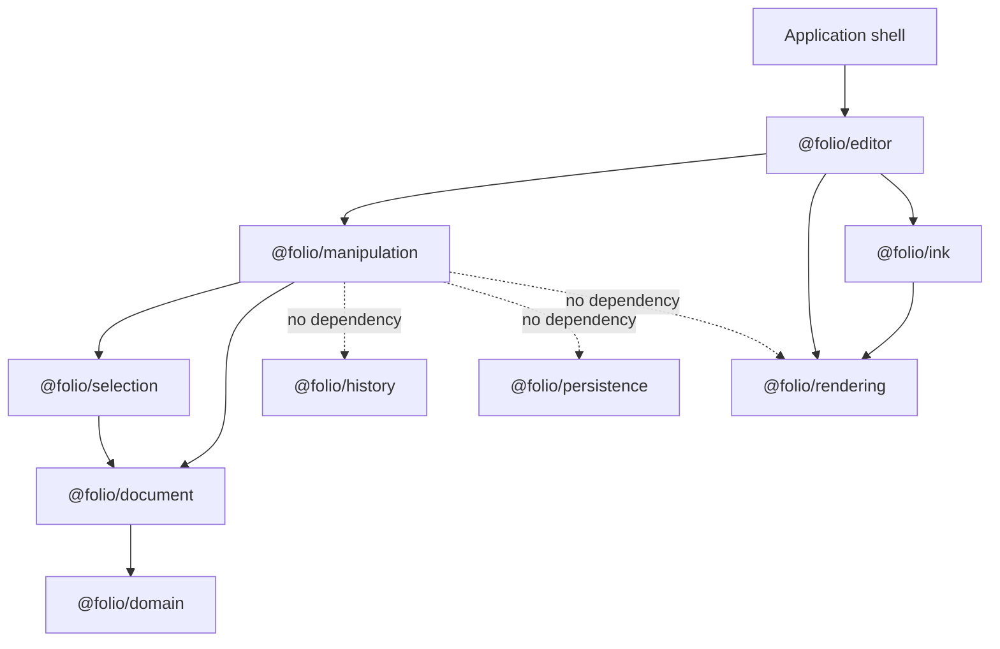
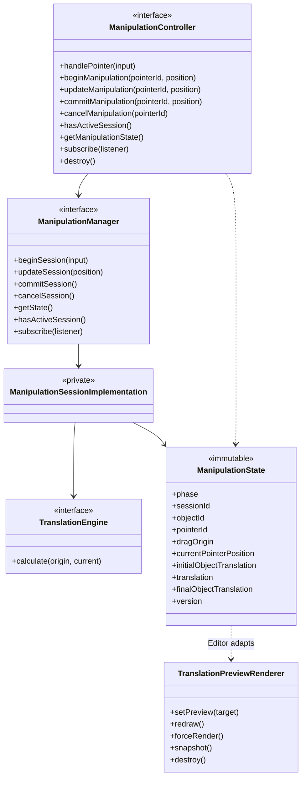
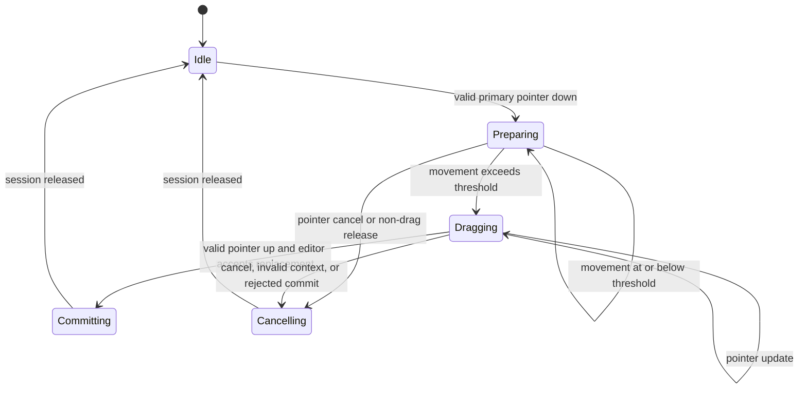
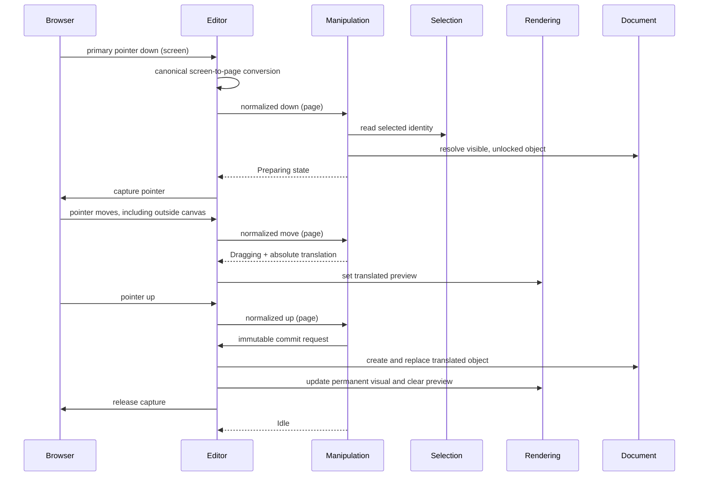
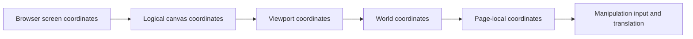
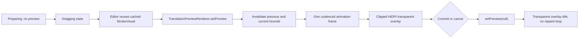
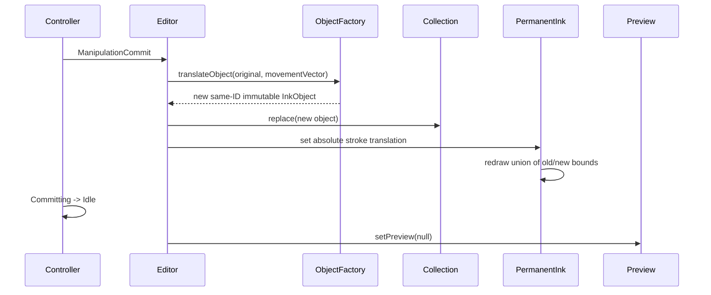
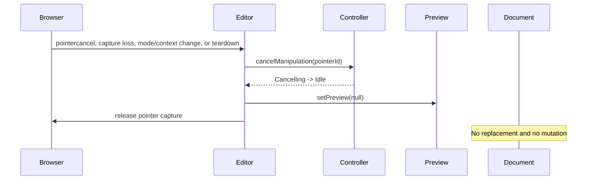

# Phase 10 — Object Manipulation Architecture

## Architecture overview

Phase 10 adds translation-only movement for one selected immutable page object. The new `@folio/manipulation` package owns the logical interaction lifecycle and origin-relative translation calculation. It never receives browser events, screen coordinates, viewport state, rendering objects, or writable document objects.

The editor remains the composition boundary. It routes the Move tool, converts browser screen coordinates through rendering's canonical converter, supplies normalized page points to manipulation, maps immutable state to a renderer-owned preview, and commits one immutable replacement to its active document session.

## Package responsibilities

| Package | Phase 10 responsibility | Explicitly does not own |
| --- | --- | --- |
| Application | Exposes Move in the existing toolbar and selects editor mode | Sessions, math, rendering |
| Editor | Browser adapter, coordinate bridge, package composition, immutable replacement | Translation algorithm, preview pixels, viewport math |
| Manipulation | Session lifecycle, pointer ownership, threshold, translation state, commit/cancel decision | React, Electron, rendering, history, persistence |
| Selection | Reports the single selected object identity | Manipulation sessions |
| Document | Creates and validates immutable translated replacement objects | Drag lifecycle |
| Ink | Reuses stroke geometry for permanent ink and preview visual adapters | Manipulation state |
| Rendering | Owns transparent preview pixels, clipping, HiDPI transforms, scheduling, invalidation | Manipulation decisions or documents |

## Dependency graph



`@folio/manipulation` production dependencies are exactly `@folio/selection` and `@folio/document`. Rendering has no dependency on manipulation.

## Class diagram



Only interfaces, utility types, centralized configuration, and factories are exported from manipulation. Concrete controller, manager, session, and translation classes remain private.

## Manipulation session state machine



Illegal or repeated transitions return the existing state reference. Only one session and one pointer ID can own interaction at a time.

## Pointer interaction sequence



## Coordinate systems



The editor calls `CoordinateConverter.screenToPage()`. Session starts are clipped to the active page. Once pointer capture belongs to a session, page coordinates outside page bounds remain valid so movement continues without discontinuity. Device-pixel ratio affects only the canvas backing store, never logical translation values.

## Translation algorithm

For every accepted update:

```text
movement.x = currentPointer.x - dragOrigin.x
movement.y = currentPointer.y - dragOrigin.y
distance   = hypot(movement.x, movement.y)

finalObjectTranslation = initialObjectTranslation + movement
```

All values use page units. Deltas are never accumulated, so event frequency and frame rate cannot introduce numerical drift. The original object and stroke remain untouched during the session.

## Preview lifecycle



Preview input contains identity, raw bounds, absolute page translation, and a visual interface. Rendering never reads selection, manipulation state, or document objects. The base page and permanent ink canvases are unchanged while dragging.

## Commit sequence



Exactly one replacement is created for a successful drag. Stroke geometry is retained by reference. No history or persistence operation is invoked.

## Cancel sequence



Failed preconditions are ignored. A removed, hidden, or locked object, changed selection context, or rejected commit returns safely to Idle. Editor-owned pointer capture is explicitly released on commit, cancel, context change, and teardown.

## Public APIs

The manipulation runtime surface is deliberately limited to:

- `createManipulationController`
- `createManipulationManager`
- `createTranslationEngine`
- `DEFAULT_MANIPULATION_CONFIGURATION`

Public type contracts include `ManipulationController`, `ManipulationManager`, `TranslationEngine`, immutable state and commit types, normalized pointer input, selection/object sources, and configuration. `CanvasSurface` adds the type-only `move` interaction mode plus optional interface/state callbacks; it remains the editor package's only runtime export.

## Extension points

- A future transformation model can extend the immutable session payload while preserving controller/manager/session ownership.
- Replaceable calculation interfaces can add resize, rotation, scale, skew, or group strategies.
- Identity-only object lookup naturally supports future multi-object identities without storing mutable objects in a session.
- `TranslationPreviewVisual` permits new object visuals without giving rendering document knowledge.
- Commit remains an editor callback, leaving future history wrapping outside manipulation.

No resize, rotation, scale, snapping, alignment, history, persistence, clipboard, keyboard, touch-gesture, or multi-selection behavior is implemented in Phase 10.

## Design rationale and performance

Origin-relative math is deterministic and avoids drift. Immutable state references make notification ownership explicit. Object lookup uses existing maps, sessions retain identity rather than documents, stroke preview retains one immutable geometry reference, animation-frame scheduling coalesces pointer bursts, duplicate dirty bounds are discarded, and old/current dirty bounds avoid full-page repaint. Focused tests exercise documents containing 100, 1,000, and 5,000 objects without inventing wall-clock benchmark claims.
