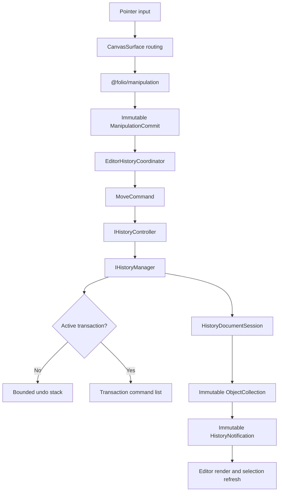
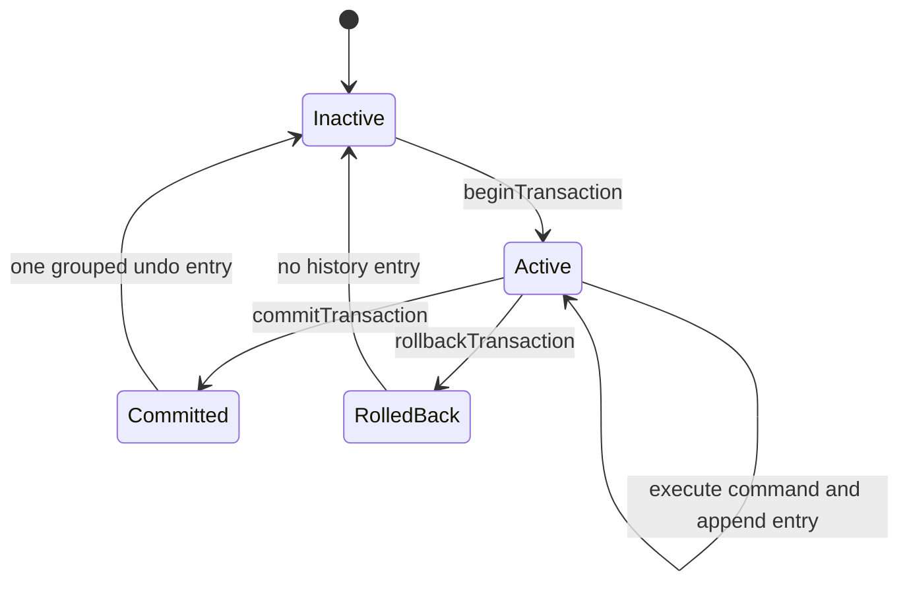

# Phase 11 — History Architecture and Developer Guide

Status: implemented and verified  
Scope: Phase 11 Stages 1–9  
Primary packages: `@folio/history` and `@folio/editor`

This document describes the Phase 11 implementation as it exists. It is the developer reference for the generic editor-history subsystem and its move integration. The original Phase 5 notebook-history API remains available as a separate compatibility surface in the same package.

## 1. Phase overview

Phase 11 adds a model-neutral, command-based execution path for manipulation-originated document changes. It solves four architectural problems:

- editor changes can be executed, undone, and redone through one controller;
- History no longer needs to know the editor's document model;
- committed transactions can be reversed as one logical step without retaining whole-document snapshots; and
- Manipulation, Rendering, Selection, and Persistence remain independent from History.

The implementation follows these principles:

- immutable commands produce immutable successor documents;
- commands own operation-specific and document-specific validation;
- History owns only command protocol, stacks, transactions, lifecycle, and notifications;
- Editor coordinates the independent Manipulation, History, Document, Selection, and Rendering subsystems;
- factories are the construction boundary for the new manager and controller; and
- the accepted Phase 5 public API remains source- and behavior-compatible.

Phase 11 does not route every editor modification through History. It integrates only manipulation-originated single-object moves. Ink finalization continues to update the current editor document session directly. History persistence, a History UI, additional editor commands, collaboration, and serialization are non-goals.

## 2. Package responsibilities

| Package | Owns | Must not own |
| --- | --- | --- |
| `@folio/history` | Generic command contracts, document-session boundary, bounded undo/redo stacks, lifecycle state, non-nested transactions, immutable notifications, manager/controller factories, and the frozen Phase 5 compatibility surface | Editor document semantics, manipulation sessions, rendering, selection, React/Electron lifecycle, persistence coordination, or UI |
| `@folio/editor` | `MoveCommand`, `EditorHistoryCoordinator`, shortcut registration, one History manager/controller per mounted `CanvasSurface`, document-successor installation, and render/selection synchronization | Generic stack or transaction algorithms, manipulation math, hit testing, viewport math, or persisted notebook history |
| `@folio/manipulation` | Pointer-driven translation sessions and immutable `ManipulationCommit` results | History commands, stacks, controllers, document replacement, or rendering |
| `@folio/document` | Immutable `ObjectCollection`, `InkObject`, transforms, replacement operations, and object validation | History orchestration, UI, persistence, or interaction sessions |
| `@folio/rendering` | Canvas lifecycle and passive rendering of the current editor state | History, commands, document mutation, selection decisions, or manipulation commits |
| `@folio/selection` | Identity-only selection state and hit testing over immutable document objects | History, document mutation, rendering, or manipulation commits |
| `@folio/ink` | Stroke input, immutable stroke construction, and ink rendering | History integration or notebook persistence; Phase 11 does not add an ink command |
| `@folio/persistence` | Notebook folder storage, dirty tracking, autosave, recovery, and format validation | Generic editor History state or command execution |
| `@folio/domain` | The immutable persistence-facing `Notebook` aggregate used by the legacy Phase 5 History surface | The Phase 11 editor document session or generic History lifecycle |

`@folio/history` has a production dependency on `@folio/domain` only because the legacy Phase 5 surface remains in the package. Its generic `src/editor-history` subtree has no Folio-package dependency. `@folio/persistence` is a development-only dependency used to prove structural compatibility with the legacy dirty-sink contract.

## 3. Architecture

### 3.1 Move execution flow

Commands execute before they are recorded. The manager reads the current document through `HistoryDocumentSession`, asks the command for a successor, installs that successor, and then records only the command and immutable metadata. It never stores whole before/after document aggregates in a Phase 11 history entry.

### 3.2 Package ownership

```mermaid
flowchart TD
    Desktop["Desktop shell"] --> Editor["@folio/editor"]
    Editor --> History["@folio/history"]
    Editor --> Manipulation["@folio/manipulation"]
    Editor --> Selection["@folio/selection"]
    Editor --> Document["@folio/document"]
    Editor --> Rendering["@folio/rendering"]
    Editor --> Ink["@folio/ink"]
    Manipulation --> Selection
    Manipulation --> Document
    Selection --> Document
    Document --> Domain["@folio/domain"]
    Document --> Ink
    Ink --> Rendering
    History --> Domain
    Persistence["@folio/persistence"] --> Domain
    History -. "development compatibility test only" .-> Persistence
```

The `History → Domain` production edge belongs only to the legacy surface. There is no production edge from History to Document, Editor, Manipulation, Selection, Rendering, Persistence, React, Electron, or UI.

## 4. Public `@folio/history` API

The package exposes one root entry point. New concrete implementations and helper modules are intentionally private.

### 4.1 Generic Phase 11 runtime construction

| API | Purpose and lifecycle |
| --- | --- |
| `createEditorHistoryManager<TDocument>(options)` | Creates one private generic manager around a `HistoryDocumentSession<TDocument>`. `historyLimit` defaults to 100 and must be a positive safe integer. The caller does not receive a concrete implementation class. |
| `createHistoryController<TDocument>(options)` | Claims one manager and returns its sole editor-facing controller. A manager can have only one active controller. `destroy()` releases the claim so a new controller may later claim the manager. |
| `EditorHistoryManagerOptions<TDocument>` | Supplies the model-neutral document session and optional bounded history limit. |
| `EditorHistoryControllerOptions<TDocument>` | Supplies a manager created by `createEditorHistoryManager`. |

### 4.2 Generic contracts

| API | Purpose |
| --- | --- |
| `EditorCommand<TDocument>` | Immutable command identity and `execute`, `undo`, and `redo` transitions over `TDocument`. The concrete command owns all document semantics. |
| `HistoryDocumentSession<TDocument>` | Reads the active immutable document and installs an immutable successor. It is the only document-state boundary known to generic History. |
| `IHistoryManager<TDocument>` | Model-neutral execution, bounded stacks, state queries, clearing, and transaction lifecycle. Editor code normally uses the controller instead. |
| `IHistoryController<TDocument>` | The editor-facing execution, undo/redo, transaction, state, subscription, and destruction boundary. |

### 4.3 Generic state and metadata

| API | Purpose |
| --- | --- |
| `HistoryCommandMetadata` | Immutable `id`, ISO timestamp, and description without executable command behavior. |
| `HistoryOperation` | The observable command operations: `execute`, `undo`, or `redo`. |
| `HistoryOperationOutcome` | `succeeded` or `failed`. |
| `HistoryTransactionOptions` | Optional transaction `id`, timestamp, and description. Missing values are generated. |
| `IHistoryState` | Immutable, document-free capabilities and counters: depths, limit, version, execution count/state, active transaction, and last command. |
| `HistoryExecutionState` | Discriminated union of idle, executing, undoing, redoing, and completed states. |
| `IdleHistoryExecutionState` | Idle state with no operation or command. |
| `ExecutingHistoryExecutionState` | Active execute state. |
| `UndoingHistoryExecutionState` | Active undo state. |
| `RedoingHistoryExecutionState` | Active redo state. |
| `CompletedHistoryExecutionState` | Completed operation plus success/failure outcome. Notifications expose this state before the manager returns to idle. |
| `HistoryExecutionPhase` | Union of the five execution-state phase names. |
| `HistoryTransactionState` | Immutable active-transaction metadata and collected command count. It contains no document. |

`historyVersion` increments when the installed document changes, when a non-empty rollback installs its successor, and when non-empty stack clearing changes History. `executionCounter` increments after each successfully completed execute, undo, or redo command lifecycle. Transaction begin/commit alone do not increment either counter.

### 4.4 Notifications

| API | Purpose |
| --- | --- |
| `HistorySuccessNotification` | Immutable completed operation, command metadata, and post-operation state. |
| `HistoryFailureNotification` | Immutable failed operation, optional readable command metadata, state, and frozen `HistoryError`. |
| `HistoryNotification` | Success/failure discriminated union. |
| `HistoryListener` | Listener invoked after an execute, undo, or redo lifecycle completes. |

Transaction begin, commit, and rollback do not introduce separate notification kinds. Commands executed inside a transaction still publish their command notifications. Undoing or redoing a committed transaction publishes one notification with the transaction metadata. Listener exceptions are isolated and cannot alter History state or prevent later listeners from running.

### 4.5 Errors

`HistoryError`, `HistoryErrorCode`, `HistoryErrorOptions`, and `isHistoryError()` are shared public error contracts. Phase 11 adds codes for invalid generic commands/sessions/managers/listeners, controller ownership/destruction, lifecycle violations, command execute/undo/redo failure, and transaction commit/rollback failure. Domain-specific reasons remain the concrete command's responsibility and appear as the wrapped cause of a protocol-level History error.

### 4.6 Frozen Phase 5 compatibility surface

The following public APIs remain unchanged and notebook-specific:

- `HistoryManager` and `HistoryManagerOptions`;
- `Command`, `CommandCategory`, `CommandFactoryOptions`, `HistoryChangeTarget`, and `HistoryContext`;
- `HistorySnapshot`, `HistoryState`, and `Transaction`;
- `LegacyHistoryDirtySink`;
- `createRenameNotebookCommand()` and `createUpdateNotebookMetadataCommand()`;
- `createAddSectionCommand()`, `createDeleteSectionCommand()`, `createRenameSectionCommand()`, and `createReorderSectionsCommand()`;
- `createAddPageCommand()`, `createDeletePageCommand()`, `createDuplicatePageCommand()`, and `createReorderPagesCommand()`; and
- the `DuplicatePageCommand` type.

This compatibility manager operates on `@folio/domain.Notebook`, validates/freeze-checks notebook results, uses exact before/after notebook references, exposes save-point dirtiness, and retains its snapshot-based transaction representation. `LegacyHistoryDirtySink` replaces the former Persistence type dependency while remaining structurally compatible with `DirtyTracker`. None of these behaviors apply to the generic Phase 11 surface.

## 5. Internal components

| Component | Responsibility and collaboration |
| --- | --- |
| Generic History manager | Owns the active command lifecycle, bounded undo/redo stacks, counters, version, transaction record, and the `HistoryDocumentSession`. It validates protocol integrity, calls commands, installs successors, and emits one internal lifecycle event to its controller. Its implementation class is private. |
| History controller | Claims exactly one generic manager, delegates operations, converts lifecycle events into immutable notifications, isolates listeners, prevents reentrant operations, and releases ownership on destruction. Its implementation class is private. |
| Transaction engine | Collects immutable command entries while their effects are installed. Commit creates one private command group; rollback invokes child undo operations in reverse. It stores commands and metadata, never whole documents. |
| `MoveCommand` | Editor-owned, package-private `EditorCommand<ObjectCollection>`. It validates one visible, unlocked, current `InkObject` and performs one absolute translation transition. It stores only identity, expected revision, initial/final translations, and command metadata. |
| `EditorHistoryCoordinator` | Editor-owned lifetime adapter. It creates one manager/controller, turns `ManipulationCommit` into `MoveCommand`, subscribes once, installs session successors through History, and requests document/render/selection synchronization. |
| `InkDocumentSession` | Owns the active immutable `ObjectCollection`. It implements `HistoryDocumentSession`, creates ink objects directly on stroke finalization, and installs exact command successors. Its direct translation helper remains only for Phase 10 compatibility and is not called by `CanvasSurface`. |
| Shortcut adapter | Registers one `keydown` listener for the mounted editor lifetime and removes it idempotently. It reuses the coordinator's controller and never constructs History infrastructure. |

The generic manager is not the public legacy `HistoryManager` class. The identical concept name reflects responsibility, not a shared implementation.

## 6. Command lifecycle

### 6.1 Creation and execution

1. Manipulation produces a frozen `ManipulationCommit` containing the object ID, session ID, and initial/final translations.
2. `EditorHistoryCoordinator` resolves the current object's revision and creates an immutable `MoveCommand` with a stable ID, ISO timestamp, and description.
3. The controller rejects calls after destruction or during another operation/notification dispatch.
4. The manager verifies only the frozen `EditorCommand` protocol and enters `executing` state.
5. The manager reads the active immutable document from `HistoryDocumentSession` and calls `command.execute(document)`.
6. `MoveCommand` validates the object and produces a new `ObjectCollection`. It does not mutate the predecessor.
7. The manager asks the session to install the exact successor and verifies that it was retained.
8. Outside a transaction, the command entry is pushed to undo and redo is cleared. Inside a transaction, the command entry is appended to that transaction instead.
9. History updates its version/counter, enters `completed`, and emits a lifecycle event.
10. The controller publishes an immutable notification. The editor synchronizes permanent ink translation, document diagnostics, and selection bounds from the current collection.
11. After synchronous notification delivery completes, the manager returns to `idle`.

### 6.2 Undo and redo

Undo peeks the newest undo entry, calls its `undo()` against the current document, installs the distinct successor, and then moves the entry to redo. Redo performs the inverse stack movement through `redo()`. Stack mutation happens only after successor installation succeeds. An empty operation returns current state and publishes no notification.

A new successful non-transactional command invalidates redo. A non-empty committed transaction also invalidates redo. A rolled-back or empty transaction preserves the existing redo branch.

### 6.3 Keyboard access

For the mounted Windows/Linux editor, `Ctrl+Z` invokes undo, while `Ctrl+Shift+Z` and `Ctrl+Y` invoke redo. The adapter ignores composing events, already-prevented events, Alt/Meta combinations, and editable input/select/textarea/content-editable targets. It calls `preventDefault()` only when the requested History operation is available and will be handled. Repeated keydown events perform repeated operations until the corresponding stack is empty.

No new controller is created for shortcuts. macOS Command-key handling is not implemented because the application has no existing cross-platform shortcut abstraction.

## 7. Transaction model

- Transactions are explicit, manager-owned, and non-nested. A nested begin fails with `TRANSACTION_ACTIVE`.
- Child commands execute immediately and install immutable successors. They are recorded in order in the active transaction and do not enter the undo stack individually.
- Commit stores the ordered child commands as one command-only entry. It does not retain the transaction's starting or final document.
- Undo of a committed transaction invokes child undo operations in reverse order. Redo invokes child redo operations in forward order.
- The group computes intermediate immutable successors before the manager performs one final session replacement, so a child failure leaves the installed document and stacks unchanged.
- Rollback runs child undo operations in reverse and performs one final document replacement. It creates no undo entry and preserves the redo branch.
- A failed rollback keeps the transaction active for a retry. A failed grouped undo/redo leaves the document and stacks unchanged.
- Empty transactions commit without creating an entry or clearing redo.
- Undo, redo, and history clearing are rejected while a transaction is active.

## 8. Failure recovery and consistency

| Failure | Owner and result |
| --- | --- |
| Invalid command identity, timestamp, description, mutability, or missing lifecycle method | Generic History rejects it as `INVALID_EDITOR_COMMAND`; the controller publishes one failure notification when possible. |
| Missing move object | `MoveCommand` fails with `MOVE_OBJECT_NOT_FOUND`; History wraps the cause as `COMMAND_EXECUTION_FAILED`, `COMMAND_UNDO_FAILED`, or `COMMAND_REDO_FAILED`. |
| Hidden or locked object | `MoveCommand` fails before replacement. History state and document remain unchanged. |
| Unsupported object/document | `MoveCommand` accepts only `ObjectCollection` documents containing `InkObject` targets. Other values fail inside the command. |
| Revision or translation mismatch | `MoveCommand` treats the command as stale or in the wrong lifecycle state and produces no successor. |
| Session replacement failure | The manager attempts to restore the predecessor reference. Stacks change only after successful installation. If both installation and restoration fail, the operation reports an aggregate cause. |
| Command or grouped-command failure | The active document and relevant stacks remain unchanged because replacement occurs only after a complete successor is calculated. |
| Controller destruction | All listeners are cleared, the manager claim is released, and later controller operations fail with `HISTORY_CONTROLLER_DESTROYED`. Destruction is idempotent. |
| Listener exception | The exception is swallowed at the notification boundary; remaining listeners continue and History state is not rolled back. |
| Reentrant operation | Manager/controller lifecycle guards reject it with `HISTORY_LIFECYCLE_VIOLATION`. |
| Rollback failure | The installed document, stacks, and active transaction remain consistent; the transaction stays active for recovery or retry. |

Failure notifications contain the current immutable History state. History never interprets move-specific error codes or document rules.

## 9. Extension guide

To add another History-enabled editor command:

1. Keep the editing subsystem independent. It should return an immutable logical result and must not construct or import History commands.
2. Place the concrete command and its factory in `@folio/editor` or another composition layer that may depend on both the editing model and `@folio/history` contracts. Do not put document-specific commands in the generic History subtree.
3. Implement `EditorCommand<TDocument>` as an immutable object. Store only stable identity, reversible operation data, and command metadata—not before/after documents, rendering state, UI state, or subsystem sessions.
4. Validate all object references, revisions, permissions, and operation invariants inside the command. Generic History validates only the command protocol and lifecycle.
5. Make `execute`, `undo`, and `redo` deterministic for the expected current state. Each non-no-op undo/redo must create a distinct immutable successor without mutating prior versions.
6. Adapt the subsystem result into the command in Editor, then submit it through the existing editor-session `IHistoryController`. Do not construct a second manager/controller.
7. Synchronize rendering and selection from the installed session document through editor-owned notification handling. Commands must not render or modify selection.
8. Test success, inverse transitions, stale/missing/invalid targets, immutability, transaction grouping, notifications, and editor synchronization.

Never bypass the controller for a modification that has joined the Phase 11 History path. Ink finalization is the sole currently approved direct-session exception.

## 10. Dependency rules

Allowed production directions relevant to Phase 11 are:

- Desktop → Editor;
- Editor → History, Manipulation, Selection, Document, Rendering, and Ink;
- Manipulation → Selection and Document;
- Selection → Document;
- Document → Domain and Ink;
- Ink → Rendering;
- History → Domain for legacy modules only; and
- Persistence → Domain.

Forbidden directions are:

- History → Document, Editor, Manipulation, Selection, Rendering, Persistence, React, Electron, or UI;
- generic `history/src/editor-history` → any Folio package;
- Manipulation → History or Editor;
- Rendering → History, Editor, Manipulation, or Selection;
- Selection → History, Editor, Manipulation, or Rendering; and
- Persistence → History or editor subsystems.

Editor imports only public `@folio/history` contracts and factories. Private History modules and implementation classes must not be imported across the package boundary.

## 11. Testing strategy

Phase 11 is protected at several levels:

- generic contract tests verify immutable, model-neutral public types and error codes;
- manager tests cover execute/undo/redo, empty operations, redo invalidation, bounded and large histories, counters, lifecycle states, and failure consistency;
- controller tests cover manager ownership, notification ordering/immutability, listener isolation, reentrancy, destruction, and claim release;
- transaction tests cover grouping, child order, one-step undo/redo, empty commit, rollback, nested rejection, and failure atomicity;
- move-command tests use real immutable document objects and cover success, reversal, stale/missing/hidden/locked/unsupported targets, metadata, transactions, and notifications;
- editor integration tests cover commit adaptation, session replacement, render/selection callbacks, command rejection, controller isolation, and teardown;
- shortcut tests cover all three Windows/Linux bindings, repeated operations, empty stacks, editable targets, browser-default suppression, and listener cleanup;
- compatibility and dependency tests lock the Phase 5 exports, dirty-sink behavior, generic import boundary, private implementation boundary, and absence of snapshot storage; and
- Electron tests cover the mounted move/undo/redo path, unchanged canvas identity, scope boundaries, resize/theme/dialog/notification behavior, and demand-driven rendering.

The Stage 8 release matrix passed formatting, format checking, type checking, linting, 455 unit/integration tests in 58 files, production build, two Electron end-to-end tests, and Windows packaging. Critical lifecycle suites and Electron tests also passed repeatedly to detect leaks or intermittent state corruption.

## 12. Known scope boundaries

- Generic and legacy History are session-memory only.
- History stacks, commands, transactions, counters, and notifications are not serialized.
- There is no History persistence, autosave integration, or crash recovery for History state.
- There is no History toolbar, menu, panel, timeline, visual browser, or command palette.
- There is no collaborative or distributed History.
- Only single-object translation of an `InkObject` is implemented as a Phase 11 editor command.
- Ink finalization remains a direct `InkDocumentSession.completeStroke()` update and creates no History entry.
- The legacy Phase 5 notebook manager, command factories, snapshots, transactions, save points, and structural dirty-sink compatibility remain available unchanged.
- The generic and legacy managers are independent and do not share entries or state.
- The active editor document is still session-only and is not adapted to the persisted `@folio/domain.Notebook` model.
- Shortcuts implement Windows/Linux Control-key bindings only under the current desktop input architecture.

## 13. Future work

The following work is intentionally deferred beyond Phase 11:

- History-enabled ink and additional editor commands;
- History persistence or restoration;
- History UI, menus, command palette, timeline, and visual browser;
- collaborative editing History; and
- mapping the session document model into notebook persistence.

These items are scope markers only; Phase 11 defines no design for them.

