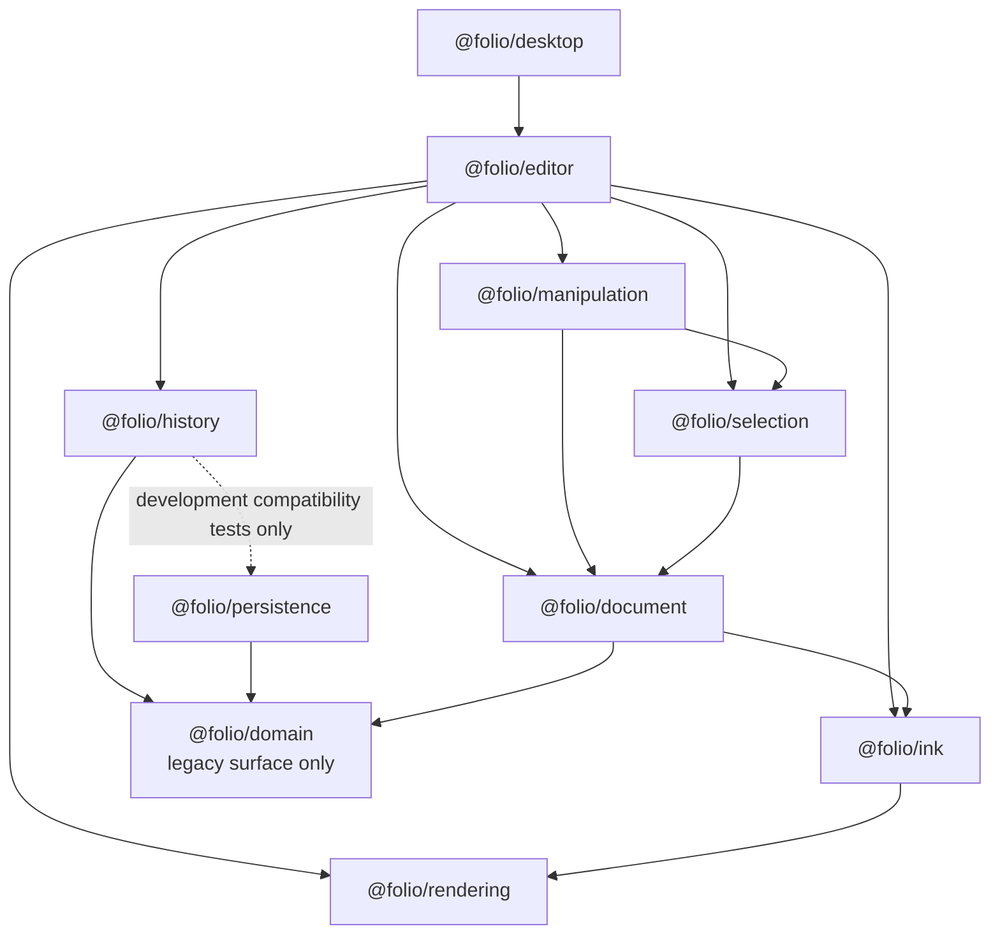

# Phase 11 — Implementation Roadmap

Status: completed; retained as the approved implementation record  
Current-code baseline: `main` at `5791c60` (`Phase 10 completed`)  
Authoritative sources: Architecture Reference Manual; Phase 11 Part 1 Revision 2; Phase 11 Part 2A; Phase 11 Part 2B; Phase 11 Architecture Clarification; Phase 11 Compatibility & Migration Specification; Phase 11 Scope Clarification

No production implementation is embedded in this document. All stages are implemented and verified; `PHASE11_HISTORY_ARCHITECTURE.md` documents the resulting developer contract.

## Pre-implementation verification

### Confirmed implementability

The approved architecture is implementable with the current package boundaries:

- `@folio/history` can retain its Phase 5 API while adding a separate generic editor-history surface in the same package.
- The direct History-to-Persistence production dependency can be removed without changing `DirtyTracker`; the existing tracker structurally satisfies the approved legacy dirty-sink compatibility boundary.
- A generic History surface can remain model-neutral while the existing manager continues operating on `@folio/domain.Notebook`.
- `@folio/editor` can become the only coordinator by adding a production dependency on `@folio/history`; this creates no package cycle.
- `ManipulationCommit` already contains the object identity and logical initial/final translation needed by an editor-owned move command.
- `ObjectCollection`, `ObjectFactory`, and immutable `InkObject` replacements provide the document successor operations needed by a move command without changing `@folio/document`.
- `StrokeRenderer.setStrokeTranslation`, selection identity state, and the existing manipulation commit callback provide the required rendering and interaction integration points.
- Existing public exports can remain intact while new Phase 11 implementations stay private behind interfaces and factories.
- Snapshot-free command grouping can coexist with the unchanged Phase 5 snapshot transaction implementation.
- Phase 11 can route manipulation-originated document changes through History while leaving the existing direct ink-finalization path unchanged and outside Phase 11 History scope.

The resolved precedence rules are:

1. The Architecture Clarification supersedes Part 1 and Part 2A where command creation or validation ownership differs.
2. The Compatibility & Migration Specification supersedes the ARM contradiction register by defining two separated History surfaces.
3. The active editor uses only the new Phase 11 surface. The public Phase 5 `HistoryManager` remains a compatibility API and is not the editor-session manager.
4. The Scope Clarification limits the Phase 11 History-integration requirement to manipulation-originated document modifications. Existing ink finalization remains a permitted direct document-session update until a future Ink phase.

### Resolved Phase 11 scope

The Scope Clarification resolves the roadmap’s only blocker:

- Only manipulation-originated document modifications must pass through History in Phase 11.
- `CanvasSurface` may continue calling `InkDocumentSession.completeStroke` directly for existing ink finalization.
- Phase 11 does not add a draw/ink command, adapt ink creation into History, or change the Ink package.
- The generic History contracts must support future editing commands without implementing those commands now.
- “Every document modification” in the Phase 11 sources means every modification made by a system participating in Phase 11, not every currently implemented editor modification.

No unresolved contradiction, dependency cycle, or missing architectural extension point remains. The roadmap is ready to execute without additional architecture work.

---

# 1. Implementation Roadmap

## Stage 0 — Baseline and compatibility gate

- **Goal:** Establish an executable baseline and lock the accepted Phase 5 compatibility surface before Phase 11 files change.
- **Why the step is needed:** The migration requires additive APIs and one narrowly modified dependency seam. A captured baseline distinguishes intentional Phase 11 additions from regressions.
- **Packages affected:** `@folio/history`, `@folio/editor`, and repository verification configuration; no production package behavior changes.
- **Files likely to change:** No production files. Test inventories and the approved public-export lists are recorded before implementation. If a repository test fixture is needed, it belongs under `packages/history/src/__tests__`.
- **New interfaces:** None.
- **New classes:** None.
- **Existing classes that must be extended:** None.
- **Public API changes:** None.
- **Internal API changes:** None.
- **Tests required:** Run the existing format check, typecheck, lint, 327-test baseline, desktop build, Electron end-to-end suite, and Windows directory packaging. Record the exact runtime exports of `@folio/history` and `@folio/editor`.
- **Dependencies on previous steps:** None; all required architecture and scope clarifications are approved.
- **Expected completion criteria:** The baseline is green; current exports and dependency edges are captured; the manipulation-only Phase 11 scope is included in acceptance criteria without changing any other approved architecture.

## Stage 1 — Decouple legacy History from Persistence

- **Goal:** Remove the production dependency from `@folio/history` to `@folio/persistence` while preserving Phase 5 dirty-tracker behavior and source compatibility.
- **Why the step is needed:** The Compatibility & Migration Specification permanently separates History and Persistence but explicitly retains the legacy manager’s optional injected dirty sink.
- **Packages affected:** `@folio/history`; `@folio/persistence` only as a development-time compatibility-test dependency; workspace lockfile metadata.
- **Files likely to change:** `packages/history/package.json`, `packages/history/src/history-manager.ts`, `packages/history/src/index.ts`, a new `packages/history/src/compatibility/legacy-history-dirty-sink.ts`, `packages/history/src/__tests__/dirty-persistence.test.ts`, `packages/history/src/__tests__/public-api.test.ts`, and `pnpm-lock.yaml`.
- **New interfaces:** `LegacyHistoryDirtySink`, owned and exported by History, containing only the operations already consumed by the Phase 5 manager.
- **New classes:** None.
- **Existing classes that must be extended:** `HistoryManager` changes only its private field and option type from the Persistence class to the structurally compatible History-owned interface. Its runtime behavior remains unchanged.
- **Public API changes:** Add the `LegacyHistoryDirtySink` type. Preserve the `HistoryManagerOptions.dirtyTracker` property name and structural compatibility. Remove no existing export.
- **Internal API changes:** Remove the `DirtyTracker` import. No legacy stack, snapshot, save-point, transaction, or dirty-target behavior changes.
- **Tests required:** Retain every existing dirty/save-point test; add a compile-time compatibility case proving that a real `DirtyTracker` is accepted; add manifest/import-boundary tests proving Persistence is absent from History production dependencies and production imports; keep Persistence as a History dev dependency only while those tests import it.
- **Dependencies on previous steps:** Stage 0.
- **Expected completion criteria:** All Phase 5 tests pass unchanged in meaning; callers can still pass `new DirtyTracker()`; `@folio/history` has no production import or manifest dependency on `@folio/persistence`.

## Stage 2 — Add the Phase 11 public contracts

- **Goal:** Define the stable, model-neutral interfaces used by every later Phase 11 implementation without exposing concrete classes.
- **Why the step is needed:** History must operate only on an immutable `EditorCommand` abstraction, Editor must communicate only with a controller, and History state must exclude document objects.
- **Packages affected:** `@folio/history`.
- **Files likely to change:** New files under `packages/history/src/editor-history/interfaces`, `packages/history/src/editor-history/model`, and `packages/history/src/editor-history/state`; additive exports in `packages/history/src/index.ts`; additive codes/types in `packages/history/src/errors.ts`; public API tests.
- **New interfaces:**
  - `EditorCommand<TDocument>` with immutable identity, timestamp, description, and execute/undo/redo operations returning immutable successors.
  - `HistoryDocumentSession<TDocument>` as the model-neutral current-document read/replacement boundary used by History without importing Document.
  - `IHistoryManager<TDocument>` for execution, undo/redo, state queries, clearing, and the approved transaction lifecycle.
  - `IHistoryController<TDocument>` as the only editor-facing execution and subscription boundary.
  - `IHistoryState` containing capabilities, depths, limit, version, execution counter, explicit execution state, active transaction summary, and last-command metadata, but no document reference.
  - Immutable notification/listener, command-metadata, execution-state, transaction-state, manager-options, and controller-options contracts.
- **New classes:** None in the public API.
- **Existing classes that must be extended:** `HistoryError` remains the shared structured error class; its error-code union is extended only with generic execution, lifecycle, controller, and transaction failures required by the new contracts.
- **Public API changes:** Add the Phase 11 interfaces and supporting immutable types. Do not remove, rename, or narrow `Command`, `HistoryState`, `Transaction`, `HistoryManager`, or any existing command factory. Existing and Phase 11 state/type names remain distinct.
- **Internal API changes:** Establish a dedicated `src/editor-history` subtree so generic code cannot accidentally reuse the legacy snapshot command, `Notebook` validation, or persistence targets.
- **Tests required:** Type-level contract tests for generic document types; immutability tests for public state/metadata/event records; public API tests that preserve every Phase 5 runtime export; negative dependency tests confirming the new interfaces import no Domain, Document, Persistence, Manipulation, Selection, Rendering, React, Electron, or UI type.
- **Dependencies on previous steps:** Stage 1.
- **Expected completion criteria:** The contracts compile under strict/exact-optional settings, expose no document model, retain no complete aggregate in public state, and leave the legacy API intact.

## Stage 3 — Implement the private generic manager and stacks

- **Goal:** Implement deterministic command execution, undo, redo, limits, lifecycle state, and failure consistency behind `IHistoryManager<TDocument>`.
- **Why the step is needed:** This is the permanent model-neutral execution core required by Phase 11.
- **Packages affected:** `@folio/history`.
- **Files likely to change:** New manager, stack, state-builder, command-integrity, and factory modules under `packages/history/src/editor-history`; `packages/history/src/index.ts`; `packages/history/src/errors.ts`; new manager/state test files.
- **New interfaces:** No additional public interface beyond Stage 2. Private entry and stack records are introduced.
- **New classes:** Private `EditorHistoryManagerImplementation<TDocument>` and a private bounded command-stack implementation. The public `createEditorHistoryManager` factory returns `IHistoryManager<TDocument>`.
- **Existing classes that must be extended:** None. The public Phase 5 `HistoryManager` is not generalized, subclassed, or used internally.
- **Public API changes:** Add the `createEditorHistoryManager` runtime factory. Add no concrete class export.
- **Internal API changes:** Add command-only undo/redo entries, explicit idle/executing/undoing/redoing/completed state objects, monotonic history version and execution counter ownership, bounded stack management, redo invalidation, and protocol-only command integrity checks. Entries retain commands and lifecycle metadata, never whole before/after document aggregates.
- **Tests required:** Execute, multiple undo/redo, empty operations, redo invalidation, no-op successor behavior, default/custom limits, limit overflow, clearing, thousands of commands, immutable state, distinct immutable successors for execute/undo/redo, command immutability, invalid lifecycle calls, reentrancy rejection, failed execute/undo/redo consistency, and proof that state/entries exposed to callers contain no document aggregate.
- **Dependencies on previous steps:** Stage 2.
- **Expected completion criteria:** All operations are deterministic and bounded; undo/redo produce successors rather than restoring retained aggregate states; failures leave document session, stacks, version, counters, and execution state consistent; no legacy manager behavior changes.

## Stage 4 — Implement the private controller and notifications

- **Goal:** Add the editor-facing coordinator that receives commands, delegates to the manager, and publishes immutable post-operation notifications.
- **Why the step is needed:** Approved architecture forbids Editor from communicating with the manager implementation directly and requires success and failure notification after History operations.
- **Packages affected:** `@folio/history`.
- **Files likely to change:** New controller implementation and factory modules under `packages/history/src/editor-history/controller`; event/state modules from Stage 2; `packages/history/src/index.ts`; controller tests.
- **New interfaces:** No new public interface beyond Stage 2; private subscription registry records may be added.
- **New classes:** Private `HistoryControllerImplementation<TDocument>`. The public `createHistoryController` factory returns `IHistoryController<TDocument>`.
- **Existing classes that must be extended:** Private manager implementation may gain controller-only coordination hooks, but it remains inaccessible to Editor.
- **Public API changes:** Add the `createHistoryController` runtime factory. No implementation class is exported.
- **Internal API changes:** Add subscription ownership, immutable notification creation, destroyed-controller guards, and notification/error propagation. The controller does not import or notify Rendering, Manipulation, Selection, or Persistence.
- **Tests required:** Successful execute/undo/redo notifications, failure notifications, immutable event/state payloads, notification ordering relative to explicit lifecycle state, unsubscribe behavior, destroy behavior, listener isolation, no partial state after listener or command exceptions, and one-manager-per-controller ownership.
- **Dependencies on previous steps:** Stage 3.
- **Expected completion criteria:** Editor can perform every History operation through `IHistoryController`; notifications occur only at the approved boundaries; private implementations remain absent from the package barrel.

## Stage 5 — Add snapshot-free Phase 11 transactions

- **Goal:** Preserve the accepted transaction contract on the generic surface without using aggregate snapshots.
- **Why the step is needed:** Phase 11 must support non-nested grouping, one committed undo step, rollback, and deterministic ordering while the Compatibility & Migration Specification prohibits the Phase 5 snapshot representation on the editor path.
- **Packages affected:** `@folio/history`.
- **Files likely to change:** New transaction and command-group modules under `packages/history/src/editor-history/transaction`; private manager/controller modules; state model; transaction tests.
- **New interfaces:** Use the Stage 2 immutable transaction-state and transaction-options contracts; no additional capability is introduced.
- **New classes:** Private immutable command-group/transaction-entry implementation. It retains ordered child commands and metadata only.
- **Existing classes that must be extended:** Private generic manager and controller gain begin, commit, and rollback coordination. The public Phase 5 `HistoryManager` remains unchanged.
- **Public API changes:** No capability beyond the Stage 2 transaction methods. Nested transactions, merging, and serialization are not added.
- **Internal API changes:** Add active transaction ownership, child-command collection, one-entry commit representation, reverse-order rollback responsibility, and transaction-aware stack/state consistency. No complete starting/final document state is stored in the committed history entry.
- **Tests required:** Begin/commit/rollback, multiple child commands as one undo step, redo of a group, reverse undo and forward redo ordering, empty commit, rollback with an existing redo branch, nested rejection, illegal operations during a transaction, child failure, rollback failure consistency, limit behavior for grouped entries, and assertions that transaction entries contain no whole-document snapshot.
- **Dependencies on previous steps:** Stages 3 and 4.
- **Expected completion criteria:** Transactions preserve Phase 5 observable semantics required by the compatibility decision while using only ordered commands on the Phase 11 surface; legacy snapshot transactions remain untouched.

## Stage 6 — Add the editor-owned move command and document-session bridge

- **Goal:** Adapt `ManipulationCommit` into an immutable concrete command that changes the editor’s `ObjectCollection` only through History.
- **Why the step is needed:** The Architecture Clarification assigns logical interaction to Manipulation, command creation and domain validation to Editor, and command execution to History.
- **Packages affected:** `@folio/editor`; `@folio/history` as a new production dependency. `@folio/document` and `@folio/manipulation` are consumed through their existing APIs and remain unchanged.
- **Files likely to change:** `packages/editor/package.json`, `pnpm-lock.yaml`, `packages/editor/src/InkDocumentSession.ts`, new files under `packages/editor/src/history` for the move command/factory and model-neutral session adapter, plus new unit tests.
- **New interfaces:** Editor-internal command-factory input and document-change callback contracts only. The History-owned `HistoryDocumentSession<ObjectCollection>` interface is implemented at the Editor boundary.
- **New classes:** Private immutable `MoveObjectCommand`; optionally a private `EditorDocumentHistoryAdapter` if composition is kept separate from `InkDocumentSession`.
- **Existing classes that must be extended:** `InkDocumentSession` gains an internal way to install a validated immutable `ObjectCollection` successor and expose it through the History document-session contract. Existing stroke completion, lookup, snapshot, direct translation helper, and clear behavior remain compatible.
- **Public API changes:** None in `@folio/editor` at runtime. The concrete move command and adapter are not barrel-exported. `@folio/manipulation` exports remain unchanged.
- **Internal API changes:** Add commit-to-command adaptation using only object ID, session identity, timestamps, and logical initial/final translation. The command owns object existence/type/visibility/lock/translation precondition checks and produces new collections and object replacements for execute, undo, and redo. It retains no `ObjectCollection`, `PageObject`, or complete document snapshot.
- **Tests required:** Command immutability; metadata; successful execute/undo/redo; logically correct initial/final translation; a distinct immutable successor on every lifecycle operation; unchanged predecessor collections/objects; same object/stroke identity where required; missing, hidden, locked, wrong-state, stale, and invalid-vector failures; no rendering/UI logic; no snapshot references; `InkDocumentSession` successor installation; and a dependency test proving Manipulation still imports neither History nor Editor.
- **Dependencies on previous steps:** Stages 2–5.
- **Expected completion criteria:** A `ManipulationCommit` can be adapted by Editor into one valid History command; neither Manipulation nor History imports the other’s implementation; Document and Manipulation packages require no source changes.

## Stage 7 — Integrate History with the mounted editor session

- **Goal:** Replace the direct manipulation mutation path with the permanent Editor → command → History → document-session path and synchronize rendering/selection after execute, undo, and redo.
- **Why the step is needed:** The move acceptance workflow is incomplete until the active `CanvasSurface` owns one History controller for its lifetime and all successful History transitions update the existing visual/session state.
- **Packages affected:** `@folio/editor`; desktop production code remains unchanged unless optional callback plumbing is needed by the host.
- **Files likely to change:** `packages/editor/src/CanvasSurface.tsx`, a new private `packages/editor/src/history/EditorHistoryCoordinator.ts`, `packages/editor/src/index.ts` for type exposure through props, editor unit/integration tests, and `tests/e2e/electron-launch.spec.ts`.
- **New interfaces:** Optional `CanvasSurfaceProps` callbacks for History-controller readiness and immutable History changes, typed with the History-owned interfaces. Internal renderer/session synchronization callbacks may be introduced.
- **New classes:** Private `EditorHistoryCoordinator`, responsible only for adapting commits, owning the controller subscription, applying document successors to the session, and asking existing render/selection adapters to refresh.
- **Existing classes that must be extended:** `CanvasSurface` constructs one manager/controller per mounted editor session, submits `MoveObjectCommand` from `onCommit`, reports command failure as a rejected manipulation commit, publishes diagnostics/callbacks, and destroys/unsubscribes History during existing teardown. `InkDocumentSession` uses the Stage 6 successor boundary.
- **Public API changes:** `CanvasSurface` remains the only runtime export. `CanvasSurfaceProps` gains optional additive History callbacks; existing callers remain source-compatible. No Undo/Redo UI, keyboard shortcut, toolbar behavior, or desktop state store is added.
- **Internal API changes:** Remove the direct `documentSession.translateObject` call from the manipulation commit callback. After any successful move execute/undo/redo, refresh permanent stroke translation, current selection bounds, document diagnostics, and History diagnostics from the new session collection. Preview and pointer capture remain Manipulation/Rendering responsibilities.
- **Tests required:** End-to-end package integration for `ManipulationCommit` → move command → controller → immutable collection successor; programmatic undo/redo restoring logical position through newly created successors; renderer synchronization callbacks; unchanged selected identity with updated bounds; command rejection causing manipulation cancellation; notification/error routing; one manager per mount; cleanup/unsubscribe; no canvas remount; and Electron E2E assertions that a committed drag creates one undoable History entry while existing canvas, selection, preview, resize, theme, dialog, and notification behavior remains intact.
- **Dependencies on previous steps:** Stages 4–6.
- **Expected completion criteria:** The accepted move workflow succeeds through History; undo and redo are verifiable through the controller without UI work; Manipulation and Rendering remain independent/passive; the canvas remains mounted; existing visible behavior is unchanged.

## Stage 8 — Verify the manipulation-only scope boundary

- **Goal:** Prove that manipulation uses History while existing ink finalization remains unchanged and outside the Phase 11 command path.
- **Why the step is needed:** The approved scope must be enforced in tests and documentation so implementation neither omits manipulation integration nor expands into deferred Ink work.
- **Packages affected:** `@folio/editor` and `@folio/history` tests and documentation. `@folio/ink` production source remains unchanged.
- **Files likely to change:** Editor/History boundary and integration tests, `tests/e2e/electron-launch.spec.ts`, `packages/history/README.md`, `packages/editor/README.md`, and the ARM. No Ink production file is expected to change.
- **New interfaces:** None.
- **New classes:** None.
- **Existing classes that must be extended:** None beyond Stages 1–7.
- **Public API changes:** None.
- **Internal API changes:** None; this stage verifies the approved boundary rather than adding behavior.
- **Tests required:** Prove a committed manipulation creates one History entry; prove ink finalization still updates the document session directly and creates no History entry; prove no draw/ink command exists; prove `@folio/ink` has no History dependency; and inventory the Phase 11-participating modification paths.
- **Dependencies on previous steps:** Stages 1–7.
- **Expected completion criteria:** Every manipulation-originated document modification enters History, existing ink finalization remains behaviorally unchanged outside History, and no future editing-system integration is implemented.

## Stage 9 — Documentation, compatibility hardening, and release verification

- **Goal:** Freeze the Phase 11 implementation as an accurate, backward-compatible package surface.
- **Why the step is needed:** The ARM and package READMEs must describe the implementation that now exists, and every frozen subsystem must remain unchanged.
- **Packages affected:** Documentation for `@folio/history` and `@folio/editor`; tests across the repository; no unrelated production package.
- **Files likely to change:** `packages/history/README.md`, `packages/editor/README.md`, `docs/architecture/FOLIO_ARCHITECTURE_REFERENCE_MANUAL.md`, History and Editor public API tests, dependency-boundary tests, E2E tests, and any Phase 11 package-level architecture document required by the accepted completion workflow.
- **New interfaces:** None.
- **New classes:** None.
- **Existing classes that must be extended:** None beyond completed stages.
- **Public API changes:** Document the exact additive Phase 11 exports and the unchanged Phase 5 compatibility exports. Confirm no private implementation/helper is exported.
- **Internal API changes:** Remove temporary code, debug logging, TODO/FIXME comments, unused helpers, and duplicated Phase 11 logic only if introduced during implementation.
- **Tests required:** Complete unit, integration, regression, compatibility, dependency, public API, performance, build, E2E, and packaging matrix described below.
- **Dependencies on previous steps:** Stages 1–8.
- **Expected completion criteria:** Documentation matches source; all verification commands pass; only approved dependencies/exports changed; Phase 5 APIs behave as before; the Phase 11 move workflow and manipulation-only scope boundary are proven; no Phase 12 work is present.

---

# 2. Package Impact Analysis

| Package/area | Why it changes | Planned change | Expected public API impact |
| --- | --- | --- | --- |
| `@folio/history` | Owns both the frozen Phase 5 compatibility surface and new permanent editor command infrastructure | Remove Persistence production dependency; add legacy dirty-sink type; add generic command, state, manager/controller interfaces; add private manager/controller/stacks/transactions; add factories and notifications | Additive interfaces, types, error codes, and two runtime factories. Existing manager, factories, types, methods, and behavior remain public |
| `@folio/editor` | Approved coordinator between Manipulation, History, Document, and Rendering | Add History dependency; add private move command and history coordinator; extend internal session replacement; route manipulation commits through History; synchronize current visuals/state | `CanvasSurface` remains the sole runtime export. Optional History readiness/change callbacks are additive to `CanvasSurfaceProps` |
| `@folio/document` | Supplies immutable `ObjectCollection`, `ObjectFactory`, and `InkObject` used by the editor-owned command | No planned production change; existing public successor operations are sufficient | None |
| `@folio/manipulation` | Produces the immutable logical result consumed by Editor | No planned production change; existing `ManipulationCommit` is retained | None |
| `@folio/rendering` | Passively reflects updated document state | No planned production change; existing stroke translation and selection overlay APIs are sufficient | None |
| `@folio/ink` | Provides current stroke objects and renderer synchronization | No change. Existing ink finalization continues through the direct editor document-session path and does not create History entries in Phase 11 | None |
| `@folio/persistence` | Existing `DirtyTracker` is used only to verify legacy structural compatibility | No production source change; referenced from History tests through a development dependency | None |
| `@folio/domain` | Continues to support Phase 5 notebook history and persistence | No change | None |
| `@folio/selection` | Selection identity/bounds are refreshed by Editor after document replacement | No change | None |
| `@folio/desktop` | Hosts `CanvasSurface` but Phase 11 adds no UI workflow | No planned production change. E2E expectations may observe History diagnostics | None |
| Workspace metadata | Dependency directions change | Update `pnpm-lock.yaml`: Editor adds History; History removes Persistence from production and retains it only for compatibility tests | No source API |
| Architecture/package documentation | Must remain authoritative after source changes | Update History/Editor READMEs and ARM facts, inventories, graphs, event flows, states, and readiness | Documentation only |

Production dependency result:



The graph remains acyclic. The generic editor-history subtree imports no Folio model package; the package-level Domain dependency remains only because the frozen Phase 5 surface remains in the same package.

---

# 3. Dependency Order


This order minimizes risk because:

1. The only necessary modification to accepted Phase 5 code is isolated and regression-tested before new History behavior exists.
2. Public types are fixed before private implementations, preventing implementation classes from leaking into Editor.
3. The generic manager is tested with a small model-neutral fixture before Document or React integration.
4. Notifications and transactions are proven inside History before Editor depends on them.
5. The concrete move command is tested independently of Canvas and browser lifecycle.
6. `CanvasSurface` changes only after every lower-level seam is stable.
7. Full UI/Electron regression work happens after the programmatic pipeline is proven.

No package can be implemented in the reverse dependency direction: Manipulation must not acquire History, History must not acquire Document or Editor, and Rendering/Selection must not acquire History.

---

# 4. Test Strategy

## 4.1 Unit tests

| Stage | Required unit coverage |
| --- | --- |
| Persistence decoupling | Structural `DirtyTracker` compatibility, unchanged target mapping/save-point behavior, manifest/import separation |
| Public contracts | Generic typing, frozen state/events/metadata, no document value in `IHistoryState`, exact public exports |
| Manager | Execute/undo/redo, multiple operations, empty stacks, branch invalidation, no-op, limits, clear, explicit lifecycle, counters/version, failure atomicity, reentrancy, large history |
| Controller | Delegation, successful and failed notifications, ordering, listener unsubscribe/isolation, destroy, no hidden singleton state |
| Transactions | Grouping, one-step undo, redo, reverse rollback order, empty commit, redo preservation on rollback, nesting rejection, failure consistency, no snapshots |
| Move command | Commit adaptation, immutable successors, inverse/repeated transitions, command validation, stale/missing/locked/hidden objects, predecessor preservation, no stored aggregate |
| Editor session bridge | Successor installation, diagnostics, current collection ownership, clear, no direct mutation |
| Editor coordinator | Command submission, accepted/rejected manipulation commit, session replacement, render/selection refresh, undo/redo, cleanup |

## 4.2 Integration tests

- Use a real `ObjectCollection`, `ObjectFactory`, `ManipulationCommit`, Phase 11 History controller, and Editor coordinator together.
- Verify the complete move pipeline produces one undo entry and no direct document mutation.
- Verify undo and redo create new logical successors and update the active editor session.
- Verify previous `ObjectCollection` and `InkObject` instances remain unchanged.
- Verify selection retains identity and resolves updated bounds from the current collection.
- Verify permanent ink translation follows execute, undo, and redo while preview state remains Manipulation-owned.
- Verify failed command validation leaves History, session, renderer adapter, and selection state consistent.
- Verify a real Persistence `DirtyTracker` remains compatible only with the legacy manager and is absent from the Phase 11 path.

## 4.3 Regression tests

- Preserve every current History command, transaction, dirty-state, save/load boundary, public API, and 2,000-command test.
- Preserve every current Document, Manipulation, Selection, Ink, Rendering, Editor, and desktop test.
- Preserve `CanvasSurface` mount stability, mode routing, pointer capture, cancellation, theme response, resize behavior, HiDPI backing dimensions, demand-driven rendering, dialogs, notifications, and sidebar interactions.
- Preserve the runtime export lists for every frozen package; update only `@folio/history` with the approved factories and `@folio/editor` only if a new runtime export is explicitly required (none is planned).
- Prove no Phase 11 source change modifies Persistence serialization, recovery, autosave, Domain models, selection semantics, manipulation math, canvas geometry, or visible shell behavior.

## 4.4 Compatibility tests

- Compile and run all documented Phase 5 `HistoryManager` construction and command-factory use cases.
- Pass a real `DirtyTracker` to the unchanged `dirtyTracker` option and verify identical runtime effects.
- Assert all pre-Phase 11 runtime exports remain present.
- Assert the Phase 5 manager still stores/restores exact notebook references and still uses snapshot transactions.
- Assert the Phase 11 manager does not expose or reuse legacy `Command`, `HistorySnapshot`, snapshot-command helpers, `Notebook` validation, `HistoryChangeTarget`, or dirty-sink behavior.
- Assert legacy and Phase 11 manager instances can exist independently without shared/global state.

## 4.5 Dependency and architecture tests

- Inspect `packages/history/package.json` and production imports: Domain is permitted for legacy modules; Persistence is forbidden in production; Document, Editor, Manipulation, Selection, Rendering, React, Electron, and UI are forbidden throughout History.
- Inspect `packages/history/src/editor-history`: all Folio package imports are forbidden.
- Inspect `packages/manipulation`: History and Editor imports are forbidden.
- Inspect `packages/editor`: History is permitted; concrete History implementation paths and private modules are forbidden.
- Assert new private manager/controller/stack/transaction classes are not reachable from `@folio/history`.
- Assert `MoveObjectCommand` and editor history adapters are not reachable from `@folio/editor`.

## 4.6 End-to-end and release verification

Electron E2E must continue to prove:

- normal launch and unchanged shell layout;
- stable canvas/overlay mounts;
- existing ink objects can still be finalized directly without changing History depth;
- selection and movement behave visibly as before;
- one committed move changes History version/depth exactly once;
- no base-canvas continuous repaint is introduced;
- cancellation and tool changes do not create History entries;
- resize, theme, dialogs, notifications, and sidebar interactions do not reset editor History.

Programmatic package integration tests, not new UI controls, prove undo and redo during Phase 11.

Final commands:

```text
pnpm format
pnpm format:check
pnpm typecheck
pnpm lint
pnpm test
pnpm build
pnpm test:e2e
pnpm package
```

All commands must pass before Phase 11 is accepted.

---

# 5. Risk Assessment

| Risk | Impact | Required verification during development |
| --- | --- | --- |
| Scope creep into Ink or other editing systems | Phase 11 could implement deferred commands or falsely apply its manipulation requirement universally | Assert ink finalization leaves History depth unchanged; audit public/internal command sets and package dependencies |
| Accidental legacy breakage | Existing accepted History consumers or tests could fail | Preserve legacy runtime exports and behavior tests verbatim; add structural dirty-sink compatibility compilation |
| Persistence dependency remains indirectly | Package boundary would still violate the compatibility decision | Audit manifest, lockfile classification, production imports, and generated type references |
| Generic surface leaks a Folio model | History would cease to be reusable and could create cycles later | Import-boundary tests on every `src/editor-history` module |
| Whole-document references enter entries/transactions | Violates the no-snapshot decision and increases retention | Inspect private entry types; test successor identity and state/event shapes; audit command/group fields |
| Domain validation moves into History | Violates the clarification and couples History to Document | Command failure tests plus static import checks; History error assertions must remain protocol-level |
| Public concrete implementations leak | Breaks the interface/factory contract | Exact barrel/runtime export tests and source reachability audit |
| Lifecycle or transaction failure corrupts stacks | Undo/redo order or document state could diverge | Failure injection at execute/undo/redo/commit/rollback with before/after state assertions |
| Notification reentrancy corrupts execution state | Listener-driven calls could bypass legal transitions | Explicit completed/idle ordering and reentrant-call tests |
| Editor session and renderer diverge | Document position could differ from pixels or selection bounds | Integration assertions across collection transform, stroke renderer translation, and selection overlay after execute/undo/redo |
| Manipulation accepts a failed command | Preview could commit visually while document/history rejects it | Verify the `onCommit` boolean is false on any command/controller failure and terminal state becomes cancellation |
| Controller/session survives React teardown | Listeners or history state could leak across mounts | Destroy/unsubscribe tests and E2E remount checks |
| New history work triggers continuous repaint | Violates frozen rendering scheduling | Render-count stability checks before and after History operations |
| Large histories retain excessive data | Violates performance and snapshot constraints | Thousands-command tests with bounded depth and minimal command-only entry inspection |
| Strict TypeScript options expose optional/generic errors late | Implementation churn and API mismatch | Typecheck each stage independently under existing exact-optional and unchecked-index settings |
| Lockfile classifies Persistence as production | Architectural graph remains wrong despite source changes | Review importer sections in `pnpm-lock.yaml` and add a manifest assertion |

---

# 6. Final Completion Assessment

## Implementation complete

All approved stages were implemented in the documented dependency order and passed the complete formatting, type-checking, linting, unit/integration, build, Electron end-to-end, and Windows packaging matrix.

The Compatibility & Migration Specification is preserved: Phase 5 APIs remain available, generic History is model-neutral and snapshot-free, History has no production Persistence dependency, and the editor uses one controller per mounted session. The Scope Clarification is also preserved: manipulation moves use History, while existing ink finalization remains unchanged outside the Phase 11 command path.

No unresolved contradiction, dependency problem, public API regression, or incomplete Phase 11 extension point remains. The implemented architecture and developer workflow are documented in `PHASE11_HISTORY_ARCHITECTURE.md`.
