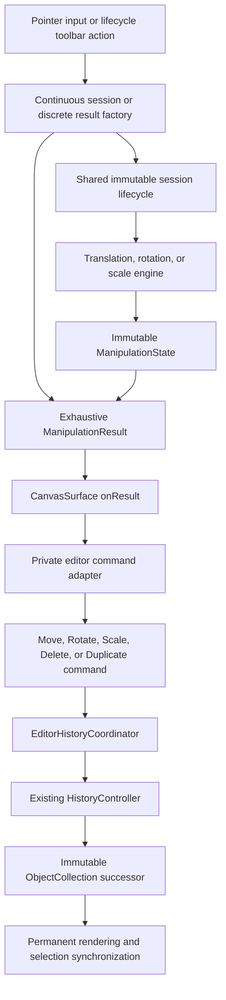
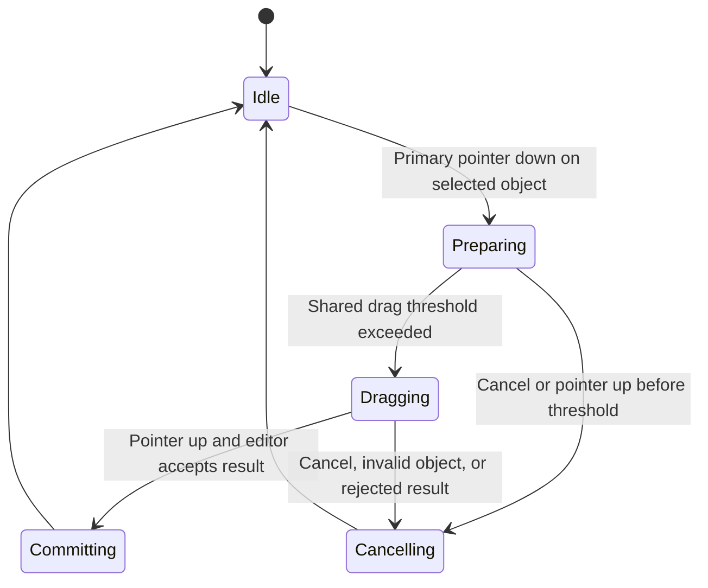
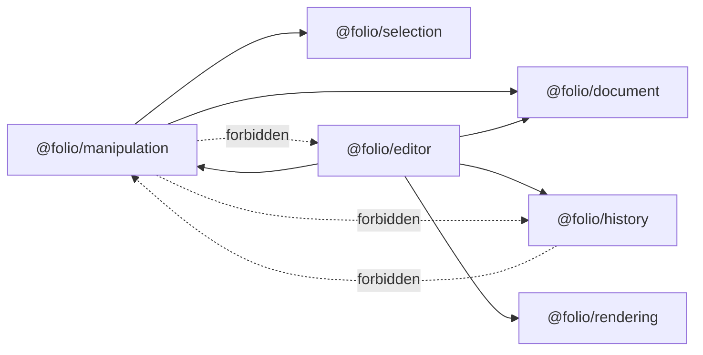

# Phase 12 — Generalized Manipulation Framework

Status: complete and architecture-frozen after Stage 4  
Scope: translation, rotation, uniform scale, deletion, and duplication

## Purpose

Phase 12 preserves the established immutable editing pipeline while making translation, rotation, scale, deletion, and duplication concrete members of one result-to-command architecture:

1. Manipulation owns pointer interaction and immutable session state.
2. Manipulation emits an exhaustive discriminated result with no History behavior.
3. Editor adapts the result into a concrete `EditorCommand<ObjectCollection>`.
4. The existing History controller installs the immutable successor document.
5. Rendering and selection synchronize from document replacement.

History manager/controller behavior, transactions, notification ordering, keyboard undo/redo, and canvas lifecycle remain unchanged.

## Implemented scope

The concrete manipulation families are:

- translation, adapted to `MoveCommand`;
- center-pivot rotation in radians, adapted to `RotateCommand`; and
- center-pivot uniform scale, adapted to `ScaleCommand`;
- selected-object deletion, adapted to `DeleteCommand`; and
- selected-object duplication, adapted to `DuplicateCommand`.

Grouping, multi-selection, resize handles, clipboard operations, persistence, serialization, and other manipulation families are not implemented.

## Architecture



Manipulation depends on Selection and Document for read-only session eligibility and object transform values. It does not depend on Editor or History. Editor is the sole composition layer that knows both the manipulation result and History command contracts.

## Shared interaction lifecycle

The three continuous transform families use one controller, manager, and session state machine. Delete and duplicate are discrete actions and do not create artificial pointer sessions:



Only one session and pointer owner exist at a time. Existence, visibility, lock state, and selection identity are revalidated while the interaction is active. Rotation and scale reject an origin at the exact object center because no angular or radial vector exists there.

The concrete calculations remain origin-relative rather than accumulating event deltas:

- translation is the current point minus the origin point;
- rotation is the normalized angle from the origin center-relative vector to the current vector; and
- scale is the current center-relative radius divided by the origin radius, clamped to the configured absolute scale range.

## Manipulation result contract

`ManipulationResult` is an immutable discriminated union owned by `@folio/manipulation`:

- `TranslationManipulationResult` has `kind: "translation"`, the translation model, and absolute initial/final translations;
- `RotationManipulationResult` has `kind: "rotation"`, the angular delta, and absolute initial/final rotations; and
- `ScaleManipulationResult` has `kind: "scale"`, the scale multiplier, and absolute initial/final scales;
- `DeleteManipulationResult` has `kind: "delete"` and logical session/object identity; and
- `DuplicateManipulationResult` has `kind: "duplicate"` and logical session/object identity.

Every variant also contains the session, object, and timestamp identity from `ManipulationResultBase`. Results contain no document aggregate, command behavior, History state, renderer state, or UI state.

`ManipulationCommit` and the legacy `onCommit` controller option remain source-compatible for translation-only callers. New editor composition uses `onResult`; rotation and scale are intentionally available only through that generalized boundary.

## Editor command adaptation

The private editor adapter exhaustively maps the result union:

```text
translation → MoveCommand
rotation    → RotateCommand
scale       → ScaleCommand
delete      → DeleteCommand
duplicate   → DuplicateCommand
```

The adapter resolves the current immutable object and revision before command construction. `DeleteCommand` retains the exact deleted immutable object and its original index. `DuplicateCommand` invokes `ObjectFactory.cloneObject()` once, then retains the clone and insertion index so redo never regenerates identity. `ObjectCollection.insert()` owns positional reconstruction, validation, z-index normalization, and statistics. No command manipulates collection arrays.

Transform commands retain only identity and operation-specific before/after values. All five commands create new collection/object successors and share the unchanged generic History contracts without introducing a public command hierarchy.

Commands remain unaware of manipulation sessions, rendering, selection, and History stack behavior. The adapter, commands, and coordinator are package-internal; `CanvasSurface` remains the only runtime export from `@folio/editor`.

## Transform and visual synchronization

`@folio/document` applies clockwise rotation in radians and positive uniform scale around the center of the stroke's local inflated bounds. Translation remains page-space. Each transform operation preserves the other transform axes and produces transformed axis-aligned bounds.

The editor supplies the same complete immutable transform to temporary preview and permanent ink rendering. Hit testing inverse-transforms the page point into stroke-local coordinates. Selection stores identity only and refreshes its overlay from the successor object's transformed bounds. Lifecycle replacement clears removed selection identities and selects the new duplicate after the initiating action. No command manipulates rendering or selection directly.

Permanent rendering projects the complete ordered `ObjectCollection` into retained stroke visuals keyed by object identity rather than stroke identity. This permits a duplicate to reuse the exact immutable `Stroke` while remaining independently removable, transformable, and ordered.

`TransformPreviewRenderer` is the generalized demand-driven preview. `TranslationPreviewRenderer` remains a compatibility facade for translation-only callers.

## Frozen-boundary compatibility correction

The pre-Stage-2 `MoveCommand` reconstructed a transform from translation alone. Once non-identity rotation and scale became valid, that would have reset those axes during a later move and broken mixed-command undo/redo. Its transition now preserves the current rotation and scale while changing only translation. Command identity, metadata, validation, History integration, and translation-only behavior are unchanged.

The generic and legacy History implementations themselves are unchanged. Move, Rotate, Scale, History shortcut, transaction, notification, and canvas lifecycle implementations remain unchanged in Stage 3.

The final Stage 4 audit corrected one lifecycle-state defect in `DuplicateCommand`. Undo previously required the retained duplicate to have the same JavaScript object reference created by the command. An intervening transform followed by its undo legitimately reconstructs an equivalent immutable object, so duplication undo now validates the complete logical duplicate state—identity, lifecycle, ordering, stroke, metadata, rendering hints, and transform—without requiring heap-reference equality. History, transaction, adapter, document replacement, and command ordering behavior are unchanged.

## Extension contract

A future manipulation family contributes only:

1. its interaction calculation behind the shared session lifecycle where applicable;
2. one immutable `ManipulationResult` variant with a unique discriminator; and
3. one exhaustive editor-adapter branch that creates its concrete command.

It must not add dependencies from Manipulation to Editor or History or move domain validation into History. No plugin registry, runtime registry, or inheritance framework is part of this contract.

## Dependency rules



## Verification boundary

Final Phase 12 verification covers:

- execute, undo, and redo for rotation, scale, delete, and duplicate;
- mixed translation/rotation and translation/scale histories;
- transaction grouping, redo invalidation, and repeated undo/redo;
- immutable results, commands, objects, and collections;
- stale revision, missing, hidden, locked, and state-mismatch rejection;
- preview, permanent rendering, hit testing, and selection synchronization;
- session/controller cleanup and retained canvas identity;
- translation and public API regressions; and
- unchanged History package behavior and dependency boundaries;
- deterministic delete restoration and duplicate insertion ordering;
- stable duplicate identity across redo and immutable stroke reuse;
- mixed transform/lifecycle and lifecycle/lifecycle histories; and
- lifecycle rendering, selection, toolbar, and Electron integration.
