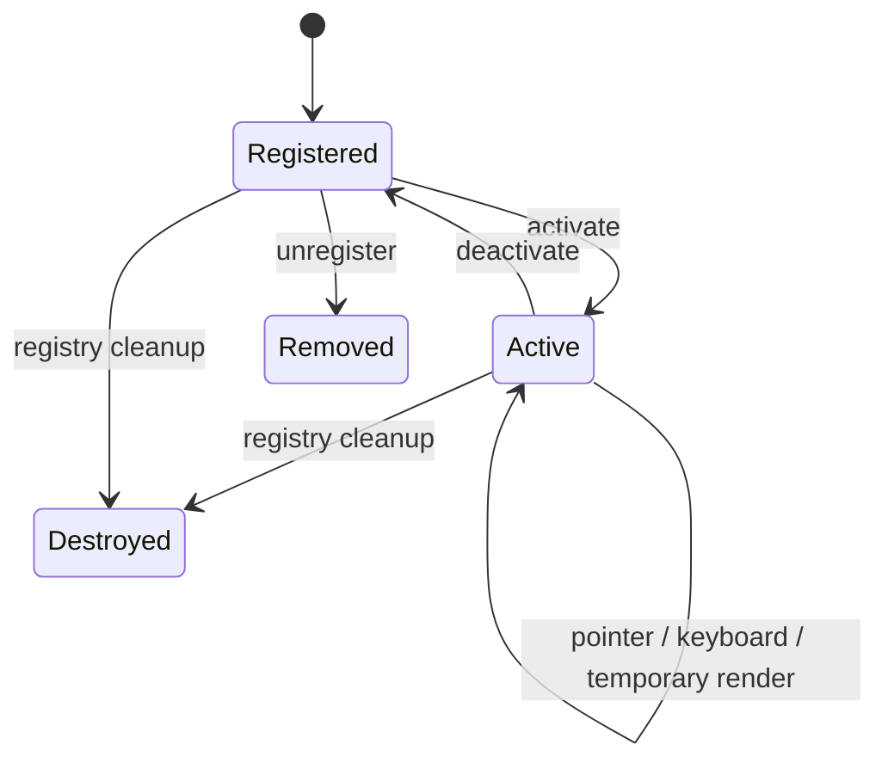
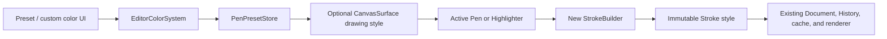
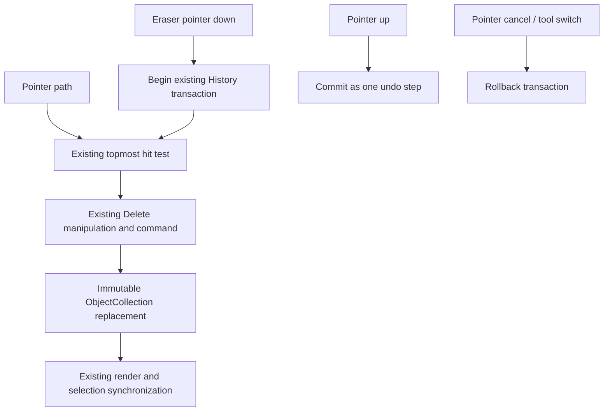

# Phase 14 Editor Foundation

Phase 14 adds reusable editing infrastructure without changing existing document, History, selection, manipulation, rendering, clipboard, ink-fitting, caching, or serialization behavior. `PageObject` remains the common data-only canvas-object abstraction.

## Tool lifecycle

`EditorToolRegistry` owns tool registration, activation, event delegation, cursor selection, temporary-render requests, and cleanup. Switching tools calls deactivation and activation without remounting `CanvasSurface`, rebuilding the renderer, or creating another History controller.

The mounted editor registers:

- Select, Move, Rotate, and Scale adapters over existing interaction behavior;
- Pen and Highlighter adapters over the same `PointerInputController`;
- a whole-stroke Eraser adapter over existing hit testing and Delete commands; and
- Disabled as the safe fallback for future toolbar placeholders.

New tools implement the same lifecycle contract. Their temporary interaction state remains outside `PageObject`.

## Drawing style flow

The color system accepts hexadecimal or RGB input, canonicalizes it, validates opacity, exposes preset colors, and retains a bounded deduplicated recent list. Pen and Highlighter retain independent active presets. Width defaults are 1, 2, 4, 6, 8, 12, and 16 pixels, while the style contract accepts any positive finite width.

The active style is read only when pointer-down creates a builder. Completed strokes retain their own immutable style when presets later change.

Highlighter is not a new document type. It uses wider, pressure-independent, semi-transparent ink through the unchanged stroke, curve-fitting, caching, rendering, selection, manipulation, clipboard, and History pipeline.

## Whole-stroke eraser

Each object is deleted at most once per gesture. Erasing never mutates a stroke, removes points, splits paths, or edits cached curve geometry. Empty and cancelled gestures roll back without adding an undo entry.

## Property descriptors

The backend-only `PropertyDescriptorRegistry` maps `PageObject.type` to a provider. Providers return immutable descriptors containing a stable key, display name, property type, current value, constraints, and validation function.

The Ink provider currently describes stroke color, stroke width, and opacity. No Properties Panel UI exists. Future Shape, Text, and Image types can register providers without adding object-type conditionals to a panel.

## Compatibility guarantees

- Existing `CanvasSurface` callers require no changes; new modes and drawing style are optional.
- Existing `CanvasInteractionMode` values retain their behavior.
- `ObjectCollection`, `ObjectFactory`, `Transform`, History commands, and clipboard logic are unchanged.
- `PageObject` remains the only canvas-object contract.
- Existing ink serialization and document semantics are unchanged.
- No package was moved and no dependency was added.
- Tool switching preserves the mounted canvas, controller, viewport, cache, History session, selection session, and document session.
