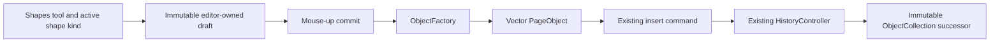

# Phase 15 — Vector Object Foundation

Phase 15 adds exactly three first-class vector `PageObject` types: Line, Rectangle, and Ellipse. It is an additive extension of the accepted document, editor, selection, manipulation, rendering, clipboard, and History boundaries. No existing package dependency or subsystem ownership changes.

## Object architecture

Each vector class composes immutable local geometry, the existing `EditableStyle`, lifecycle metadata, the shared `Transform`, and cached local/transformed bounds. Tool behavior is not stored in an object. `ObjectFactory` creates, clones, translates, rotates, and scales all supported objects; `ObjectCollection` remains the sole immutable ordering and replacement owner.

## Creation and preview

The desktop exposes one Shapes tool whose compact floating widget selects Line, Rectangle, or Ellipse. Pointer-down records page-local start position and the current editor drawing style. Pointer movement creates an immutable draft. Shift snaps lines continuously to 45-degree increments, rectangles to squares, and ellipses to circles, including when Shift changes during a gesture. The existing `TransformPreviewRenderer` draws the draft at full opacity on a controller-owned transparent layer. The draft is never a `PageObject` and never enters History. Shape creation does not expose color, width, or opacity controls; those properties are edited after selection.

An editor-owned DOM measurement beside the cursor displays line length and a positive counter-clockwise angle, or rectangle/ellipse width by height. It is temporary presentation state, disappears synchronously on commit, Escape, pointer cancellation, tool switch, or teardown, and is never serialized. Escape leaves the active Shapes tool and selected shape kind active.

Mouse-up rejects a sub-pixel/degenerate draft or creates exactly one object and executes exactly one existing insert command. The committed object uses the draft's exact geometry/style and is selected immediately.

## Rendering strategy

Finalized vectors use the base renderer's existing ordered overlay-hook seam. The hook receives the renderer's immutable viewport/page input, clips to the page, and draws native Canvas paths (`lineTo`, `rect`, and `ellipse`) from immutable object data. It requests rendering only after document replacement, resize, zoom/pan invalidation, theme updates, or other existing controller invalidation. Creation and manipulation reuse existing demand-driven preview layers; no continuous render loop is added.

Uniform transforms use the existing object pivot and compensate only Canvas stroke width so geometry scales while the configured vector stroke width remains stable. Rendering reads document state but never mutates it or imports History, Selection, Clipboard, or Manipulation.

## Selection and manipulation reuse

The Selection package keeps its linear cached-bounds broad phase and object-specific vector geometry tests. The editor hit-test adapter makes rectangles and ellipses selectable anywhere inside their transformed geometry while lines retain a forgiving outline tolerance. Local geometry is tested after inverse application of the shared object transform. Selection state remains identity-only.

An editor-owned, demand-driven interaction overlay supplies hover emphasis without changing logical selection. Selected lines render their actual highlighted path with endpoint and midpoint handles instead of a rectangular selection box. Rectangles and ellipses retain the established transform handles and receive a subtle outline emphasis. Hover and selection presentation are temporary and never enter the document or History.

## Phase 15R editing refinement

A mounted desktop shape-editing toolbar is shown only for one selected Line, Rectangle, or Ellipse. It is positioned next to the selected object, clamped inside the workspace viewport, and placed above or below the object to avoid covering it where space permits. Switching directly between supported vector selections updates the mounted toolbar rather than recreating it.

Stroke color, width, and opacity changes create immutable successor objects through an editor-owned `UpdateVectorStyleCommand`. The command validates identity, revision, visibility, lock state, and expected style, then delegates document replacement to existing `ObjectFactory` and `ObjectCollection` operations. Each accepted edit is one existing History operation and therefore supports undo, redo, deterministic serialization, rendering synchronization, and selection synchronization. Duplicate and Delete reuse their existing lifecycle actions. More is a non-functional placeholder in this phase.

Move, Rotate, Scale, Delete, Duplicate, Copy, Paste, Undo, and Redo reuse the accepted PageObject commands and generalized manipulation-result adapter. The only command changes broaden supported targets from `InkObject` to the four concrete PageObject implementations; command lifecycle, transaction behavior, notifications, and History internals are unchanged.

## Serialization

`serializeVectorObject()` and `deserializeVectorObject()` use the existing version-1 `SerializedPageObject` envelope. Payloads contain only immutable geometry and style. Transform, bounds, lifecycle, metadata, visibility, locking, and ordering use the common envelope. Preview, measurements, selection, active tool, clipboard, and History state are excluded.

## Boundaries and exclusions

- Implemented: Line, Rectangle, Ellipse/Circle.
- Not implemented: fill UI, corner radius, dash styles, arrowheads, smart guides, snapping, alignment, measurement persistence, geometry editing, Bézier editing, text, images, or new panels.
- Unchanged: History engine, transactions, manipulation engine, ink engine, curve fitting/cache, rendering package, package graph, notebook persistence, and existing public API behavior.
