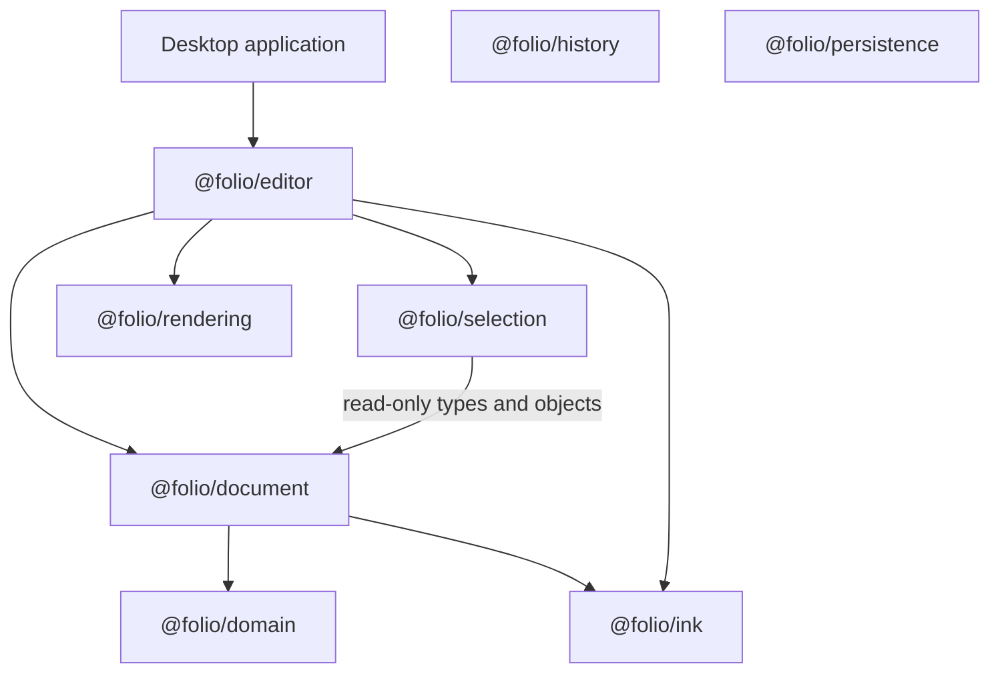
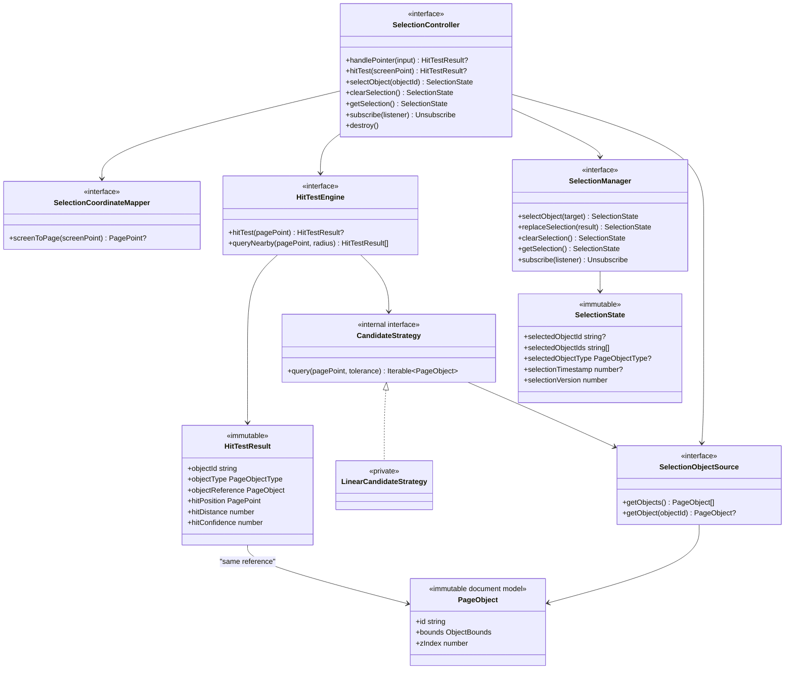
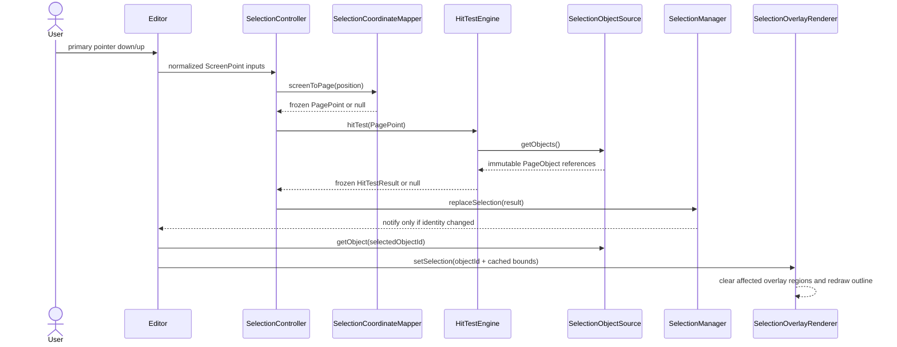
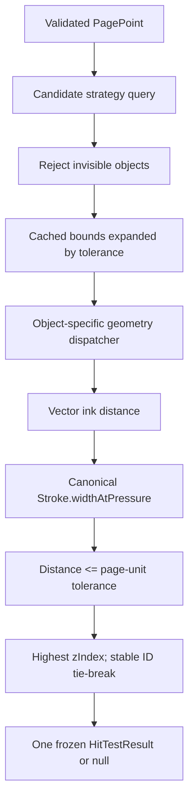
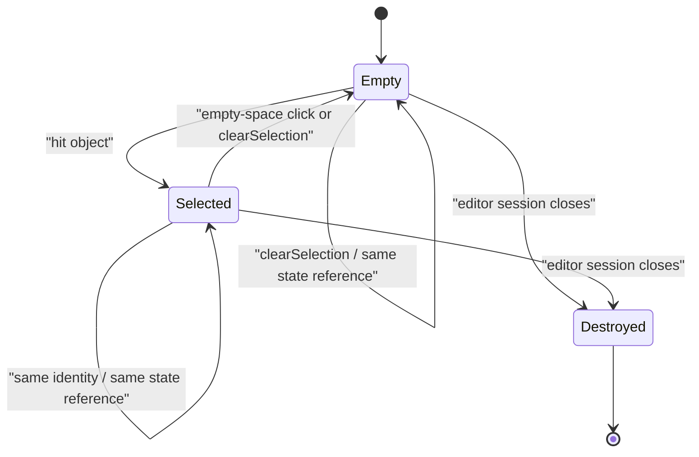

# Phase 9 Selection Architecture

Status: frozen Phase 9 release candidate. This document is the validated architectural contract for selection and hit testing in later editor phases.

## Architecture overview

Selection is a transient editor interaction concern. It translates a completed pointer click into a page-space query, resolves the top-most immutable document object, and owns an immutable identity-only selection state. It never changes notebook data, renders pixels, creates history entries, or persists state.

The editor is the composition boundary. It provides normalized pointer input, adapts the rendering engine's canonical coordinate conversion to selection's coordinate interface, exposes the active immutable object collection, and translates selection state into a renderer-owned overlay target.

## Package responsibilities

| Component | Owns | Must not own |
| --- | --- | --- |
| `@folio/selection` | Pointer-click interpretation, page-space hit queries, selection identity state, change notifications | React, Electron, canvas drawing, viewport math, document mutation, history, persistence |
| `@folio/editor` | Composition, browser-event normalization, screen-to-page adapter, active session wiring | Hit geometry, canvas drawing, notebook persistence |
| `@folio/document` | Immutable page objects, cached bounds, stable object identities | Selection state or pointer workflows |
| `@folio/ink` | Immutable stroke data and the canonical pressure-to-rendered-width contract | Selection state or object discovery |
| `@folio/rendering` | Page and overlay drawing, viewport/camera transforms, HiDPI canvas lifecycle | Selection decisions or document mutation |
| `@folio/history` | Reversible notebook commands | Selection session state |
| `@folio/persistence` | Durable notebook storage | Selection session state |

The Selection package's only production package dependency is `@folio/document`. `@folio/ink` is a development-only dependency used to build realistic immutable test fixtures. There are no production dependencies from Selection to Rendering, React, Electron, History, Persistence, or application UI packages.

## Dependency graph



History and Persistence are intentionally unconnected because Selection has no dependency on either. Rendering does not read or call Selection. The editor supplies rendering with the minimal immutable overlay target `{ objectId, bounds }`.

## Package structure

```text
packages/selection/
├── src/
│   ├── controller/       Private pointer-workflow implementation
│   ├── manager/          Private selection-state owner
│   ├── hit-testing/      Private broad phase, geometry, and engine implementation
│   ├── interfaces/       Stable editor-facing contracts
│   ├── model/            Coordinate and hit-result contracts
│   ├── state/            Immutable identity-only state construction
│   ├── __tests__/        Contract, edge-case, scale, and immutability tests
│   └── index.ts          Deliberate public package boundary
└── README.md             Package-level operating guide
```

## Class diagram



Concrete controller, manager, hit-test engine, and candidate-strategy implementations are not exported from the package barrel. Factories return their public interfaces.

## Pointer-to-selection sequence



Moves, cancelled pointers, non-primary pointers, and non-left-button sequences never enter the hit/replace portion of the sequence. An empty-page hit resolves to `null` and clears the current selection.

## Public API

The runtime API deliberately contains only three factories and one immutable default configuration:

| Runtime export | Contract |
| --- | --- |
| `createSelectionController(options)` | Composes pointer interpretation, coordinate mapping, hit testing, and state replacement; returns `SelectionController` |
| `createSelectionManager(options?)` | Creates the isolated owner of selection state; returns `SelectionManager` |
| `createHitTestEngine(options)` | Creates a deterministic vector query engine; returns `HitTestEngine` |
| `DEFAULT_HIT_TEST_CONFIGURATION` | Frozen centralized page-space tolerance defaults |

The package also exports TypeScript-only interfaces and immutable data contracts: `SelectionController`, `SelectionManager`, `HitTestEngine`, their option interfaces, `SelectionCoordinateMapper`, `SelectionObjectSource`, normalized pointer types, explicit coordinate-point types, `SelectionTarget`, `SelectionState`, `HitTestConfiguration`, and `HitTestResult`.

No concrete implementation, geometry utility, broad-phase strategy, or state-construction function is part of the package API. A public-API test locks the runtime surface.

## Coordinate systems

```mermaid
flowchart LR
    Screen["Screen / CSS client pixels"] -->|"canvas DOM bounds and logical-size ratio"| Canvas["Canvas logical pixels"]
    Canvas --> Viewport["Viewport logical pixels"]
    Viewport -->|"inverse camera pan and zoom"| World["World units"]
    World -->|"subtract active page origin"| Page["Page-local units"]
    Page --> HitTest["HitTestEngine"]
```



`PageSelectionCoordinateMapper` lives in `@folio/editor` and delegates to `@folio/rendering`'s `CoordinateConverter`; it does not duplicate camera formulas. It rejects unusable canvas bounds and points outside the active page. Selection receives only a frozen `PagePoint` carrying `coordinateSpace: "page"`.

Device pixel ratio affects only the physical canvas backing store. Pointer coordinates, viewport size, camera transforms, overlay bounds, and hit tolerance remain logical/page units, so DPR changes do not alter hit results. Pan and zoom are consumed by the canonical inverse viewport transform before the hit engine runs.

The configured hit tolerance is intentionally measured in page units, as required by Phase 9. If a later tool needs a screen-constant tolerance for a particular pointer type, the editor must convert that tool's screen tolerance to page units before configuring/querying Selection; the hit engine must not acquire a rendering dependency.

## Hit-testing pipeline



The broad phase is replaceable behind the internal `CandidateStrategy` interface. The current implementation performs a linear scan and bounds rejection. A quadtree, R-tree, or spatial hash can replace it without changing `HitTestEngine`, `SelectionController`, or editor code.

Ink geometry uses vector distance rather than pixels or canvas readback. Single-point strokes are circles. Multi-point strokes use the shortest distance to each segment minus the average endpoint radius. Segment projection uses `Math.hypot` and a normalized direction vector, avoiding squared-length overflow and handling zero-length segments explicitly. Pressure widths come from the immutable Stroke API shared with ink rendering.

For `hitTest`, no result object is allocated per candidate: the engine retains only the current top-most object reference and distance, then creates one immutable result. `queryNearby` necessarily allocates one result per qualifying hit and returns a frozen, deterministically sorted array.

The current linear broad phase is appropriate for thousands of objects because cached bounds reject most objects before stroke traversal and it never copies the object collection. Spatial indexing remains the planned optimization when measured notebook workloads justify it.

## Selection lifecycle



`SelectionState` stores only stable IDs, type, timestamp, and monotonic version. `selectedObjectIds` is a frozen array reserved for future multi-selection and currently contains zero or one ID. A `HitTestResult` may carry the canonical immutable object reference for immediate inspection, but the manager extracts identity and never retains that reference in state. Re-selecting the same ID and type returns the exact previous state reference and sends no notification.

Selection is session-only. It has no serialization boundary and is discarded with the editor session. It does not enter notebook JSON, autosave, recovery, or history snapshots.

## Rendering integration

Selection owns no colors, paths, canvases, render scheduling, or invalidation logic. The renderer owns a transparent, pointer-events-disabled overlay layer independent of the page and ink canvases. The editor converts a selected identity into a minimal target using the document object's cached bounds.

Changing selection clears the old and new bounds as separate dirty regions and redraws only the overlay. Intersecting dirty regions are merged; a bounded region budget falls back to a full overlay clear. Repeated identical target/bounds input does not invalidate. Page rendering is never requested by a selection-only change.

## Extension points

- **Move, resize, and rotation:** future tools can read selected identities and resolve canonical objects through `SelectionObjectSource`. They must create document/history operations outside Selection. Transform handles remain renderer-owned overlays.
- **Clipboard:** clipboard commands can consume selected IDs without adding serialized data or copied objects to `SelectionState`.
- **Multi-selection:** `selectedObjectIds` and identity-oriented manager/controller contracts provide the state shape; later phases may add additive/toggle operations without changing hit testing.
- **Lasso and rectangle selection:** region tools can use `queryNearby` or a future region-query interface backed by the same candidate strategy. They belong in future controllers, not the single-click engine.
- **Future object types:** the private geometry dispatcher can add shape, text, image, or group testers while the public `HitTestResult` and controller interfaces remain stable.
- **Spatial indexing:** replace `LinearCandidateStrategy` internally with a quadtree, R-tree, or spatial hash. Index ownership and invalidation will be coordinated with immutable document aggregate replacement.

These are architectural seams only. Phase 9 implements none of the future behaviors listed above.

## Design rationale

1. **Interfaces plus factories** keep editor code independent of concrete algorithms and prevent accidental implementation coupling.
2. **Identity-only state** preserves document immutability, avoids object copies, and establishes clean history, persistence, and collaboration boundaries.
3. **Injected coordinate and object sources** keep Selection deterministic and framework-independent while allowing the editor to use current viewport/document state.
4. **Page-space geometry** makes hit testing independent of canvas resolution and rendering implementation.
5. **Vector hit testing with cached bounds first** is accurate for ink and inexpensive for common misses.
6. **A private candidate strategy** allows measured spatial optimization later without premature index complexity now.
7. **A separate renderer-owned overlay** isolates visual invalidation and prevents selection changes from repainting the page.
8. **Immutable results and no-op repeated selection** make notifications predictable and avoid unnecessary React/editor work.

## Validated invariants

Automated tests cover overlapping z-order, rendered-width tolerance and exact boundaries, single-point strokes, hidden and locked objects, empty documents, invalid inputs and IDs, repeated selection reference stability, selection clearing, immutable state/results, zoom, pan, HiDPI independence, overlay-only invalidation, canvas retention, session reset, and a 5,000-object linear query. Package type checks and the root lint/build/end-to-end/package verification guard the architectural boundaries described here.
