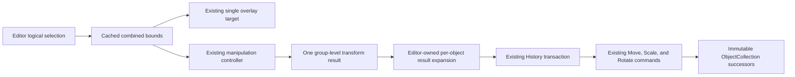

# Phase 13.1 — Core Editor Interaction Polish

Status: implemented as a narrow interaction refinement over the frozen Phase 13 architecture.

Phase 13.2 subsequently replaces the `move`/`crosshair` presentation below with open/closed-hand and circular-rotation cursors and enlarges handle targets. See `PHASE13_2_FINAL_EDITOR_UX_POLISH.md` for the current interaction values.

## Scope

Phase 13.1 adds only:

- manipulation cursors over the active selection overlay;
- constant rendered pen width during object scaling; and
- grouped Move, Scale, and Rotate after Select All.

History, commands, document structures, transforms, Selection, clipboard ownership, package exports, and package dependencies remain unchanged. The sole core exception is width-only compensation inside `StrokeRenderer`; geometry continues to use its existing canvas transform.

## Cursor behavior

The editor uses the existing selection-handle geometry to resolve hover feedback:

| Hover target | Cursor | Drag behavior |
| --- | --- | --- |
| Selection or group interior | `move` | Translation |
| Top-left or bottom-right corner | `nwse-resize` | Uniform scale |
| Top-right or bottom-left corner | `nesw-resize` | Uniform scale |
| Rotation handle | `crosshair` | Rotation |
| Outside the selection | `default` | No manipulation |

Hover does not modify selection, execute commands, or change History. Calculations are page-space and zoom-aware. Active drags retain their current cursor without repeating hover hit tests.

## Constant-width scaling

Document scaling remains represented by the unchanged `Transform.scale` value and unchanged `ScaleCommand`. `StrokeRenderer` continues applying the complete transform to stroke geometry. Before drawing a finalized transformed stroke, it derives an internal immutable style whose width is divided by that transform scale. Canvas then scales that width together with geometry, producing the original effective thickness.

Only this transient rendered width is compensated. The source `Stroke`, pressure behavior, style width, object transform, immutable document aggregate, bounds semantics, undo/redo state, and renderer dependencies remain unchanged. Dirty bounds retain the scaled centerline geometry but use constant stroke padding so shrinking a stroke cannot leave uncleared pixels.

## Group manipulation

The Phase 13 editor logical-selection set remains the group owner. A private geometry cache resolves selected objects in document order and computes their combined axis-aligned bound only when the immutable document reference or selection identity array changes.

### Move

The group translation vector is applied unchanged to every selected object through existing Move commands. Relative positions are preserved. All commands commit as one transaction and one undo step.

### Scale

Every object scale is multiplied by the group factor through existing Scale commands. Each object center is also moved away from or toward the combined center by that factor through existing Move commands. Object rotation, immutable stroke geometry, style, and relative layout remain intact. The complete operation is one transaction.

### Rotate

The group delta is added to every object rotation through existing Rotate commands. Object centers rotate around the combined bound center through existing Move commands. Distance from the group center and relative arrangement are preserved. The complete operation is one transaction.

The Manipulation package still emits only its existing result variants. Its command adapter remains unchanged. The editor performs group expansion before submitting ordinary results to its existing History coordinator.

## Selection and rendering boundaries

The Selection package continues owning one primary identity and pointer hit testing. The editor supplies combined bounds to the unchanged selection overlay API. Context-menu Select All and `Ctrl+A` both populate the same logical group.

Rendering remains document-driven. Permanent ink changes only after immutable document replacement. Rendering receives no History, Selection, Clipboard, command, or transaction state.

## Verification coverage

Unit and integration coverage includes cursor resolution for every handle, geometry-cache reuse, combined bounds, per-object group-result expansion, one-step transactions, group undo/redo, relative-position preservation, repeated scaling, and width compensation without style mutation.

Electron coverage uses real pointer input to verify hover cursors, combined selection bounds, grouped Move/Scale/Rotate, undo/redo, relative centers, unchanged document stroke width, and constant rendered pixel thickness after scaling. Existing clipboard context-menu coverage verifies that context-menu Select All creates the same group state.
