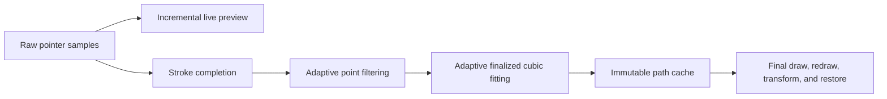

# Phase 13.2.1 — Professional Ink Engine Refinement

## Scope

Phase 13.2.1 improves only the private ink-processing and finalized rendering-quality path. Editor behavior, document and stroke aggregates, History, commands, selection, manipulation, clipboard, Canvas lifecycle, package boundaries, and public APIs remain unchanged.

## Two-stage pipeline

Live ink continues to draw only the newly invalidated tail through the one-shot render scheduler. It performs no finalized fitting and creates no idle repaint loop. Completed ink is filtered and fitted once, then rendered from cached cubic segments.

## Adaptive processing

- Filtering combines page-relative distance, turn angle, elapsed time, geometric deviation, and velocity change. Slow motion retains more detail; rapid dense input sheds redundant samples.
- The original first and last samples are retained by identity. Pointer capture now keeps raw endpoint coordinates for the finalized fit.
- Phase 13.2.2 refines the finalized fitter to use centripetal parameterization, error-tolerance multi-point segmentation, explicit corner boundaries, and curvature-aware tangent limits.
- Controls may extend beyond an adjacent endpoint rectangle when required for continuity. Local arc-length limits plus bounds and self-intersection guards constrain unsafe overshoot without forcing staircase-shaped cubics.

## Cache and lifecycle

`StrokeRenderer` owns a weak cache keyed by immutable `Stroke` references. One stroke therefore has one fitted path even when multiple document visuals share it. Redraw, resize, move, rotate, scale, duplicate visuals, removal, and undo/redo restoration reuse the cached path. Weak keys avoid retaining strokes after both the editor and History release them.

Renderer diagnostics expose source count, filtered count, fitted segment count, and lifetime path-build count through canvas data attributes for regression and Electron verification. These diagnostics do not extend the package public API.

## Verification coverage

Unit coverage exercises adaptive filtering and sampling, endpoint and corner preservation, small and large writing, bounded cubic geometry, dots, short strokes, a 10,000-point performance case, cache sharing, repeated redraw and transforms, removal/restoration, and raw pointer endpoints. Electron coverage draws small handwriting, a long curve, rapid scribbling, and a continuous loop; checks endpoint pixels and lack of idle repainting; and verifies cache reuse through undo/redo and resize.
