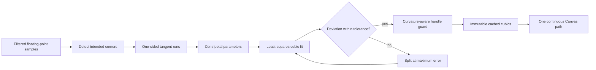

# Phase 13.2.2 — Professional Ink Curve Fitting Refinement

## Scope

Phase 13.2.2 changes only renderer-private finalized ink geometry generation and Canvas path submission. It does not modify pointer interaction, immutable strokes, document objects, History, commands, selection, manipulation, clipboard, serialization, package boundaries, or public APIs.

## Finalized fitting pipeline

The fitter assigns no fixed point count to a curve. A long smooth run may become one or a few cubics, while local detail subdivides at the sample with maximum geometric error. The adaptive tolerance remains below one page unit and is derived from sample spacing and stroke extent. This removes quantized staircase detail without globally increasing smoothing strength.

## Handwriting preservation

- First and last `StrokePoint` references remain the exact fitted endpoints.
- Direction changes above the corner threshold form explicit boundaries. The incoming and outgoing runs use one-sided tangents, so letters such as V, W, M, N, and A do not become rounded blobs.
- Recursive subdivisions share a center tangent, producing continuous tangent direction along naturally smooth portions.
- Control points are no longer clamped to the axis-aligned rectangle between two adjacent samples.
- Least-squares handle lengths are limited by local arc length and endpoint curvature. Sampled bounds and self-intersection guards shrink only unsafe handles, allowing valid controls to flow beyond an endpoint rectangle.

## Rendering and cache behavior

Finalized rendering now issues one `beginPath()`, one initial `moveTo()`, every cached `bezierCurveTo()`, and one `stroke()` for the complete stroke. Canvas therefore joins fitted cubics as one path instead of rasterizing independently capped pieces.

`StrokeRenderer` continues to cache the immutable fitted result in its existing weak cache. Zoom, pan, redraw, resize, move, rotate, scale, duplicate visuals, undo, and redo do not refit geometry.

## Verification coverage

Unit coverage includes adaptive segmentation, approximate geometric error, corners and small W-shaped writing, tangent continuity, controls beyond endpoint rectangles, loop detection, endpoints, fast and slow input, long arcs, 10,000-point performance, one-path Canvas submission, 800% camera-zoom redraw, transform reuse, and cache lifetime. Electron coverage retains the real-handwriting, long-curve, rapid-scribble, continuous-loop, endpoint-pixel, undo/redo, and repeated-resize/redraw scenarios. The current shell exposes no camera-zoom interaction, so the exact 800% case remains verified at the renderer boundary without adding out-of-scope Canvas behavior.
