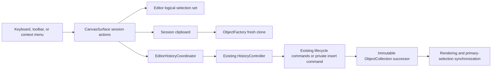

# Phase 13 — Clipboard and Editing Workflow

Status: implemented and verified as an editor-session workflow.

## Scope and ownership

Phase 13 adds Copy, Cut, Paste, multi-object Duplicate, Select All, Delete/Backspace, and a desktop context menu. Clipboard data and the logical multi-object selection are private to `@folio/editor`. They are not stored in History, Document, Persistence, Manipulation, Selection, Rendering, Electron main-process state, or the operating-system clipboard.

The frozen core packages remain unchanged. Existing immutable `ObjectCollection` transformations and `ObjectFactory` cloning are reused. Existing Delete, Duplicate, and Move commands remain the lifecycle primitives for those actions. A private insert command adds already-cloned paste objects through the same generic History contract.

## Editing flow

Copy ends at the clipboard and does not enter History. Cut, Paste, Duplicate, and Delete enter the existing controller. Multi-object operations use one transaction, so one undo or redo applies the complete group atomically.

## Clipboard rules

- The clipboard stores an immutable ordered array of existing immutable `PageObject` references. It does not deep-copy stroke point arrays during Copy.
- Empty selection leaves existing clipboard contents unchanged.
- Copy and Cut replace clipboard contents and reset the paste ordinal.
- Paste clones each object through `ObjectFactory.cloneObject()`, producing a fresh document identity and timestamps while preserving type-specific content, transform, visibility, lock state, style/rendering hints, and metadata.
- Each paste applies one common page-space offset to the complete group: `20` units for the first paste, `40` for the second, `60` for the third, and so on. A common offset preserves relative spacing.
- A prepared paste advances the ordinal only after its History transaction succeeds.
- Undo and redo never modify clipboard contents or its current ordinal.
- Clipboard contents are cleared when the mounted editor session is destroyed.

Clipboard content is intentionally internal-only. Native cross-application clipboard formats, serialization, persistence, assets, and Electron IPC are outside Phase 13.

## Selection behavior

The existing Selection package remains the single-primary-selection and pointer hit-testing authority. Phase 13 does not widen `SelectionState` or change the selection overlay renderer.

An editor-owned ordered identity set provides logical multi-selection for editing workflows:

- pointer selection collapses the set to the selected primary object;
- Select All includes every visible, unlocked document object in document order;
- Copy preserves selection;
- Cut and Delete clear selection after success;
- Paste and Duplicate select the newly created group;
- right-clicking an object outside the logical set selects only that object;
- right-clicking a member of the logical set preserves the group;
- right-clicking blank page space clears selection; and
- immutable document replacement reconciles identities that no longer exist.

The final identity in the set is projected into the unchanged primary selection controller and overlay. Editor diagnostics expose the complete selected count and ordered identity list for integration testing.

## Commands and transactions

| Workflow | History behavior | Document primitives |
| --- | --- | --- |
| Copy | No History entry | None |
| Cut | One transaction containing one Delete command per selected object | `ObjectCollection.remove()` |
| Paste | One transaction containing one private insert command per prepared clone | `ObjectFactory.cloneObject()`, `ObjectCollection.insert()` |
| Duplicate | One transaction containing existing Duplicate and Move commands per selected object | Existing clone, insert, and replace operations |
| Delete | One transaction containing one Delete command per selected object | `ObjectCollection.remove()` |

History remains model-neutral. Commands own document validation. Rendering receives only immutable document replacement and never receives clipboard or command state directly.

## Input bindings

| Input | Action |
| --- | --- |
| `Ctrl+C` | Copy |
| `Ctrl+X` | Cut |
| `Ctrl+V` | Paste |
| `Ctrl+D` | Duplicate |
| `Ctrl+A` | Select All |
| `Delete` or `Backspace` | Delete selection |
| `Ctrl+Z` | Existing undo |
| `Ctrl+Shift+Z` or `Ctrl+Y` | Existing redo |

Editing shortcuts ignore composing, already-handled, Meta/Alt-modified, and editable-target events. Browser defaults are prevented only after Folio handles the requested action. Key repeat naturally repeats supported actions while their preconditions remain true.

The right-click menu exposes Copy, Cut, Paste, Duplicate, Delete, and Select All. It calls the same session action object as the keyboard and desktop toolbar; it does not construct commands or own document state.

## Lifecycle and failure guarantees

One clipboard, logical selection set, editing-shortcut listener, context-menu listener, History controller, and document session exist per mounted `CanvasSurface`. No workflow creates a second manager or controller. Teardown unregisters every listener and clears editor-local state.

Command or transaction failure returns `false` to the initiating UI boundary and reports the normalized error through `CanvasSurface.onError`. The clipboard paste ordinal advances only after successful execution. History owns atomic rollback and stack consistency; the editor does not mutate document collections directly.
