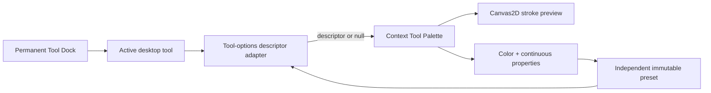
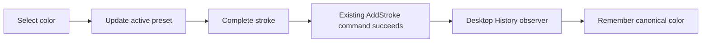

# Phase 14.1 — Tool Dock and Context Palette

Status: implemented as a desktop presentation refinement over the frozen Phase 14 editor foundation.

## Scope

Phase 14.1 changes only desktop tool presentation, drawing-style interaction, recent-color timing, and reload-key safety. History, transactions, commands, documents, `PageObject`, Selection, Manipulation, Clipboard, rendering architecture, Ink, curve fitting, caching, editor tool-registry contracts, serialization, public exports, and the package graph remain unchanged.

## Stable Tool Dock

The editor uses a permanent floating vertical Tool Dock at the left center of the workspace. Its 48-by-420-pixel container remains mounted and contains Select, Pen, Highlighter, Eraser, future Shape/Text/Image launchers, Duplicate, Delete, and a fixed More entry for future actions.

The Tool Dock does not resize, expand, collapse, scroll, or move when tools or settings change. Its buttons share consistent 36-pixel targets, icon sizing, spacing, separators, focus treatment, active styling, and subtle hover/press feedback.

## Descriptor-driven Context Tool Palette

Configurable tools are described by a private desktop adapter registry built on the existing `EditablePropertyDescriptor` contract. Pen and Highlighter use one shared provider factory; the palette maps descriptor keys to reusable property renderers instead of branching on the active tool. The frozen editor Tool Registry remains responsible for interaction lifecycle and is unchanged.

The 304-pixel Context Tool Palette floats immediately beside the dock. Activating Pen or Highlighter fades and slides it horizontally into view over 180 milliseconds. Selecting a tool without options animates it out. Direct Pen-to-Highlighter switches retain the same mounted palette container and animate only its descriptor-driven contents over 150 milliseconds.

This provider boundary is ready for future Shapes, Text, and Images to contribute descriptors without changing the palette renderer. Those object types and tools are not implemented in this phase.

## Continuous drawing controls

Pen and Highlighter expose current color, recent colors, the shared palette, a native custom-color picker, hexadecimal input, continuous width, continuous opacity, and a live preview.

Width accepts floating-point values from 0.5 to 30 pixels in 0.1-pixel increments. Opacity uses one-percentage-point increments. Pen accepts 10–100%; Highlighter accepts 10–45%, so its wide, pressure-independent translucent identity cannot become visually identical to Pen.

Each continuous control supports:

- smooth range dragging with an enlarged hit target and animated thumb;
- immediate preview and canvas-style updates;
- direct numeric entry;
- arrow-key adjustment;
- a larger Shift+Arrow increment;
- wheel adjustment while hovered; and
- double-click reset to the active tool's default.

Pen and Highlighter retain independent color, width, opacity, pressure, and preset state while switching among tools.

## Live stroke preview

The preview is a HiDPI Canvas2D surface rather than an SVG or placeholder image. It follows the finalized ink renderer's drawing sequence: device-pixel-ratio scaling, saved context state, multiplicative opacity, configured stroke color and width, round caps and joins, and a cubic `bezierCurveTo()` path. Pen and Highlighter therefore use the same drawing semantics and immutable style values as the editor without coupling the desktop package to Ink internals.

## Recently used colors

Selecting a palette, custom, or recent color only updates the active tool configuration. It does not change recent colors.

The desktop records the current canonical color only after a successful add-stroke execute notification. Entries remain deduplicated, most-recent-first, and bounded by the existing color-system limit.

## Reload-key safety

Electron intercepts `Ctrl/Cmd+R`, including the shifted variant, and `F5` at the `before-input-event` boundary. These gestures cannot reload the renderer and discard the current in-memory document. Undo, redo, clipboard, selection, editing, and text-input shortcut behavior remain unchanged.

## Performance and verification

The Tool Dock and palette are overlay presentation components and do not participate in document rendering. The descriptor registry is created once per workspace, active styles are memoized, direct configurable-tool switches retain the palette container, and the existing canvas remains mounted. Controls update only preset/UI state until normal editor interaction consumes the style.

Unit coverage locks descriptor immutability, configurable-tool registration, continuous ranges, Highlighter defaults and opacity limits, and drawing-style validation. Electron coverage verifies fixed dock dimensions, absence of scrolling, palette entry/exit and mounted-container continuity, rapid switching, Canvas2D preview use, mounted-canvas continuity, arbitrary width and opacity input, keyboard/wheel/reset behavior, independent tool state, actual-use recent colors, capped Highlighter strokes, reload-key safety, drawing, undo/redo, and minimum-window resizing.
