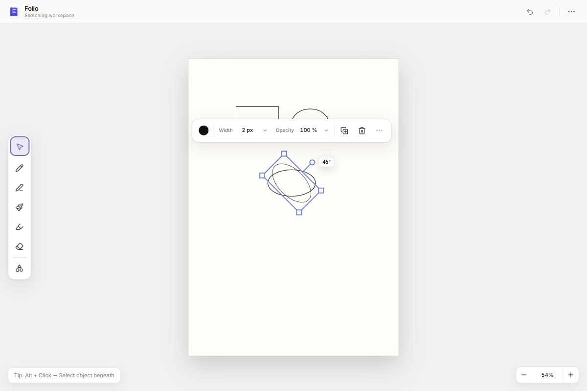

# Post-Phase-17 UX Polish

## Status and scope

This corrective pass is complete. It resolves the visible editor issues found during manual QA after Phase 17 without beginning Phase 18 or changing the accepted brush, document, History, viewport, persistence, or rendering architectures.

## QA findings and fixes

### Brush cursor boundary

The brush ring was already page-aware, but the active brush tool still supplied `cursor: none` as the canvas-wide base cursor. This could hide the native pointer over the empty workspace around the page.

The canvas now uses a normal arrow as its brush-tool base cursor. Its existing frame-coalesced imperative presentation applies `cursor: none` only when the latest mouse/pen position is inside the drawable page and the brush ring is eligible. Leaving the page, entering floating or shell UI, switching tools, or receiving touch input hides the ring and restores the arrow. A pan-state observer hides the ring without overriding the existing grab/grabbing cursor. Pointer position remains outside React state.

### Global tooltip collision

The shared tooltip portal previously positioned from the preferred side without measuring the tooltip or checking viewport edges. The provider now measures the rendered tooltip and resolves top, right, bottom, or left placement through one central collision algorithm. It uses 10 CSS px viewport padding, a 12 CSS px anchor gap, preferred/opposite/perpendicular candidates, cross-axis clamping, and a final clamped fallback.

The body portal and activation-suppression lifecycle remain intact. The tooltip layer now sits below the existing dialog layer, so modal content remains authoritative.

### Preset dropdown

The native Windows `<select>` was replaced with the existing Folio/Radix dropdown primitives. The trigger and menu use Folio surfaces, collision padding, a selected accent state and checkmark, and the established floating-layer stack. Pointer selection, trigger-based Up/Down navigation, Enter, Escape, outside dismissal, and trigger focus restoration are covered in Electron.

The portaled menu is explicitly marked as owned by its floating tool widget. The existing outside-dismissal hook recognizes that boundary, so clicking a preset closes only the dropdown rather than dismissing the complete options palette.

Preset ownership and behavior did not change: the chosen preset resets size, opacity, and smoothing to its defaults while preserving the user's current color.

### Shapes activation policy

Shapes no longer has an unarmed crosshair state. The remembered subtype initially defaults to Rectangle. Activating Shapes immediately arms the remembered subtype and opens the chooser with that subtype highlighted. Selecting Line, Rectangle, or Ellipse updates the remembered value. Switching away ends the interaction but retains it; returning rearms it. Toggling or dismissing the chooser does not disarm the subtype, so drawing is always immediately productive.

Rectangle and Ellipse constraint hints, line behavior, shape style, creation geometry, selection, manipulation, and History remain on their existing paths.

## Rotated-selection audit and result

The audit found that an oriented single-vector selection frame was feasible as an additive presentation/manipulation improvement:

- Rectangle and Ellipse objects already retain immutable local bounds plus a center-pivot `Transform` containing translation, rotation, and uniform scale.
- The vector interaction overlay already renders vector feedback in transformed local coordinates.
- Rotation and uniform scale already use the object's center, so no manipulation engine or state-machine redesign was required.
- Line already has specialized endpoint/midpoint controls and could remain separate.
- Ink and multi-object selections still require their existing aggregate axis-aligned bounds.

One shared oriented-frame resolver now derives padded transformed corners, the top midpoint, and the rotation handle from local bounds and the preview or committed transform. The vector overlay draws the border, corner handles, stem, and rotation handle from that geometry. The frame interior remains transparent so the selected shape's live color stays visible.

Hover and pointer-down hit testing use the same oriented handle points. Translation testing inverse-transforms the pointer into local space. Uniform resize remains radial around the same object center, and the frame follows the transient transform preview. The contextual toolbar receives the oriented center, width, height, and rotation and includes the rotated controls in collision placement. Generic selection rendering remains in place for ink and groups; Line keeps its specialized representation.

The result is a true oriented manipulation frame rather than a rotated visual around axis-aligned hit targets. Rotating an object no longer expands the visible frame solely because its AABB grew.

## Rotation feedback

During an active Rectangle/Ellipse rotation, an imperative frame-coalesced angle bubble appears beside the current rotation handle. It displays page-relative rotation normalized to `0°–359°` and disappears on commit or cancellation. Holding Shift maps the pointer to absolute 15-degree increments, and the bubble displays the snapped result.

This is transient DOM presentation only. It does not add React pointer-move state, document metadata, or History entries.

The old rotation cursor was replaced with a URI-encoded 32×32 SVG with a square `viewBox`, dual light/dark outline, round geometry, a centered `16 16` hotspot, and `crosshair` fallback. It has no external or emoji dependency and stays in CSS-pixel cursor space across DPR values.

## Page orientation decision

No page geometry changed in this pass. Canonical dimensions, coordinates, Fit Page/Fit Width, export dimensions, persistence, and the document format remain unchanged.

Future requirement: **Free Sketch should likely default to Landscape when Page Templates / Page Experience is implemented.** That decision belongs with the future page-experience work rather than this corrective pass.

## Tests

Focused unit coverage now includes:

- brush/native cursor policy inside and outside the page;
- tooltip collision at all four viewport edges and the top-right Workspace menu case;
- initial Rectangle and remembered Shapes subtype behavior;
- oriented frame geometry, rotated handle hit testing, local-space translation, and resize routing;
- oriented toolbar collision around corners, stem, and rotation handle;
- angle normalization at 0°, 15°, 45°, 90°, 180°, 270°, and 359° plus Shift snapping;
- oriented overlay rendering and transient preview rotation;
- the 32×32 rotation cursor and centered hotspot.

The dedicated Electron scenario covers the page/workspace/UI/settings cursor boundary, leave/re-entry, tool switch, pan, touch, Workspace tooltip bounds, pointer and keyboard preset selection/dismissal/focus, immediate Rectangle drawing, remembered Ellipse behavior, chooser dismissal, rotation cursor, Shift-snapped 45° feedback, oriented frame invariance, rotated-corner resize, toolbar visibility, and console cleanliness.

Existing Electron scenarios were updated only where their assertions encoded superseded presentation: the removed Shapes dead state, canvas-wide `cursor: none`, the old 12px cursor hotspot, and non-vector ownership of single-vector selection handles.

Final automated counts:

- Unit: 98 files, 775 tests passed.
- Electron: 21 scenarios passed in one normal no-retry run.

## Electron and visual QA

The production Electron build was exercised at 1200×800. The captured rotation state was visually inspected:

The selection frame follows the ellipse at 45°, its handles and stem align to local geometry, the `45°` indicator is readable without covering the rotation handle, and the floating toolbar remains clear. Automated interaction also confirmed immediate Rectangle drawing, remembered Ellipse drawing, the fully visible top-right Workspace tooltip, Folio preset menu behavior, native-arrow restoration outside the page and over Settings, and a transparent selection-frame interior after live shape color updates.

Native OS cursor pixels are not present in Electron screenshots. Their visual contract is covered by the square encoded SVG audit, unit assertions, and the live Electron CSS/hotspot assertion.

## Verification

- `pnpm format:check` — passed.
- `pnpm lint` — passed with zero warnings.
- `pnpm typecheck` — passed across all 14 workspace projects with typecheck scripts.
- `pnpm test` — 98 files and 775 tests passed.
- `pnpm build` — passed. Vite retains its existing advisory for the approximately 753 kB renderer chunk.
- `pnpm test:e2e` — all 21 Electron scenarios passed in one normal no-retry run.
- `git diff --check` — passed.
- `pnpm package` — passed and produced `release/win-unpacked/Folio.exe` and the packaged application resources.

## Architecture preservation

This pass did not change `BrushPreset`, `ActiveToolState`, `ResolvedBrushSnapshot`, source samples, pressure dynamics, smoothing semantics, stroke rendering, cursor sizing semantics, `PageObject`, `ObjectCollection`, document order, History command ownership, the compositor, viewport semantics, persistence, export geometry, or Eraser behavior.

The only scheduling added to pointer-hot presentation is imperative animation-frame coalescing already consistent with the accepted cursor/manipulation architecture. The oriented frame consumes existing local bounds and transforms; it does not introduce a second selection state machine.

Phase 18 has not begun.
