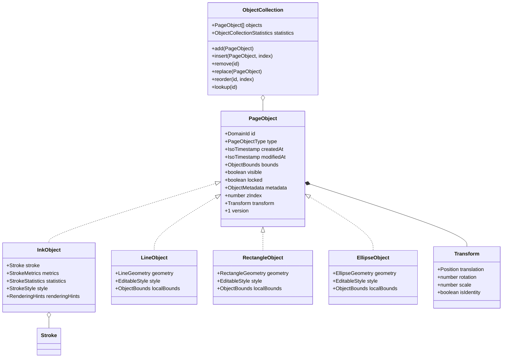
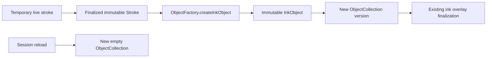
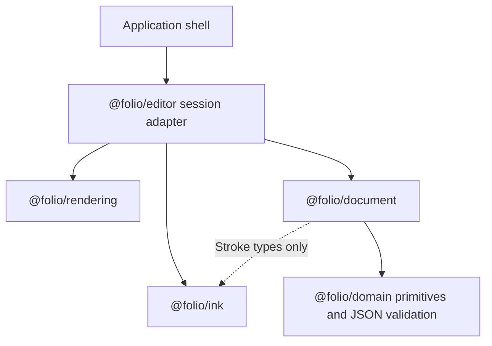

# @folio/document

`@folio/document` is Folio's framework-independent immutable page-object architecture. It implements the generic `PageObject` contract, lifecycle metadata, validation, factories, immutable collections, serialization interfaces, and four concrete visual objects: `InkObject`, `LineObject`, `RectangleObject`, and `EllipseObject`. The object transform supports finite page-space translation, clockwise rotation in radians, and positive uniform scale.

The package does not implement editing, selection, rendering, persistence, history, Electron, React, or notebook mutation. `InkObject` imports `Stroke` only as a TypeScript type and retains the finalized immutable stroke by reference, so stroke points, metrics, statistics, and style are never duplicated.

The Phase 3 `@folio/domain` page-object record remains the persistence-facing notebook contract. Phase 8 does not migrate that record or notebook files. A later persistence phase can bridge the richer document model through the serialization contracts defined here.

## Package structure

```text
packages/document/
|-- README.md
|-- package.json
|-- tsconfig.json
`-- src/
    |-- __tests__/
    |   |-- fixtures.ts
    |   |-- object-collection.test.ts
    |   |-- public-api.test.ts
    |   |-- transform-factory.test.ts
    |   `-- validation.test.ts
    |-- internal/
    |   |-- copy-object.ts
    |   `-- json.ts
    |-- errors.ts
    |-- index.ts
    |-- ink-object.ts
    |-- object-collection.ts
    |-- object-factory.ts
    |-- transform.ts
    |-- types.ts
    |-- vector-object.ts
    |-- vector-serialization.ts
    `-- validation.ts
```

## Object model



All concrete objects use composition, not a visual-object inheritance hierarchy. `InkObject` retains one immutable `Stroke`; vector objects retain only immutable geometry and the shared `EditableStyle`. Every object exposes transformed axis-aligned page bounds through the existing `PageObject` contract.

## Lifecycle



Creation and cloning use injectable identifier and ISO timestamp providers. Clones receive a new object identity and lifecycle while reusing the original immutable stroke. Collection `add`, positional `insert`, `remove`, `replace`, and `reorder` operations return new collections and never mutate earlier versions. Positional insertion validates its index and duplicate identity, then normalizes all resulting z-indices and statistics inside the document layer.

## Transform policy

`Transform` supports the following immutable values:

```text
translation = { x: finite, y: finite }
rotation = finite radians
scale = positive finite factor
```

Translation is applied in page space. Rotation and uniform scale use the center of each object's local inflated bounds as a stable pivot. `Transform.translatedBy()`, `Transform.withRotation()`, `Transform.withScale()`, and the corresponding `ObjectFactory` operations create new immutable values while preserving the other transform axes. A transformed object keeps its identity and payload references where practical, updates its lifecycle timestamp and axis-aligned page bounds, and replaces the prior object through `ObjectCollection.replace()`. Non-finite translations or rotations and non-positive or non-finite scales produce structured validation failures.

## Validation

Validation reports immutable issues with stable paths and codes. It covers:

- Empty identifiers and unknown object types
- Unsupported object versions
- Invalid or reversed lifecycle timestamps
- Invalid bounds, visibility, locks, and z-indices
- Non-JSON, cyclic, non-plain, or non-finite metadata
- Non-finite or unsupported transforms
- Missing or mutable stroke references
- Degenerate or mutable vector geometry and invalid vector styles
- Duplicate identifiers in collections

Factories and collection constructors assert validation. Non-throwing validators and type guards remain available for boundary checks.

## Serialization boundary

`SerializedPageObject` and `ObjectSerializationContract` remain the generic envelope and adapter contracts. `serializeVectorObject()` and `deserializeVectorObject()` provide a deterministic, versioned, JSON-safe round trip for Line, Rectangle, and Ellipse objects. They serialize no creation preview, selection, tool, measurement, or other editor state. Notebook save/load integration, schema migration, and persistence adapters remain outside this package.

## Shared editable style

`EditableColor` and `EditableStyle` are additive, serialization-neutral values for editor configuration and future `PageObject` types. Colors have a canonical lowercase hexadecimal form, immutable RGB channels, and opacity. Styles currently expose stroke color and width while reserving optional fill, font, line, shadow, and blend fields. Factories validate and freeze every nested value.

`PageObject` remains Folio's only common canvas-object abstraction. No visual inheritance hierarchy or tool behavior was added to the document model. Existing `InkObject` behavior, collection semantics, transforms, and serialization contracts remain compatible.

## Dependency direction



There is no dependency from document objects to React, Electron, rendering, history, persistence, shell, toolbar, or editor code.

## Performance

- `ObjectCollection.lookup` uses a private lookup map.
- Ordered objects are stored in a frozen array with contiguous `zIndex` values.
- Collection statistics and union bounds are calculated once per immutable collection version.
- Reindexing reuses immutable strokes, metadata, transforms, and unchanged object references where possible.
- The large-collection test constructs and validates 5,000 objects and verifies deterministic lookup and ordering.

## Future extension points

- Additional `PageObjectType` variants and factory branches beyond the current ink and vector types
- Additional transform operations beyond translation, rotation, and uniform scale
- Object-specific rendering hints
- Persistence serialization adapters and migrations
- History commands around immutable collection successors
- Selection, hit testing, spatial indexing, and editor state

All of these remain additive extension points; Phase 15 implements only Line, Rectangle, and Ellipse.
