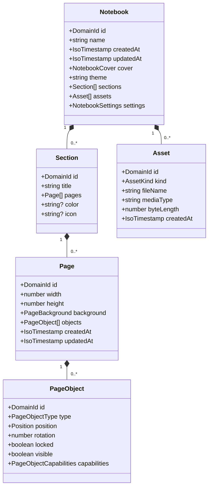
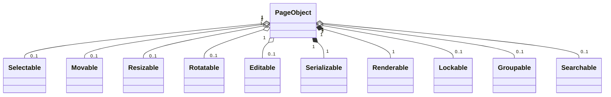

# Folio Domain Model

`@folio/domain` contains Folio's framework-independent, in-memory notebook model. It has no React, Electron, rendering, persistence, or search dependencies.

Models are immutable plain objects containing only JSON-safe values. Dates are ISO-compatible strings, assets contain metadata rather than binary data or file-system paths, and aggregate operations return new notebooks instead of mutating their inputs.

## Aggregate model

Pages are owned directly by one ordered section. There are no persistence-layer page references in the domain model; validation guarantees that every contained page is valid and that identifiers are unique throughout the notebook aggregate.

## Capability composition

Capabilities are dependency-free, serializable markers. They describe what an editor, renderer, or search adapter may do without placing those behaviors in the domain layer.

All page objects must include `Serializable` and `Renderable`. Other capabilities are composed only when appropriate for the concrete object type.

## Public API groups

- Models and primitives: `Notebook`, `Section`, `Page`, `PageObject`, `Asset`, identifiers, timestamps, JSON values, covers, backgrounds, and discriminants.
- Factories: `createNotebook`, `createSection`, `createPage`, `createPageObject`, `createAsset`, and `duplicatePage`.
- Aggregate operations: notebook metadata, section CRUD/reordering, and page CRUD/duplication/reordering.
- Validation: standalone validators, `validateNotebook`, `assertValidNotebook`, `isNotebook`, structured issues, and `DomainValidationError`.
- Factory context: injectable identifier and clock functions for deterministic tests and platform-independent creation.
