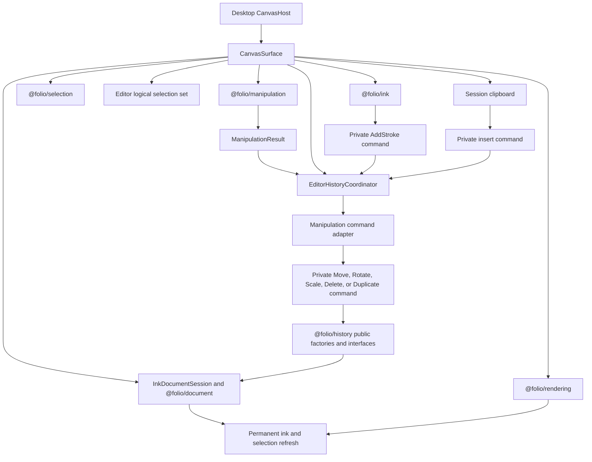

# @folio/editor

`@folio/editor` is Folio's application-facing composition layer. `CanvasSurface` is the thin React lifecycle adapter around rendering, ink, immutable document objects, selection, manipulation, the Phase 11 generic History controller, and the Phase 13 session clipboard workflow.

React supplies the host lifecycle and callbacks. It does not calculate transforms, build strokes, perform hit testing, own viewport math, manage History stacks, or draw pixels.

## Public API

- `CanvasSurface` is the package's only runtime export.
- `CanvasSurfaceProps` documents interaction mode, lifecycle, diagnostics, selection, manipulation, History, and error callbacks.
- `CanvasInteractionMode` is the type-only `"select" | "move" | "rotate" | "scale" | "ink" | "disabled"` routing contract.
- `ObjectLifecycleActions` is a session-scoped type-only action boundary for deleting or duplicating the editor's logical selection; the desktop toolbar receives it through `onObjectLifecycleActionsReady`.

The additive History callbacks are:

- `onHistoryControllerReady(controller)`, which exposes the session's interface-oriented `IHistoryController<ObjectCollection>` for programmatic operations; and
- `onHistoryChange(notification)`, which receives immutable post-execute/undo/redo notifications.

`InkDocumentSession`, all concrete commands, the manipulation command adapter, `EditorHistoryCoordinator`, the clipboard and logical-selection models, shortcut adapters, context menu, interaction hit policies, and coordinate mappers are package-internal. They are not exported from the package barrel. A public-API test locks this boundary.

## Editor composition

`CanvasSurface` mounts one `CanvasController`, ink overlay, selection overlay, manipulation-preview overlay, document session, selection subsystem, editor logical-selection set, session clipboard, manipulation subsystem, History manager/controller pair, shortcut listeners, and context-menu bridge. Teardown removes listeners, clears editor-local state, unsubscribes observers, destroys the controller/coordinator, clears the session, and disposes rendering resources. Tool changes do not remount the canvas or recreate History.

## Manipulation and History

The editor is the only adapter between Manipulation and History:

All six private commands implement `EditorCommand<ObjectCollection>` for exactly one `InkObject`. Transform and lifecycle commands require a visible, unlocked target and store only their operation-specific state. `AddStrokeCommand` retains one newly finalized immutable ink object; one pointer-down/draw/pointer-up lifecycle therefore creates exactly one History entry. `DeleteCommand` retains the exact immutable deleted object and its original index; `DuplicateCommand` creates one immutable clone through `ObjectFactory.cloneObject()` and retains its identity and insertion index. Commands contain no rendering, selection, manipulation-session, or History-stack behavior.

`DuplicateCommand` validates the clone's complete logical immutable state rather than requiring heap-reference equality. This allows a later transform to execute and undo before the duplication itself is undone, while still rejecting stale or mismatched clone state.

The private command adapter exhaustively maps `translation`, `rotation`, `scale`, `delete`, and `duplicate` to their matching commands. `EditorHistoryCoordinator` owns one manager/controller pair, executes adapted manipulation commands and completed-stroke commands, and listens for successful transitions. `CanvasSurface` projects the complete ordered object collection into permanent ink visuals, clears invalid selection identities, and selects a newly duplicated object after the initiating action. A failed command leaves the current document and selection consistent.

Duplicate creation and its fixed `{ x: 10, y: 10 }` page-space translation execute as one existing History transaction. The frozen `DuplicateCommand` and `MoveCommand` remain unchanged; redo replays their stored deterministic values and undo removes the duplicate in one step.

## Clipboard and logical selection

Phase 13 keeps clipboard ownership entirely inside the mounted editor session. Copy stores an immutable ordered group of existing document-object references and creates no History entry. Paste clones every stored object through `ObjectFactory`, assigns fresh identities, preserves stroke/style/metadata and relative spacing, and applies a common page-space offset of `{ x: 20, y: 20 }` per paste ordinal. A new copy or cut resets the ordinal; editor teardown clears the clipboard.

The frozen Selection package remains the primary pointer authority for one object. An editor-owned logical selection set adds the minimum multi-object state required by Select All and grouped editor actions without changing `SelectionState`. The primary object is the final logical-selection identity. For a group, the editor caches the union of every selected object bound and supplies that single combined rectangle to the existing overlay renderer. Diagnostics expose the complete ordered identity set, combined bounds, and immutable transforms. Pointer selection collapses the logical set to one object. Document replacement reconciles removed identities.

Cut copies first and executes one transaction containing existing delete commands. Paste executes one transaction containing private insert commands. Multi-object Duplicate reuses existing Duplicate and Move commands in one transaction. Delete uses existing Delete commands. Each operation is one undo/redo step, selection is updated only by the editor, and the clipboard never changes during undo or redo.

## Select tool interaction

Select is the universal object-manipulation tool. A click uses a forgiving, top-most-first bounds hit policy with a two-page-unit tolerance. Once selected, the overlay displays four scale handles and one rotation handle. Pointer targeting is editor-owned: dragging inside the selected bounds starts translation, dragging a corner starts uniform scale, and dragging the upper handle starts rotation. Each route delegates to the existing manipulation controller and unchanged command adapter. The legacy Move, Rotate, and Scale modes remain compatible, but they are not required for normal manipulation.

Switching to Pen clears selection immediately without remounting the canvas, recreating History, or affecting the document. Ink rendering remains live during pointer movement; only the completed immutable stroke is submitted to History.

Continuous transforms use one generalized manipulation-preview renderer. All five operations use the same document replacement, rendering projection, and selection synchronization path. Future interaction types add an immutable result variant and an editor command-adapter branch. They do not change History, the coordinator lifecycle, document installation, notifications, or canvas synchronization.

## Interaction polish

The Select tool resolves cursor feedback with the same page-space hit regions used to start manipulation. The group interior uses the platform open-hand `grab` cursor and changes to `grabbing` while translation owns the pointer. Opposing corners use `nwse-resize` or `nesw-resize`; the rotation handle uses a lightweight circular-arrow cursor with `crosshair` fallback. All other page space immediately restores `default`. Hover is editor presentation state only: it neither changes selection nor enters History. Cursor calculation is skipped while an active manipulation owns the pointer.

Move, Rotate, and Scale are handle-driven and no longer appear as desktop toolbar buttons. Their compatible `CanvasInteractionMode` values remain intact; this is a composition-only toolbar simplification. Selection handles retain their established square/circular style and 28-pixel rotation spacing, with 10-pixel visuals and a separate 12-pixel hit radius for easier targeting.

Logical groups reuse the editor-owned selection set without changing the Selection package. A cached combined bound becomes the manipulation target and the one overlay rectangle. Translation expands to one existing Move command per selected object. Scale expands to existing Scale commands plus Move commands that reposition each object around the combined center. Rotation similarly combines existing Rotate and Move commands around the group center. Every expansion executes inside one existing History transaction, preserving relative spacing and one-step undo/redo.

Permanent ink continues to project immutable strokes and transforms into `StrokeRenderer`. During transformed drawing, the renderer keeps the existing geometry transform but divides only its internal rendered width by the object scale. Canvas scaling therefore restores the original effective pen width. Document stroke styles, `Transform`, `ScaleCommand`, bounds, History, and object identity remain unchanged.

Ink paths use bounded Catmull–Rom-derived cubic Bézier segments. Every segment passes through its sampled endpoints, and control points are clamped to the endpoint rectangle to prevent overshoot and oscillation. Live segments draw incrementally; finalization replaces the preview once with the complete curve. Finalized curve geometry is cached with the immutable stroke and reused by redraw, move, rotation, scale, clipboard, and History-driven document replacement.

## Keyboard shortcuts

The mounted editor reuses the coordinator's controller for:

- `Ctrl+Z`: undo;
- `Ctrl+Shift+Z`: redo; and
- `Ctrl+Y`: redo.

Editor-local workflow shortcuts use the same mounted session:

- `Ctrl+C`: copy the logical selection without History;
- `Ctrl+X`: copy, then cut as one History transaction;
- `Ctrl+V`: paste fresh objects as one History transaction;
- `Ctrl+D`: duplicate the logical selection as one History transaction;
- `Ctrl+A`: select all visible, unlocked objects; and
- `Delete` or `Backspace`: delete the logical selection as one History transaction.

The desktop context menu exposes Copy, Cut, Paste, Duplicate, Delete, and Select All through these exact action callbacks. Capability state controls disabled items. Right-clicking an already selected object preserves the logical group; right-clicking another object selects only that object; right-clicking blank page space clears selection while leaving Paste available.

The listeners ignore composing or already-prevented events, Meta/Alt combinations, and editable input/select/textarea/content-editable targets. Browser default behavior is prevented only when the requested History or editing operation is handled. They are installed once per editor lifetime and removed idempotently on teardown. No additional manager or controller is created.

The application currently has no platform shortcut abstraction, so macOS Command-key bindings are not implemented.

## History scope boundary

Translation, rotation, scale, delete, and duplicate use History through the generalized manipulation-result boundary. Finalized ink uses a private `AddStrokeCommand` through the same generic controller, while `InkDocumentSession.completeStroke()` remains available for existing package-internal compatibility tests. The existing direct translation helper remains for Phase 10 source compatibility but is not used by `CanvasSurface`.

The editor still has no notebook persistence or native operating-system clipboard integration. History, clipboard contents, document objects, strokes, selections, and manipulations are session-only and are discarded with the mounted editor session.

## Dependency boundary

Editor may depend on History, Manipulation, Selection, Document, Rendering, Ink, and React because it coordinates them. It imports only public History interfaces and factories. History never imports Editor, and Manipulation, Rendering, Selection, Document, Ink, and Persistence remain unaware of editor History coordination.

See [Phase 11 History Architecture and Developer Guide](../../docs/architecture/PHASE11_HISTORY_ARCHITECTURE.md) for History lifecycle and guarantees, and [Phase 12 Manipulation Framework](../../docs/architecture/PHASE12_MANIPULATION_FRAMEWORK.md) for the generalized result/adaptation boundary.
