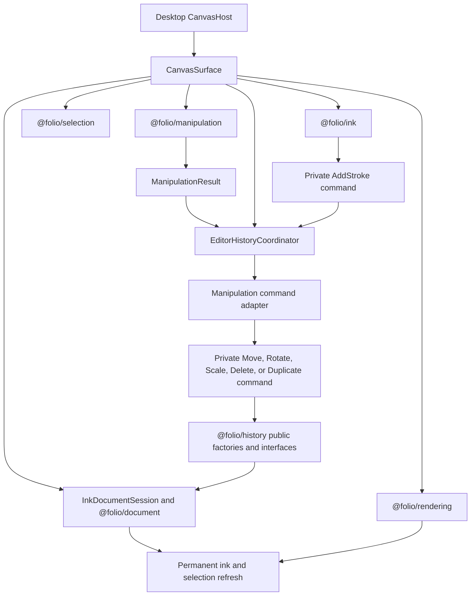

# @folio/editor

`@folio/editor` is Folio's application-facing composition layer. `CanvasSurface` is the thin React lifecycle adapter around rendering, ink, immutable document objects, selection, manipulation, and the Phase 11 generic History controller.

React supplies the host lifecycle and callbacks. It does not calculate transforms, build strokes, perform hit testing, own viewport math, manage History stacks, or draw pixels.

## Public API

- `CanvasSurface` is the package's only runtime export.
- `CanvasSurfaceProps` documents interaction mode, lifecycle, diagnostics, selection, manipulation, History, and error callbacks.
- `CanvasInteractionMode` is the type-only `"select" | "move" | "rotate" | "scale" | "ink" | "disabled"` routing contract.
- `ObjectLifecycleActions` is a session-scoped type-only action boundary for deleting or duplicating the current selection; the desktop toolbar receives it through `onObjectLifecycleActionsReady`.

The additive History callbacks are:

- `onHistoryControllerReady(controller)`, which exposes the session's interface-oriented `IHistoryController<ObjectCollection>` for programmatic operations; and
- `onHistoryChange(notification)`, which receives immutable post-execute/undo/redo notifications.

`InkDocumentSession`, all six concrete commands, the manipulation command adapter, `EditorHistoryCoordinator`, the shortcut adapter, interaction hit policies, and coordinate mappers are package-internal. They are not exported from the package barrel. A public-API test locks this boundary.

## Editor composition

`CanvasSurface` mounts one `CanvasController`, ink overlay, selection overlay, manipulation-preview overlay, document session, selection subsystem, manipulation subsystem, History manager/controller pair, and History shortcut listener. Teardown removes listeners, unsubscribes observers, destroys the controller/coordinator, clears the session, and disposes rendering resources. Tool changes do not remount the canvas or recreate History.

## Manipulation and History

The editor is the only adapter between Manipulation and History:

All six private commands implement `EditorCommand<ObjectCollection>` for exactly one `InkObject`. Transform and lifecycle commands require a visible, unlocked target and store only their operation-specific state. `AddStrokeCommand` retains one newly finalized immutable ink object; one pointer-down/draw/pointer-up lifecycle therefore creates exactly one History entry. `DeleteCommand` retains the exact immutable deleted object and its original index; `DuplicateCommand` creates one immutable clone through `ObjectFactory.cloneObject()` and retains its identity and insertion index. Commands contain no rendering, selection, manipulation-session, or History-stack behavior.

`DuplicateCommand` validates the clone's complete logical immutable state rather than requiring heap-reference equality. This allows a later transform to execute and undo before the duplication itself is undone, while still rejecting stale or mismatched clone state.

The private command adapter exhaustively maps `translation`, `rotation`, `scale`, `delete`, and `duplicate` to their matching commands. `EditorHistoryCoordinator` owns one manager/controller pair, executes adapted manipulation commands and completed-stroke commands, and listens for successful transitions. `CanvasSurface` projects the complete ordered object collection into permanent ink visuals, clears invalid selection identities, and selects a newly duplicated object after the initiating action. A failed command leaves the current document and selection consistent.

Duplicate creation and its fixed `{ x: 10, y: 10 }` page-space translation execute as one existing History transaction. The frozen `DuplicateCommand` and `MoveCommand` remain unchanged; redo replays their stored deterministic values and undo removes the duplicate in one step.

## Select tool interaction

Select is the universal object-manipulation tool. A click uses a forgiving, top-most-first bounds hit policy with a two-page-unit tolerance. Once selected, the overlay displays four scale handles and one rotation handle. Pointer targeting is editor-owned: dragging inside the selected bounds starts translation, dragging a corner starts uniform scale, and dragging the upper handle starts rotation. Each route delegates to the existing manipulation controller and unchanged command adapter. The legacy Move, Rotate, and Scale modes remain compatible, but they are not required for normal manipulation.

Switching to Pen clears selection immediately without remounting the canvas, recreating History, or affecting the document. Ink rendering remains live during pointer movement; only the completed immutable stroke is submitted to History.

Continuous transforms use one generalized manipulation-preview renderer. All five operations use the same document replacement, rendering projection, and selection synchronization path. Future interaction types add an immutable result variant and an editor command-adapter branch. They do not change History, the coordinator lifecycle, document installation, notifications, or canvas synchronization.

## Keyboard shortcuts

The mounted editor reuses the coordinator's controller for:

- `Ctrl+Z`: undo;
- `Ctrl+Shift+Z`: redo; and
- `Ctrl+Y`: redo.

The listener ignores composing or already-prevented events, Meta/Alt combinations, and editable input/select/textarea/content-editable targets. Browser default behavior is prevented only when the requested History operation is available. The listener is installed once per editor lifetime and removed idempotently on teardown. No additional manager or controller is created.

The application currently has no platform shortcut abstraction, so macOS Command-key bindings are not implemented.

## History scope boundary

Translation, rotation, scale, delete, and duplicate use History through the generalized manipulation-result boundary. Finalized ink uses a private `AddStrokeCommand` through the same generic controller, while `InkDocumentSession.completeStroke()` remains available for existing package-internal compatibility tests. The existing direct translation helper remains for Phase 10 source compatibility but is not used by `CanvasSurface`.

The editor still has no notebook persistence integration. History, document objects, strokes, selections, and manipulations are session-only and are discarded with the mounted editor session.

## Dependency boundary

Editor may depend on History, Manipulation, Selection, Document, Rendering, Ink, and React because it coordinates them. It imports only public History interfaces and factories. History never imports Editor, and Manipulation, Rendering, Selection, Document, Ink, and Persistence remain unaware of editor History coordination.

See [Phase 11 History Architecture and Developer Guide](../../docs/architecture/PHASE11_HISTORY_ARCHITECTURE.md) for History lifecycle and guarantees, and [Phase 12 Manipulation Framework](../../docs/architecture/PHASE12_MANIPULATION_FRAMEWORK.md) for the generalized result/adaptation boundary.
