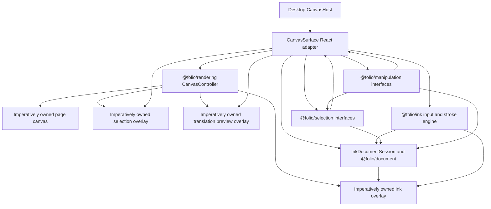

# @folio/editor

`@folio/editor` is Folio's application-facing editor adapter layer. `CanvasSurface` is a thin React lifecycle adapter around `@folio/rendering`, `@folio/ink`, `@folio/selection`, `@folio/manipulation`, and the session-only `@folio/document` collection.

The adapter supplies a host element, maps Folio CSS theme tokens into immutable renderer colors, observes theme changes, mounts one `CanvasController`, and disposes the whole lifecycle on unmount. `InkDocumentSession` converts finalized strokes into immutable objects and performs same-identity immutable translation replacement. Toolbar mode routes pointer events to ink, selection, or manipulation without remounting the canvas. Editor-owned mappers use rendering's canonical screen-to-page conversion; manipulation receives page coordinates only. The editor feeds cached stroke visuals and immutable manipulation state into a renderer-owned preview overlay, then updates permanent ink and selection bounds after commit. React does not calculate translation, build strokes, own viewport math, size canvases, or draw. Notebook, history, and persistence state remain intentionally absent.

## Public API

- `CanvasSurface` is the only runtime export and owns the composed editor lifecycle for its React host.
- `CanvasSurfaceProps` documents mode, lifecycle, diagnostics, selection, manipulation, and error callbacks.
- `CanvasInteractionMode` is the type-only `"select" | "move" | "ink" | "disabled"` routing contract.

`InkDocumentSession`, `PageSelectionCoordinateMapper`, and `PageManipulationCoordinateMapper` are package-internal implementations. They are not exported from the package barrel. A public-API test locks this runtime surface.

