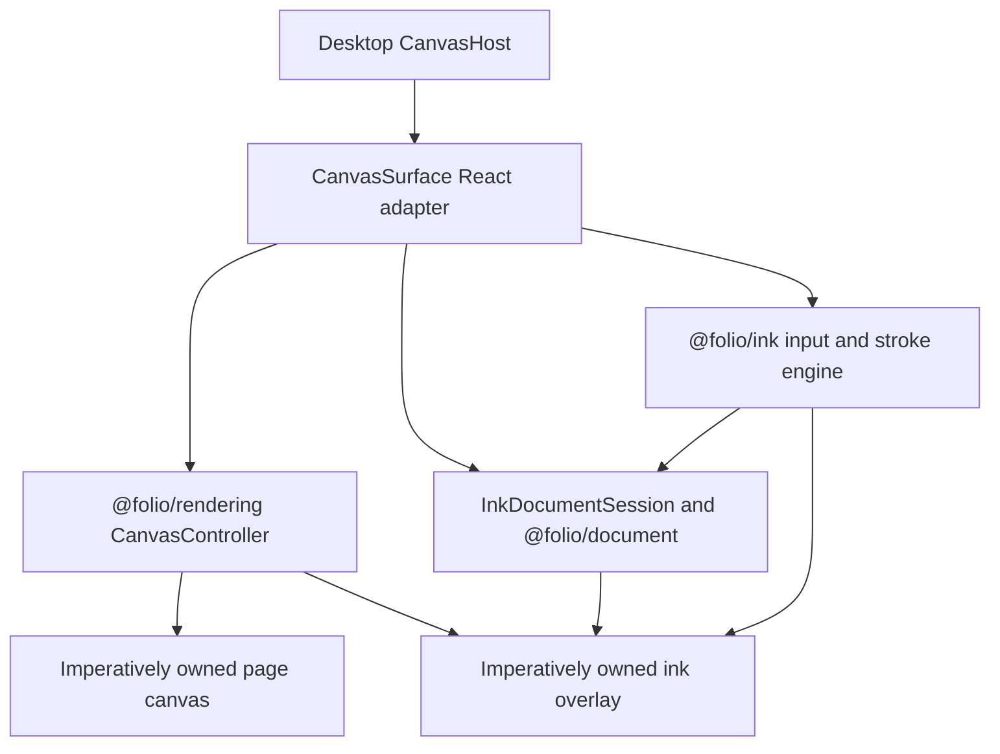

# @folio/editor

`@folio/editor` is Folio's application-facing editor adapter layer. `CanvasSurface` is a thin React lifecycle adapter around `@folio/rendering`, `@folio/ink`, and the session-only `@folio/document` collection.

The adapter supplies a host element, maps Folio CSS theme tokens into immutable renderer colors, observes theme changes, mounts one `CanvasController`, wires one `PointerInputController` to an imperatively owned ink overlay, and disposes the whole lifecycle on unmount. `InkDocumentSession` converts each finalized stroke into one immutable `InkObject` and an immutable `ObjectCollection` successor before allowing the existing ink renderer to finalize it. React does not normalize points, build strokes, calculate geometry, size canvases, or draw. Objects remain session-only and notebook, history, and persistence state remain intentionally absent.

