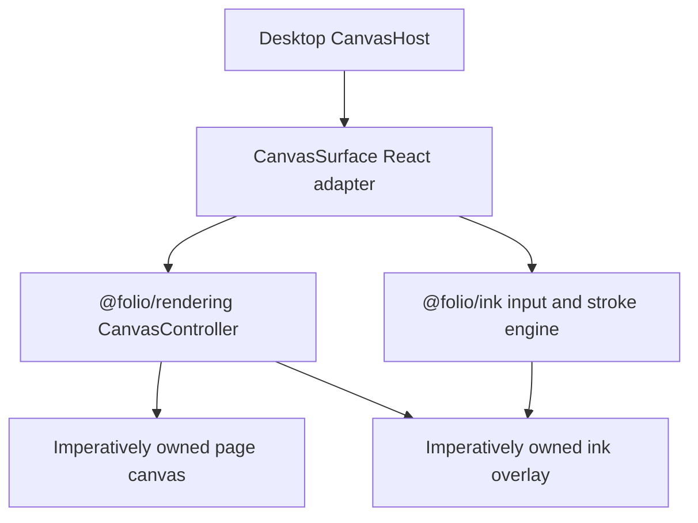

# @folio/editor

`@folio/editor` is Folio's application-facing editor adapter layer. `CanvasSurface` is a thin React lifecycle adapter around `@folio/rendering` and `@folio/ink`.

The adapter supplies a host element, maps Folio CSS theme tokens into immutable renderer colors, observes theme changes, mounts one `CanvasController`, wires one `PointerInputController` to an imperatively owned ink overlay, and disposes the whole lifecycle on unmount. React does not normalize points, build strokes, calculate geometry, size canvases, or draw. Phase 7 strokes remain session-only and notebook state remains intentionally absent.

