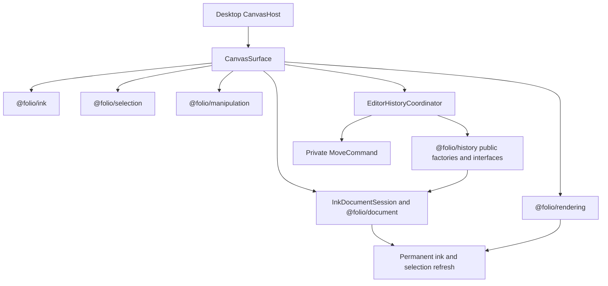
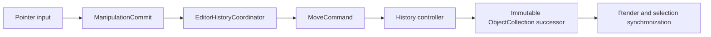

# @folio/editor

`@folio/editor` is Folio's application-facing composition layer. `CanvasSurface` is the thin React lifecycle adapter around rendering, ink, immutable document objects, selection, manipulation, and the Phase 11 generic History controller.

React supplies the host lifecycle and callbacks. It does not calculate translation, build strokes, perform hit testing, own viewport math, manage History stacks, or draw pixels.

## Public API

- `CanvasSurface` is the package's only runtime export.
- `CanvasSurfaceProps` documents interaction mode, lifecycle, diagnostics, selection, manipulation, History, and error callbacks.
- `CanvasInteractionMode` is the type-only `"select" | "move" | "ink" | "disabled"` routing contract.

The additive History callbacks are:

- `onHistoryControllerReady(controller)`, which exposes the session's interface-oriented `IHistoryController<ObjectCollection>` for programmatic operations; and
- `onHistoryChange(notification)`, which receives immutable post-execute/undo/redo notifications.

`InkDocumentSession`, `MoveCommand`, `EditorHistoryCoordinator`, the shortcut adapter, and coordinate mappers are package-internal. They are not exported from the package barrel. A public-API test locks this boundary.

## Editor composition

`CanvasSurface` mounts one `CanvasController`, ink overlay, selection overlay, manipulation-preview overlay, document session, selection subsystem, manipulation subsystem, History manager/controller pair, and History shortcut listener. Teardown removes listeners, unsubscribes observers, destroys the controller/coordinator, clears the session, and disposes rendering resources. Tool changes do not remount the canvas or recreate History.

## Manipulation and History

The editor is the only adapter between Manipulation and History:

`MoveCommand` implements `EditorCommand<ObjectCollection>` for exactly one visible, unlocked `InkObject`. It stores identity, expected object revision, initial/final translations, and immutable command metadata. Execute, undo, and redo validate the expected current state and create new collection/object successors. The command contains no rendering, selection, manipulation-session, or History-stack behavior.

`EditorHistoryCoordinator` owns one manager/controller pair for the mounted editor session. It converts the immutable `ManipulationCommit` into a `MoveCommand`, submits it through the controller, and listens for successful transitions. `CanvasSurface` then updates permanent stroke translation, document diagnostics, and selected-object bounds from the current collection. A failed command rejects the manipulation commit without accepting its preview as permanent state.

## Keyboard shortcuts

The mounted editor reuses the coordinator's controller for:

- `Ctrl+Z`: undo;
- `Ctrl+Shift+Z`: redo; and
- `Ctrl+Y`: redo.

The listener ignores composing or already-prevented events, Meta/Alt combinations, and editable input/select/textarea/content-editable targets. Browser default behavior is prevented only when the requested History operation is available. The listener is installed once per editor lifetime and removed idempotently on teardown. No additional manager or controller is created.

The application currently has no platform shortcut abstraction, so macOS Command-key bindings are not implemented.

## Phase 11 scope boundary

Only manipulation-originated moves use History. Finalized ink continues through `InkDocumentSession.completeStroke()` and creates no History entry. The existing direct translation helper remains for Phase 10 source compatibility but is not used by `CanvasSurface`.

The editor still has no notebook persistence integration. History, document objects, strokes, selections, and manipulations are session-only and are discarded with the mounted editor session.

## Dependency boundary

Editor may depend on History, Manipulation, Selection, Document, Rendering, Ink, and React because it coordinates them. It imports only public History interfaces and factories. History never imports Editor, and Manipulation, Rendering, Selection, Document, Ink, and Persistence remain unaware of editor History coordination.

See [Phase 11 History Architecture and Developer Guide](../../docs/architecture/PHASE11_HISTORY_ARCHITECTURE.md) for lifecycle, transactions, failure guarantees, public APIs, tests, and extension rules.
