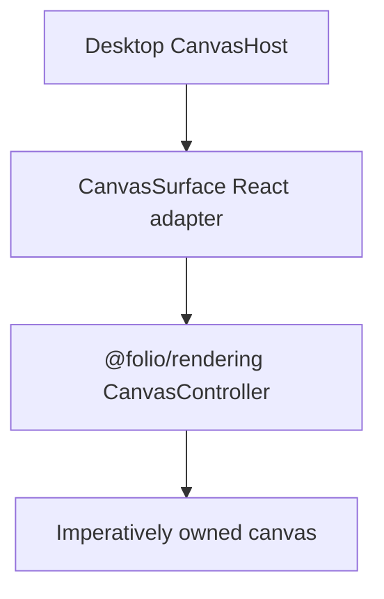

# @folio/editor

`@folio/editor` is Folio's application-facing editor adapter layer. In Phase 6 it exposes `CanvasSurface`, a thin React lifecycle adapter around `@folio/rendering`.

The adapter supplies a host element, maps Folio CSS theme tokens into immutable renderer colors, observes theme changes, mounts one `CanvasController`, and disposes it on unmount. React does not create, size, draw into, or otherwise manipulate the canvas. Editor behavior and notebook state remain intentionally absent.

