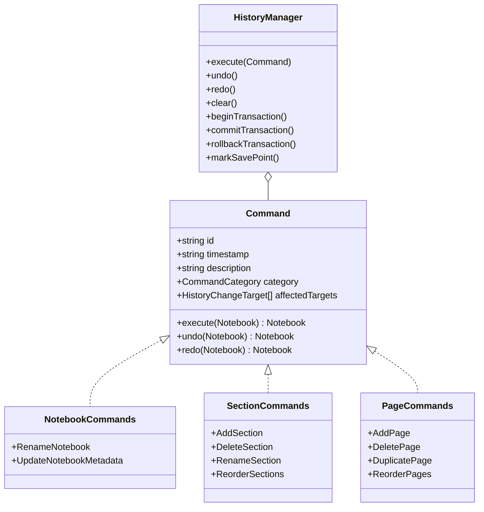
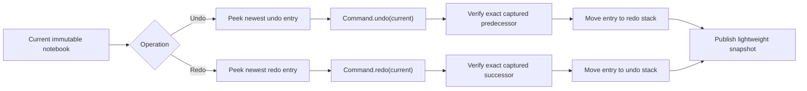
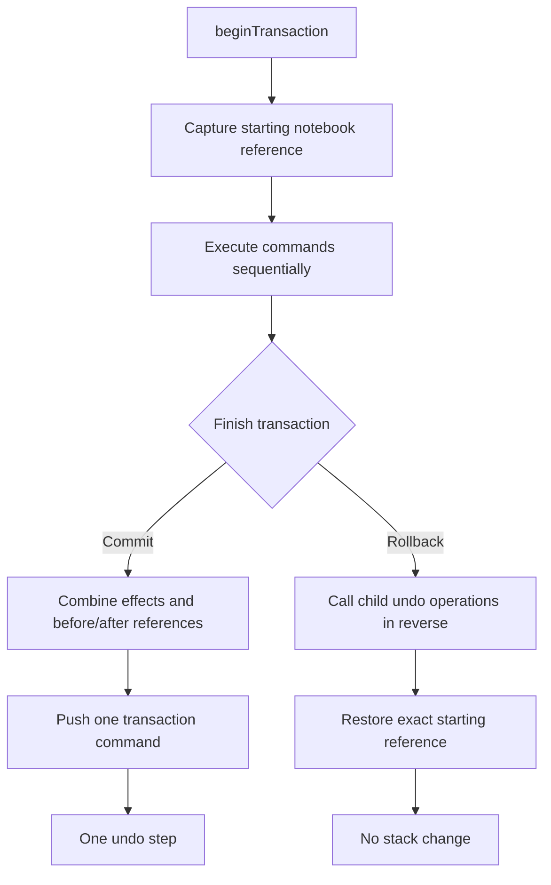
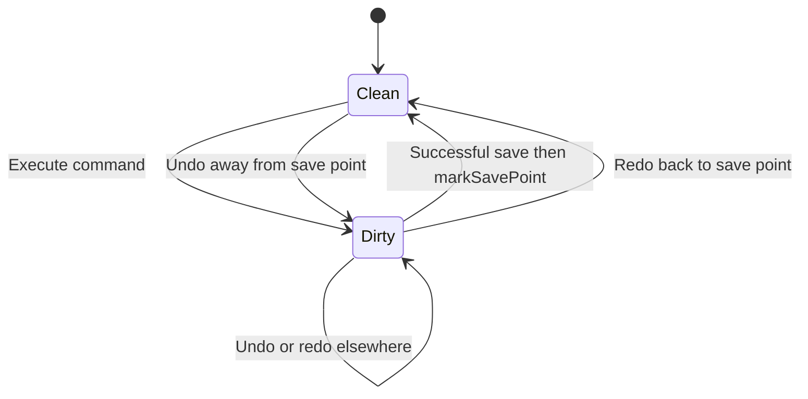

# Folio History

`@folio/history` is Folio's framework-independent, command-based notebook history package. It is the architectural entry point for future notebook state changes and has no React, Electron, rendering, canvas, search, editor-store, toolbar, or UI dependency.

Commands use `@folio/domain` aggregate operations to calculate immutable successor notebooks. Each command retains references to its exact before and after aggregates, making undo and redo deterministic and avoiding history-layer cloning. Optional `@folio/persistence` integration coordinates its `DirtyTracker`; notebook data remains the only value that crosses the persistence boundary.

History is session-only. Commands, stacks, transactions, and save points are deliberately excluded from notebook serialization and are cleared when a notebook session is discarded.

## Command architecture



Concrete command factories precompute their immutable successor through the corresponding `@folio/domain` operation. Undo restores the captured predecessor reference; redo restores the captured successor reference. Applying a command to a different reference fails with `COMMAND_STATE_MISMATCH`, preventing stale commands from silently overwriting newer state.

## Public API

- `HistoryManager` owns the current notebook, bounded undo/redo stacks, transaction state, and save point.
- `Command` defines immutable identity, time, description, category, persistence effects, and reversible transitions.
- `Transaction` describes the currently active group without exposing mutable implementation state.
- `HistorySnapshot` references the current immutable notebook and monotonic notebook-transition revision.
- `HistoryState` reports the snapshot, stack depths, limit, dirty state, capabilities, and active transaction.
- Notebook command factories create rename and metadata-update commands.
- Section command factories create add, delete, rename, and reorder commands.
- Page command factories create add, delete, duplicate, and reorder commands.
- `HistoryError` provides stable error codes and structured details for invalid commands, results, limits, and transaction state.

The default history limit is 100 undo steps. A positive safe-integer limit can be supplied when constructing the manager. Transactions count as one step regardless of their command count.

## Undo and redo flow



Executing a new, non-no-op command clears the redo stack. Empty undo and redo calls return the unchanged current snapshot.

## Transaction flow



Nested transactions are rejected. Undo, redo, history clearing, and save-point changes are unavailable during an active transaction. Persistence dirty targets are deferred until commit, so a rollback leaves persistence state untouched.

## Dirty-state integration



The manager compares immutable notebook references rather than serializing or hashing state. When a persistence `DirtyTracker` is supplied, command effects map to metadata, section, and page targets. Returning exactly to the save point clears those targets automatically.

Capture the submitted notebook reference and pass it to `markSavePoint()` only after `saveNotebook()` resolves successfully. If newer commands execute while the asynchronous save is running, they remain dirty:

```ts
const tracker = new DirtyTracker();
const history = new HistoryManager(notebook, { dirtyTracker: tracker });

history.execute(createRenameNotebookCommand(history.notebook, "Project Atlas II"));

const savedSnapshot = history.notebook;
await saveNotebook(notebookPath, savedSnapshot, { dirtyTracker: tracker });
history.markSavePoint(savedSnapshot);
```

## Example command lifecycle

```ts
const history = new HistoryManager(notebook, { historyLimit: 250 });

const command = createRenameSectionCommand(
  history.notebook,
  "research-section",
  "Primary Research",
);

const executed = history.execute(command);
const restored = history.undo();
const repeated = history.redo();

executed.notebook; // immutable renamed aggregate
restored.notebook; // exact original aggregate reference
repeated.notebook; // exact executed aggregate reference
```

Commands should be created against `history.notebook` immediately before execution. Future drawing, object-editing, and text commands can implement the same interface, but are intentionally outside Phase 5.

## Serialization boundary

Only `history.notebook` is passed to `@folio/persistence`. The following remain in memory and are never written to notebook JSON:

- Command identifiers, descriptions, timestamps, and closures.
- Undo and redo stacks.
- Transaction metadata and child commands.
- Save-point references and history revisions.

Reopening a saved notebook therefore starts a clean `HistoryManager` with empty stacks, as required by the current-session history architecture.

## Performance considerations

- Snapshots and history entries retain immutable notebook references; they do not deep-clone aggregates.
- Previously verified notebook references are cached, keeping repeated undo and redo validation constant-overhead at the history layer.
- Undo and redo use array-end operations.
- History limits discard the oldest complete steps and prevent unbounded stack growth.
- Transactions retain only their child commands and snapshot references until commit or rollback.
- No-op commands do not consume history or invalidate redo.
- The test baseline executes, undoes, and redoes 2,000 sequential commands.

The aggregate allocation cost remains owned by `@folio/domain`, where the business operation is performed. Future object commands should capture only the immutable aggregates or minimal reversible data they need.
