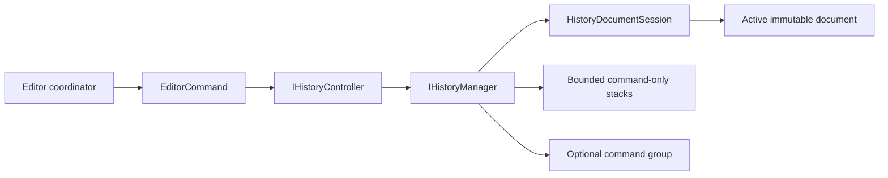

# @folio/history

`@folio/history` contains two deliberately separate, framework-independent History surfaces:

- the frozen Phase 5 compatibility API for immutable `@folio/domain.Notebook` aggregates; and
- the Phase 11 model-neutral editor History API used by `@folio/editor`.

Both are session-memory systems. Commands, stacks, transactions, save points, counters, and notifications are never serialized.

## Phase 11 generic editor History

The generic subsystem is parameterized by `TDocument`. It imports no Folio model package and knows documents only through `HistoryDocumentSession<TDocument>`. Concrete commands own document validation and produce immutable successors; History owns command protocol validation, bounded undo/redo stacks, lifecycle state, non-nested transactions, and immutable notifications.



Create one manager and one controller per editor session:

```ts
const manager = createEditorHistoryManager({ documentSession, historyLimit: 100 });
const controller = createHistoryController({ manager });

const unsubscribe = controller.subscribe((notification) => {
  // Synchronize editor-owned consumers from the installed session document.
});

controller.executeCommand(command);
controller.undo();
controller.redo();

unsubscribe();
controller.destroy();
```

`createEditorHistoryManager()` and `createHistoryController()` return public interfaces; their concrete implementations, stacks, transaction records, state builders, validation helpers, and lifecycle ownership hook are private. A manager can be claimed by only one active controller. Destroying the controller clears listeners and releases that claim.

### Generic public contracts

- `EditorCommand<TDocument>`: immutable identity, timestamp, description, and `execute`/`undo`/`redo` transitions.
- `HistoryDocumentSession<TDocument>`: reads and replaces the current immutable document.
- `IHistoryManager<TDocument>`: command, stack, state, and transaction operations.
- `IHistoryController<TDocument>`: the editor-facing manager boundary plus subscriptions and destruction.
- `IHistoryState` and execution-state types: immutable, document-free state, depths, capabilities, counters, lifecycle phase, active transaction, and last-command metadata.
- `HistoryCommandMetadata`, `HistoryOperation`, `HistoryOperationOutcome`, and `HistoryTransactionOptions`: immutable operation metadata.
- `HistoryNotification`, success/failure variants, and `HistoryListener`: immutable post-execute/undo/redo observations.
- `EditorHistoryManagerOptions<TDocument>` and `EditorHistoryControllerOptions<TDocument>`: factory inputs.
- `HistoryError`, `HistoryErrorCode`, `HistoryErrorOptions`, and `isHistoryError()`: shared structured errors.

The default history limit is 100. Executing a distinct successor outside a transaction pushes one command-only entry and clears redo. Undo and redo calculate and install new immutable successors before changing stacks. Empty operations return current state without publishing a notification.

Transactions are explicit and non-nested. Child commands execute immediately and are collected in order. Commit stores their commands as one undo unit; undo runs children in reverse and redo runs them forward. Rollback calculates the reverse chain and performs one final document replacement. No Phase 11 entry retains a whole before/after document aggregate.

Controller listeners observe `completed` state synchronously before the manager returns to `idle`. Listener failures are isolated. Begin, commit, and rollback do not create separate notification kinds; child execute and later grouped undo/redo operations use the normal command notification contract.

## Phase 5 compatibility surface

The public `HistoryManager` class and its `Command` contract remain notebook-specific. Built-in factories cover notebook rename/metadata, section add/delete/rename/reorder, and page add/delete/duplicate/reorder. The compatibility manager retains exact immutable before/after `Notebook` references, snapshot transactions, save-point dirtiness, and domain validation.

`LegacyHistoryDirtySink` is owned by History and is structurally satisfied by the existing Persistence `DirtyTracker`. This preserves the `dirtyTracker` option without a production dependency from History to Persistence. `@folio/persistence` is a development-only compatibility-test dependency.

The compatibility surface includes `HistorySnapshot`, `HistoryState`, `Transaction`, `HistoryManagerOptions`, command metadata/target types, all ten command factories, `DuplicatePageCommand`, and the shared error contracts. It is not used by the mounted editor and does not share state with the Phase 11 manager.

## Dependency boundary

The package-level production dependency on `@folio/domain` exists only for the Phase 5 modules. The generic `src/editor-history` subtree has no Folio-package dependency. Production imports from Document, Editor, Manipulation, Selection, Rendering, Persistence, React, Electron, and UI are forbidden.

## Documentation

See [Phase 11 History Architecture and Developer Guide](../../docs/architecture/PHASE11_HISTORY_ARCHITECTURE.md) for the complete command lifecycle, transaction model, failure guarantees, extension rules, editor integration, tests, and known scope boundaries.
