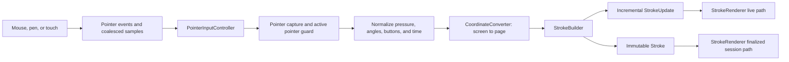
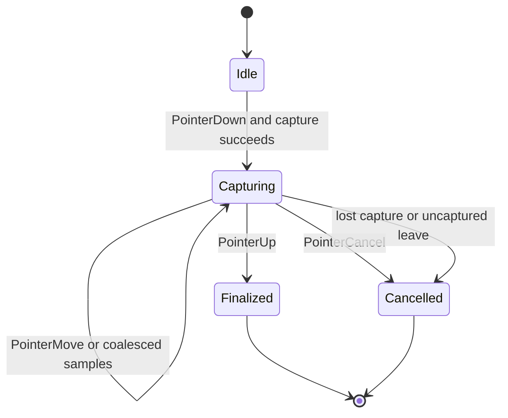
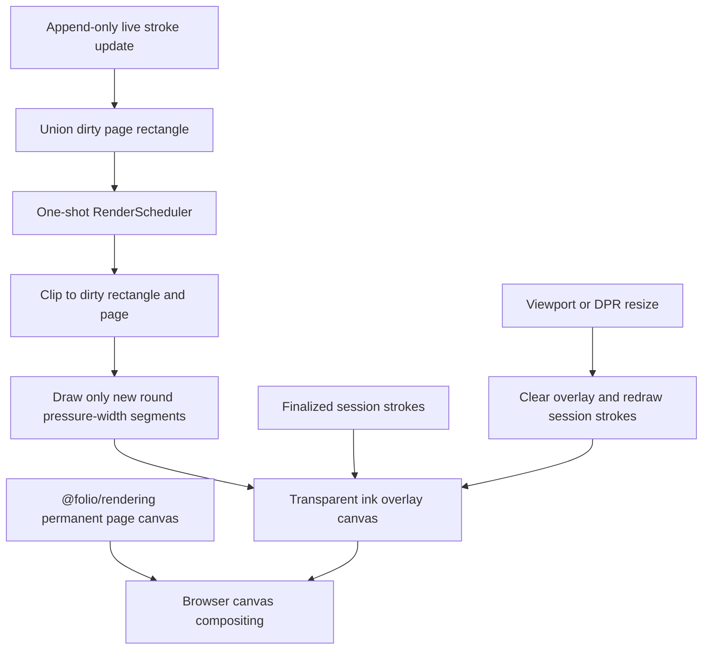
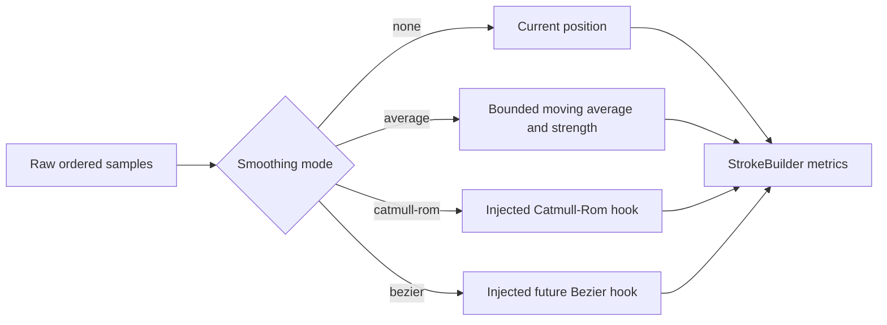

# @folio/ink

## Executive summary

`@folio/ink` is Folio's framework-independent freehand input and stroke engine. It captures primary mouse, pen, and touch pointer streams; converts them into page-local samples through `@folio/rendering`; builds immutable, measured strokes; and renders live and finalized session ink on demand. The package depends only on `@folio/rendering` and never reads or mutates notebook state.

Phase 7 ink is intentionally session-only. It is not a page object, does not enter history or persistence, and disappears when the canvas session is recreated. Selection, hit testing, editing, deletion, erasing, shapes, text, images, and multi-touch gestures remain outside this package.

## Package structure

```text
packages/ink/
|-- README.md
|-- package.json
|-- tsconfig.json
`-- src/
    |-- __tests__/
    |   |-- pointer-input-controller.test.ts
    |   |-- public-api.test.ts
    |   |-- stroke-builder.test.ts
    |   |-- stroke-renderer.test.ts
    |   `-- stroke-smoother.test.ts
    |-- internal/
    |   |-- draw-stroke.ts
    |   |-- geometry.ts
    |   `-- style.ts
    |-- errors.ts
    |-- index.ts
    |-- pointer-input-controller.ts
    |-- stroke.ts
    |-- stroke-builder.ts
    |-- stroke-renderer.ts
    |-- stroke-smoother.ts
    |-- stroke-visual.ts
    `-- types.ts
```

## Public API

- `PointerInputController` owns pointer event capture, active-pointer state, normalization, coalesced-event processing, cancellation, and finalization callbacks.
- `StrokeBuilder` filters duplicate or invalid samples and incrementally calculates movement, velocity, acceleration, bounds, length, duration, and pressure statistics.
- `StrokeSmoother` supplies replaceable `none` and lightweight `average` modes plus explicit Catmull-Rom and Bezier hook seams.
- `Stroke` is the deeply immutable finalized aggregate containing identity, ordered points, style, metrics, bounds, and statistics.
- `StrokeRenderer` uses a transparent overlay canvas for dirty-region live preview and finalized session-stroke rendering without repainting the permanent page canvas.
- `createStrokeVisual` retains one immutable `Stroke` reference and exposes the shared stroke drawing path to renderer-owned translation previews.
- `InkError` reports stable structured error codes and immutable details.
- Public types describe points, styles, metrics, statistics, updates, cancellation, hooks, callbacks, and snapshots. Geometry and style helpers remain private.

The default style is black, two logical pixels wide, fully opaque, pressure-sensitive, and round-capped/joined. Mouse input always uses pressure `0.5`; invalid pen or touch pressure falls back to the same value after reporting an `INVALID_PRESSURE` error.

## Pointer pipeline



Only one primary ink pointer is accepted in Phase 7. The controller contract preserves pointer type and IDs so a later gesture coordinator can add multi-touch without changing the stroke pipeline.

## Stroke lifecycle



Finalization copies and freezes the completed point sequence and releases the builder's mutable raw buffers. Cancellation clears the live dirty area and releases the same buffers. Duplicate `PointerUp`, lost capture, invalid values, and capture failures are represented by structured errors.

## Rendering pipeline



The base blank-page canvas and temporary/permanent session ink take separate rendering paths. Multiple point updates within a browser frame coalesce into one request. Drawing does not invalidate or repaint the page canvas. A resize necessarily clears the overlay backing store, then redraws retained session strokes using the updated camera, viewport, and DPR.

## Smoothing architecture



The default lightweight averaging uses a bounded window, so its work per point remains constant. Interpolation hooks receive the ordered raw buffer and current index, and their output is validated before it enters metrics or rendering.

## Performance considerations

- Pointer events may include browser-coalesced samples, allowing high-frequency hardware input to be processed in order.
- Builder bounds, pressure, length, velocity, and acceleration statistics are updated incrementally rather than rescanning the stroke.
- Duplicate consecutive positions are discarded before smoothing or allocation of a finalized point.
- Live updates reuse the builder's append-only point buffer; only finalized strokes copy and deeply freeze their point sequence.
- One-shot animation-frame scheduling coalesces input bursts and creates no idle render loop.
- Permanent stroke translation reuses immutable stroke geometry and redraws only the union of old and new bounds.
- Live drawing clips to the unioned dirty region and draws only the unrendered tail of the stroke.
- The default smoothing window is bounded, and the long-stroke sanity test exercises 10,000 points.
- Resize/DPR changes redraw only the ink overlay, preserving session strokes without forcing notebook or page-object work.

## Future extension points

- `PressureCurve` and `brushTextureId` allow future brush dynamics and texture strategies without changing stroke capture.
- Per-point velocity, acceleration, tilt, twist, altitude, and azimuth are retained for future expressive brushes.
- Catmull-Rom and Bezier smoothing hooks allow new interpolation algorithms behind the existing builder contract.
- Pointer type and active-pointer isolation provide a seam for a future multi-touch gesture coordinator and palm-rejection policy.
- Bounds, inflated bounds, dirty rectangle, and center can later support hit testing, selection, and spatial indexing outside this phase.
- Immutable strokes are retained by Phase 8 document objects and reused by Phase 10 permanent/preview render paths; history, persistence, and export adapters remain disconnected.
- The overlay-layer API in `@folio/rendering` can host future read-only overlays without exposing Canvas 2D details to the shell.

## Unit test summary

The package suite covers mouse, pen, touch, coalesced events, CSS/DPR coordinate compensation, pressure fallback, tilt metadata, velocity and acceleration, bounds, length, dirty rectangles, duplicate filtering, impossible values, single- and two-point strokes, cancellation, capture loss/failure, duplicate `PointerUp`, very fast and slow samples, 10,000-point construction, all smoothing modes and hooks, live/final render separation, pressure widths, round geometry, incremental clipping, resize redraw, request coalescing, lack of a continuous loop, cleanup, immutability, structured errors, and the deliberate public runtime surface.
