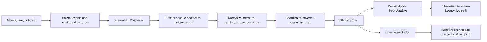
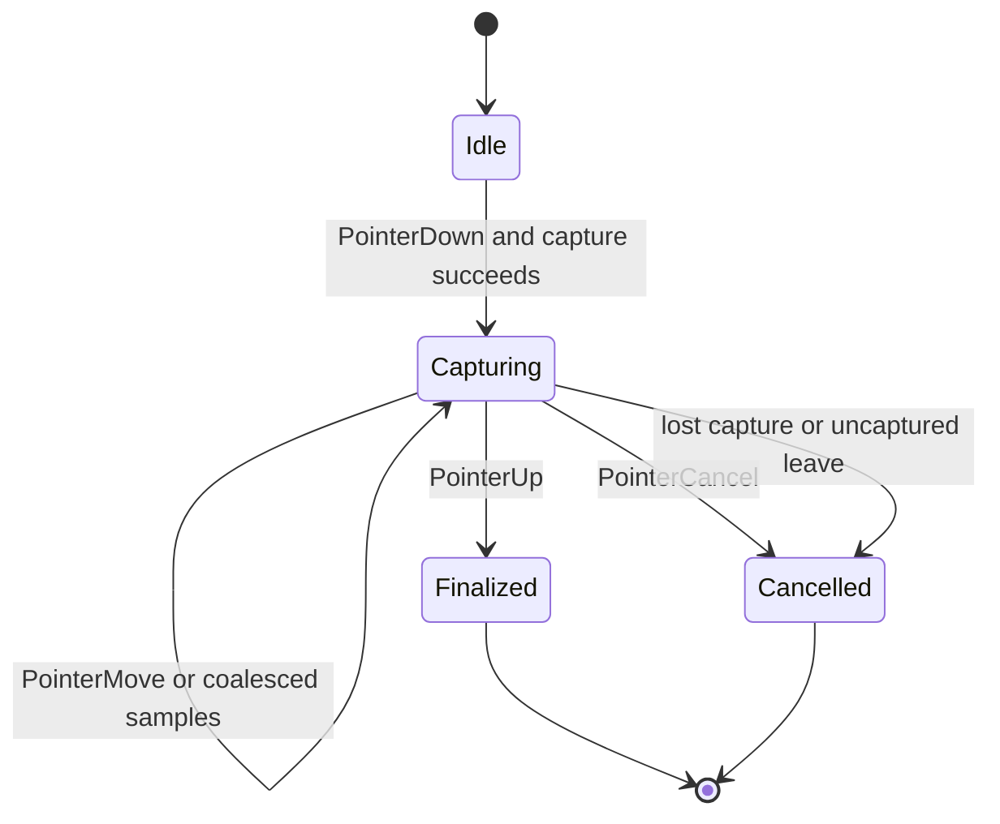
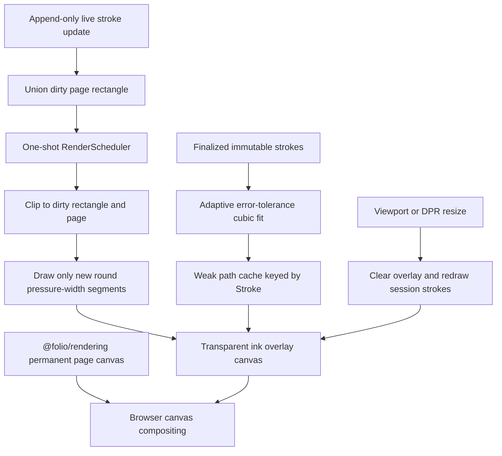
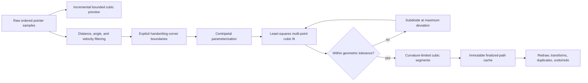

# @folio/ink

## Executive summary

`@folio/ink` is Folio's framework-independent freehand input and stroke engine. It captures primary mouse, pen, and touch pointer streams; converts them into page-local samples through `@folio/rendering`; builds immutable, measured strokes; and renders low-latency live ink plus high-quality finalized ink on demand. The package depends only on `@folio/rendering` and never reads or mutates editor-document state.

Finalized `Stroke` aggregates are retained by editor-owned document objects. Selection, History commands, object manipulation, clipboard behavior, and document replacement remain outside this package; the editor projects immutable retained visuals into `StrokeRenderer`.

## Package structure

```text
packages/ink/
|-- README.md
|-- package.json
|-- tsconfig.json
`-- src/
    |-- __tests__/
    |   |-- pointer-input-controller.test.ts
    |   |-- public-api.test.ts
    |   |-- smooth-stroke-path.test.ts
    |   |-- stroke-builder.test.ts
    |   |-- stroke-renderer.test.ts
    |   `-- stroke-smoother.test.ts
    |-- internal/
    |   |-- draw-stroke.ts
    |   |-- geometry.ts
    |   |-- professional-ink-path.ts
    |   `-- style.ts
    |-- errors.ts
    |-- index.ts
    |-- pointer-input-controller.ts
    |-- stroke.ts
    |-- stroke-builder.ts
    |-- stroke-renderer.ts
    |-- stroke-smoother.ts
    |-- stroke-visual.ts
    `-- types.ts
```

## Public API

- `PointerInputController` owns pointer event capture, active-pointer state, normalization, coalesced-event processing, cancellation, and finalization callbacks.
- `StrokeBuilder` filters duplicate or invalid samples and incrementally calculates movement, velocity, acceleration, bounds, length, duration, and pressure statistics.
- `StrokeSmoother` supplies replaceable `none` and lightweight `average` modes plus explicit Catmull-Rom and Bezier hook seams.
- `Stroke` is the deeply immutable finalized aggregate containing identity, ordered points, style, metrics, bounds, and statistics.
- `StrokeRenderer` uses a transparent overlay canvas for dirty-region live preview and transformed finalized rendering without repainting the permanent page canvas. A renderer-private weak cache shares one adaptive fitted path for every immutable `Stroke`, including duplicated visuals and undo/redo restoration.
- `createStrokeVisual` retains one immutable `Stroke` reference and exposes the shared stroke drawing path to renderer-owned transform previews.
- `InkError` reports stable structured error codes and immutable details.
- Public types describe points, styles, metrics, statistics, updates, cancellation, hooks, callbacks, and snapshots. Geometry and style helpers remain private.

The default style is black, two logical pixels wide, fully opaque, pressure-sensitive, and round-capped/joined. Mouse input always uses pressure `0.5`; invalid pen or touch pressure falls back to the same value after reporting an `INVALID_PRESSURE` error.

## Pointer pipeline



Only one primary ink pointer is accepted in Phase 7. The controller contract preserves pointer type and IDs so a later gesture coordinator can add multi-touch without changing the stroke pipeline.

## Stroke lifecycle



Finalization copies and freezes the completed point sequence and releases the builder's mutable raw buffers. Cancellation clears the live dirty area and releases the same buffers. Duplicate `PointerUp`, lost capture, invalid values, and capture failures are represented by structured errors.

## Rendering pipeline



The base blank-page canvas and temporary/permanent session ink take separate rendering paths. Multiple point updates within a browser frame coalesce into one request. Drawing does not invalidate or repaint the page canvas. A resize necessarily clears the overlay backing store, then redraws retained session strokes using the updated camera, viewport, and DPR.

## Two-stage smoothing architecture



Pointer capture preserves exact first and last samples and performs no destructive pre-fit averaging by default. Live rendering remains incremental and allocation-light. At completion, redundant samples are filtered according to distance, local turn angle, elapsed time, and velocity changes. The finalized fitter approximates multiple points with each cubic, subdividing only where measured deviation exceeds an adaptive tolerance. Sharp handwriting corners become explicit fit boundaries. Least-squares controls follow one-sided or shared tangents and may leave an individual endpoint rectangle; curvature-aware handle limits and sampled safety guards prevent introduced loops or excessive overshoot. All finalized cubics are submitted as one continuous Canvas path. The public `StrokeSmoother` modes remain available to explicit callers without changing their contracts.

## Performance considerations

- Pointer events may include browser-coalesced samples, allowing high-frequency hardware input to be processed in order.
- Builder bounds, pressure, length, velocity, and acceleration statistics are updated incrementally rather than rescanning the stroke.
- Duplicate consecutive positions are discarded before smoothing or allocation of a finalized point.
- Live updates reuse the builder's append-only point buffer; only finalized strokes copy and deeply freeze their point sequence.
- One-shot animation-frame scheduling coalesces input bursts and creates no idle render loop.
- Finalized filtering and cubic fitting run exactly once per immutable `Stroke`; a weak cache releases geometry when its stroke is no longer reachable.
- Duplicate visuals, repeated redraws, transforms, resize, and undo/redo reuse cached cubic segments without rebuilding or deep-copying source points.
- Permanent transform updates reuse immutable stroke geometry and redraw affected bounds. Ordered retained-visual replacement supports lifecycle additions, removals, and duplicate objects with shared stroke geometry through one demand-driven redraw.
- Live drawing clips to the unioned dirty region and draws only the unrendered tail of the stroke.
- Error-driven fitting is completion-only, uses an explicit subdivision stack, and the long-stroke benchmark exercises 10,000 points with compact cached output.
- Resize/DPR changes redraw only the ink overlay, preserving session strokes without forcing notebook or page-object work.

## Future extension points

- `PressureCurve` and `brushTextureId` allow future brush dynamics and texture strategies without changing stroke capture.
- Per-point velocity, acceleration, tilt, twist, altitude, and azimuth are retained for future expressive brushes.
- Catmull-Rom and Bezier smoothing hooks allow new interpolation algorithms behind the existing builder contract.
- Pointer type and active-pointer isolation provide a seam for a future multi-touch gesture coordinator and palm-rejection policy.
- Bounds, inflated bounds, dirty rectangle, and center can later support hit testing, selection, and spatial indexing outside this phase.
- Immutable strokes are retained by Phase 8 document objects and reused by Phase 10 permanent/preview render paths; history, persistence, and export adapters remain disconnected.
- The overlay-layer API in `@folio/rendering` can host future read-only overlays without exposing Canvas 2D details to the shell.

## Unit test summary

The package suite covers mouse, pen, touch, coalesced events, CSS/DPR coordinate compensation, exact pointer endpoints, pressure fallback, tilt metadata, velocity and acceleration, bounds, dirty rectangles, adaptive filtering, slow/fast sampling, error-tolerance segmentation, small handwriting identity, explicit corner boundaries, tangent continuity, controls beyond endpoint rectangles, loop guards, dots, short strokes, a 10,000-point fit benchmark, one-path finalized Canvas submission, 800% zoom redraw, cache reuse across redraw/transform/removal, shared duplicate geometry, constant-width scaling, request coalescing, cleanup, immutability, structured errors, and the deliberate public runtime surface.
