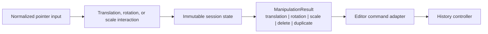

# @folio/manipulation

`@folio/manipulation` owns Folio's framework-independent object-manipulation interaction and session lifecycle. Translation, center-pivot rotation, and center-pivot uniform scale move one selected immutable object through the same explicit Preparing/Dragging/Committing-or-Cancelling state machine.

The package emits an exhaustive discriminated `ManipulationResult`: translation produces `TranslationManipulationResult`, rotation produces `RotationManipulationResult`, scale produces `ScaleManipulationResult`, and the discrete lifecycle factories produce `DeleteManipulationResult` or `DuplicateManipulationResult`. Grouping, multi-selection, and other manipulation families are not implemented.

The package has production dependencies only on `@folio/selection` and `@folio/document`. It has no React, Electron, rendering, history, persistence, or UI dependency. It neither owns document objects nor renders pixels; the editor queries its immutable state and composes those responsibilities.

## Public API

- `createManipulationController()` creates the editor-facing interaction coordinator.
- `createManipulationManager()` creates the sole owner of an active session and state transitions.
- `createTranslationEngine()` creates the origin-relative page-space calculation strategy.
- `createRotationEngine()` creates the origin-relative angular calculation strategy, expressed in radians.
- `createScaleEngine()` creates the origin-relative radial-ratio strategy for uniform scale.
- `createDeleteManipulationResult()` and `createDuplicateManipulationResult()` create immutable, document-free lifecycle results for the editor adapter.
- `DEFAULT_MANIPULATION_CONFIGURATION` exposes the frozen drag threshold and scale limits.
- `ManipulationResult` is the editor-facing union of translation, rotation, scale, delete, and duplicate results.
- `ManipulationResultBase` contains only session, object, timestamp, and kind identity shared by future result variants.
- `ManipulationCommit` remains the source-compatible Phase 10 translation payload accepted by the legacy `onCommit` callback.
- Type-only interfaces describe controller/manager contracts, state, result/commit boundaries, sources, pointer input, all three calculation models, and configuration.

New editor composition should use `ManipulationResultControllerOptions.onResult`. Existing `ManipulationControllerOptions.onCommit` remains unchanged and receives the exact legacy frozen payload shape; `onResult` receives the same translation data plus its discriminator.

Concrete controllers, managers, sessions, state builders, calculation engines, and result builders remain private. Factories are the required construction seam.

## Package structure

```text
packages/manipulation/
|-- README.md
|-- package.json
|-- tsconfig.json
`-- src/
    |-- __tests__/
    |-- controller/manipulation-controller.ts
    |-- interfaces/
    |   |-- manipulation-controller.ts
    |   |-- manipulation-manager.ts
    |   |-- manipulation-session.ts
    |   |-- rotation-engine.ts
    |   |-- scale-engine.ts
    |   `-- translation-engine.ts
    |-- manager/manipulation-manager.ts
    |-- model/types.ts
    |-- result/
    |   |-- manipulation-result.ts
    |   |-- rotation-manipulation-result.ts
    |   |-- scale-manipulation-result.ts
    |   |-- object-lifecycle-manipulation-result.ts
    |   `-- translation-manipulation-result.ts
    |-- rotation/rotation-engine.ts
    |-- scale/scale-engine.ts
    |-- session/manipulation-session.ts
    |-- state/manipulation-state.ts
    |-- translation/translation-engine.ts
    `-- index.ts
```

## Invariants

- Only one session exists per manager.
- Pointer ownership is identified by the initiating pointer ID.
- Translation is always `current page point - initial page point`; event deltas never accumulate.
- Rotation is the normalized angular difference between the origin and current center-relative pointer vectors.
- Scale is the center-relative radial ratio, clamped to the configured absolute scale limits.
- A session stays Preparing through the exact threshold and enters Dragging only after it is exceeded.
- State contains object identity and interaction values, never copied objects or stroke geometry.
- Commit is requested through an injected editor callback; rejection or failure cancels safely.
- The controller emits a frozen discriminated result before entering the terminal Committing state.
- Selection identity and object visibility, lock, and existence are revalidated throughout the session.
- Commit/cancel terminal states are observable before the manager returns to Idle.
- Destroying a controller cancels its active session and retains no document state.

## Generalized editor boundary



Manipulation does not import Editor or History. The three continuous transforms share the controller, manager, session lifecycle, threshold behavior, and terminal transitions. Delete and duplicate are discrete immutable results and do not create synthetic pointer sessions. The editor contributes every command adapter; the existing History execution path remains unchanged.

No plugin registry, runtime dispatch registry, or behavioral inheritance hierarchy is introduced. Exhaustive discriminated unions keep supported manipulation families explicit.

See `docs/architecture/PHASE12_MANIPULATION_FRAMEWORK.md` for the Phase 12 integration contract.
