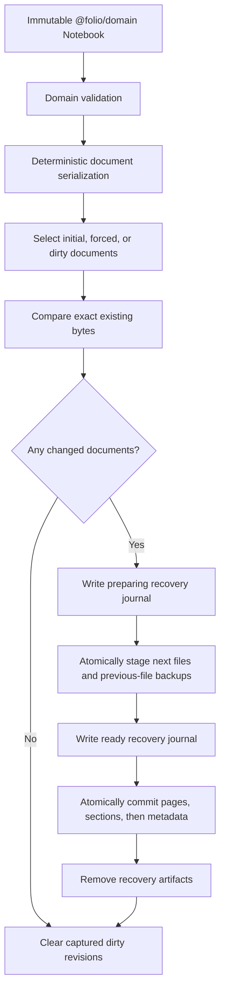
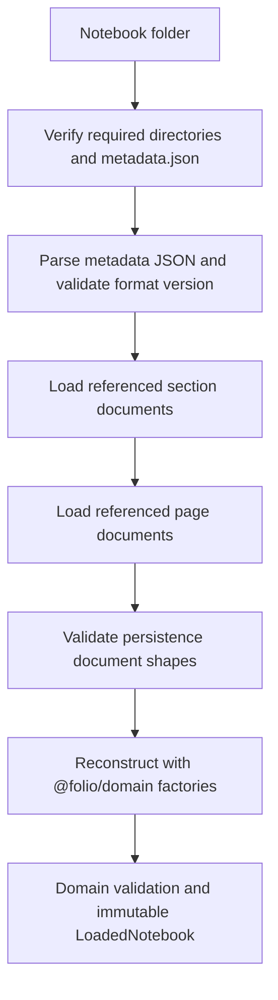
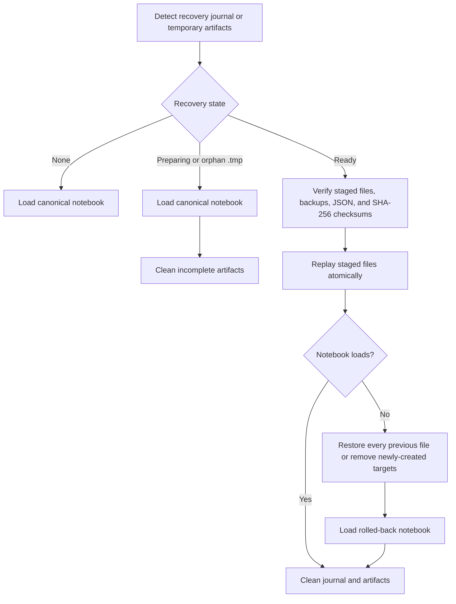

# Folio Persistence

`@folio/persistence` is Folio's framework-independent folder persistence package. It depends only on Node.js and `@folio/domain`; it has no React, Electron renderer, canvas, rendering, editor, or search dependency.

The package treats immutable `@folio/domain` notebooks as its only model input and reconstructs them through domain factories. Domain invariants remain owned by `@folio/domain`; persistence adds only file structure, document shape, version, and recovery validation.

## Notebook folder format

```text
Atlas Notebook/
├── metadata.json
├── sections/
│   └── item-section-1.json
├── pages/
│   └── item-page-1.json
├── assets/
├── thumbnails/
└── .folio/
```

`assets/` and `thumbnails/` are created because they are part of format version 1, but binary asset and thumbnail management are outside Phase 4. `.folio/` contains short-lived recovery metadata and staged transaction files only. Successful saves remove those artifacts.

Document names are derived from percent-encoded domain identifiers. Document references use identifiers, never absolute paths. Every JSON document carries `formatVersion: 1` and a `documentType` discriminator.

### `metadata.json`

```json
{
  "assets": [
    {
      "byteLength": 42,
      "createdAt": "2026-01-02T03:04:05.000Z",
      "fileName": "diagram.png",
      "id": "asset-1",
      "kind": "image",
      "mediaType": "image/png"
    }
  ],
  "cover": {
    "kind": "color",
    "value": "#7c3aed"
  },
  "createdAt": "2026-01-02T03:04:05.000Z",
  "documentType": "notebook",
  "formatVersion": 1,
  "id": "notebook-1",
  "name": "Project Atlas",
  "sectionIds": ["section-1"],
  "settings": {
    "snapToGrid": true
  },
  "theme": "violet",
  "updatedAt": "2026-01-03T03:04:05.000Z"
}
```

### `sections/item-section-1.json`

```json
{
  "color": "#7c3aed",
  "documentType": "section",
  "formatVersion": 1,
  "icon": "book",
  "id": "section-1",
  "pageIds": ["page-1"],
  "title": "Research"
}
```

### `pages/item-page-1.json`

```json
{
  "background": {
    "color": "#ffffff",
    "type": "plain"
  },
  "createdAt": "2026-01-02T03:04:05.000Z",
  "documentType": "page",
  "formatVersion": 1,
  "height": 1024,
  "id": "page-1",
  "objects": [],
  "updatedAt": "2026-01-03T03:04:05.000Z",
  "width": 1440
}
```

JSON keys are recursively sorted, indentation is two spaces, and every file ends with one newline. Unknown fields in supported-version metadata, sections, pages, page objects, and asset metadata are retained in `PersistenceCompatibility` and merged back during serialization.

## Public API

- `saveNotebook(path, notebook, options)` creates the notebook structure, validates through `@folio/domain`, writes changed documents atomically, and returns written/skipped paths.
- `loadNotebook(path, options)` validates required folders and documents, then returns an immutable notebook plus forward-compatible fields.
- `DirtyTracker` records metadata, section, and page revisions and exposes `saved`, `dirty`, and `saving` states.
- `AutosaveScheduler` debounces activity, supports immediate `flush()` for application backgrounding, and serializes overlapping save requests.
- `detectRecovery(path)` reports pending journals or orphan transaction artifacts without changing files.
- `recoverNotebook(path)` replays a complete transaction or rolls it back if replay cannot finish.
- `serializeNotebook` and `deserializeNotebook` provide pure document conversion for tests and non-filesystem adapters.
- `FileSystemAdapter` allows deterministic testing and future host-specific filesystem implementations; `nodeFileSystem` is the production adapter.
- `PersistenceError` provides stable error codes, paths, causes, and structured details.

## Save pipeline



Each atomic write creates a sibling `target.tmp`, flushes it to disk, then atomically renames it over `target`. Canonical JSON is never opened for in-place overwrite.

## Load pipeline



Missing files, corrupt JSON, invalid document shapes, unsupported versions, unsafe paths, I/O failures, and invalid recovery state produce `PersistenceError` instances with stable codes.

## Recovery flow



The recovery journal itself is versioned separately from notebook documents, leaving a migration seam for future formats.

## Performance notes

- Metadata, sections, and pages are split so dirty saves can avoid unrelated rewrites.
- Exact byte comparison suppresses writes even during a forced or full save.
- Independent section and page reads and recovery staging run concurrently.
- Save commit order keeps metadata last, reducing the time canonical references can point at incomplete content.
- JSON is currently materialized in memory. The tested Phase 4 baseline covers 500-page notebooks; streaming and bounded-concurrency reads can be added later without changing the public model.
