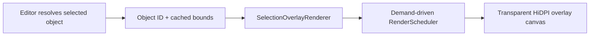
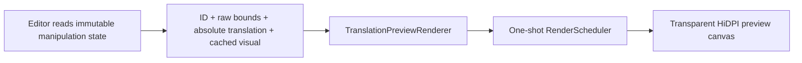
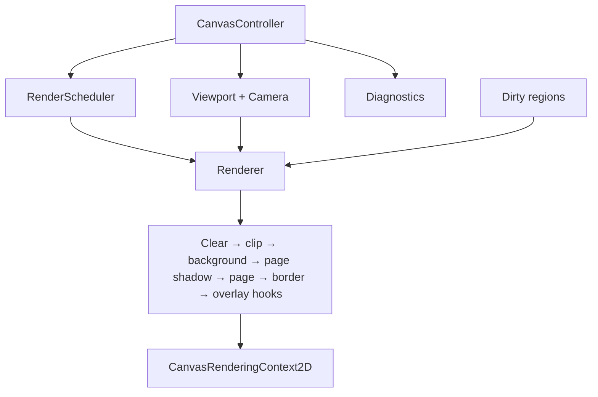
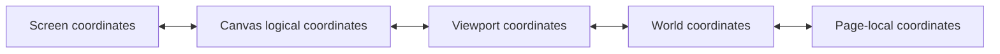
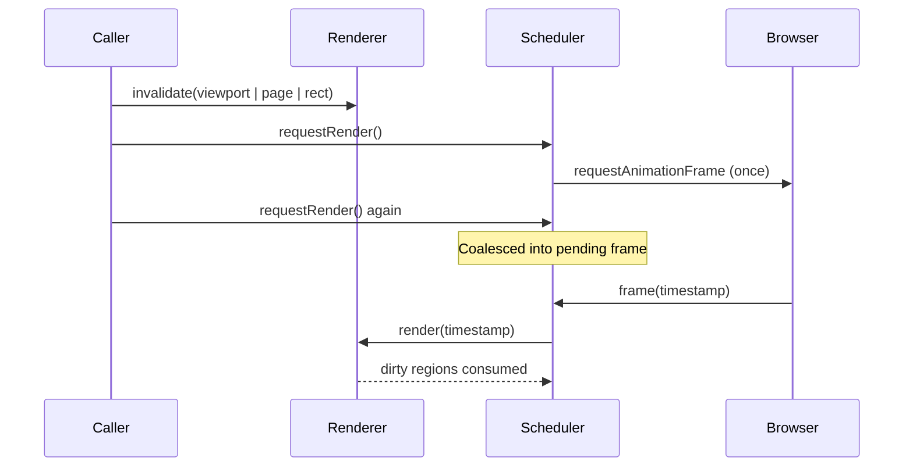
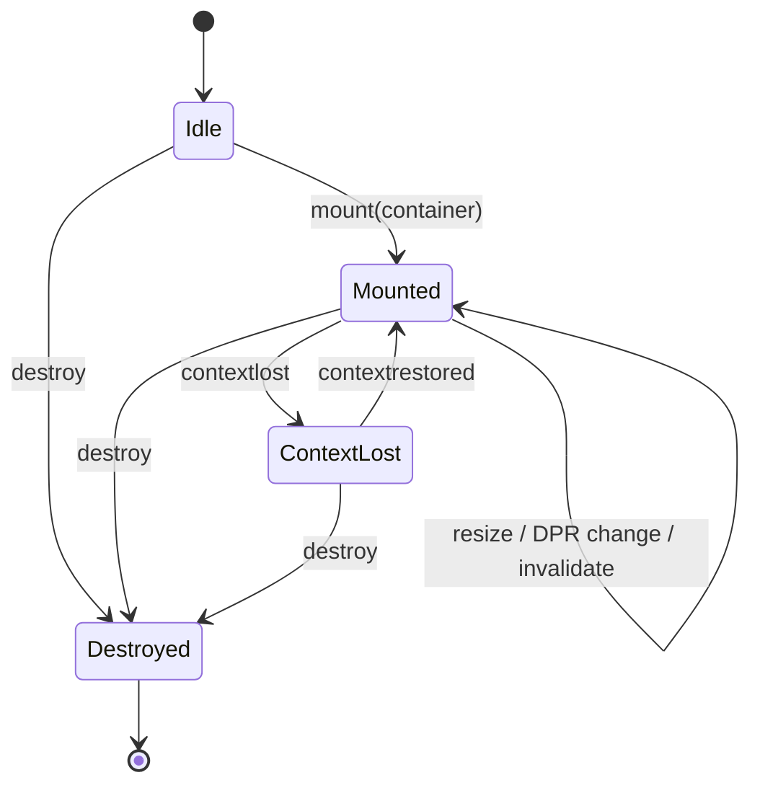

# @folio/rendering

`@folio/rendering` is Folio's framework-independent, imperative Canvas 2D engine. It owns canvas lifecycle, camera and viewport geometry, coordinate conversion, demand-driven rendering, HiDPI backing-store management, resize observation, invalidation, and diagnostics. It has no dependency on React, Electron, the domain model, persistence, history, or search.

The base renderer deliberately draws only workspace background and immutable blank-page inputs. Renderer-owned transparent overlays accept immutable visual inputs for selection and translation preview. Editing, pointer input, hit testing, notebook-object ownership, and tool behavior remain outside this package.

## Package structure

```text
src/
├── camera.ts                 Camera position, zoom, reset, fit, and centering
├── canvas-controller.ts      Canvas ownership and browser lifecycle coordination
├── coordinate-converter.ts  Screen/canvas/viewport/world/page conversion
├── diagnostics.ts            Frame, render, resize, DPR, and context-loss metrics
├── errors.ts                 Structured rendering failures
├── internal/
│   ├── canvas-overlay-layer.ts  Owned, synchronized overlay canvas lifecycle
│   ├── dirty-regions.ts         Invalidation coalescing
│   └── geometry.ts              Private geometry validation and freezing
├── renderer.ts               Deterministic Canvas 2D rendering pipeline
├── render-scheduler.ts       One-shot requestAnimationFrame scheduler
├── selection-overlay-renderer.ts  Isolated selection visual and invalidation lifecycle
├── translation-preview-renderer.ts  Isolated translated visual preview lifecycle
├── types.ts                  Immutable public rendering contracts
└── index.ts                  Deliberate public API barrel
```

## Public API

- `CanvasController` owns creation, mount, resize, context loss/restoration, render requests, and disposal.
- `CanvasController.createOverlayLayer` creates an independently rendered canvas whose size and DPR remain synchronized with the viewport and whose lifecycle remains owned by the controller.
- `Renderer` draws immutable blank-page inputs in a fixed order and exposes future overlay hooks.
- `Viewport` owns camera, logical size, page rectangle, visible world rectangle, world bounds, and DPR.
- `Camera` owns pan position and zoom, constrained by default to 25%–800%.
- `CoordinateConverter` is the only supported path between screen, canvas, viewport, world, and page coordinates.
- `RenderScheduler` coalesces invalidation into a single animation frame and never creates a continuous loop.
- `Diagnostics` exposes immutable frame and size snapshots without adding UI.
- `RenderingError` supplies stable error codes and structured details.
- `SelectionOverlayRenderer` draws a cached-bounds highlight and outline on a dedicated transparent overlay without reading selection or document state.
- `TranslationPreviewRenderer` draws an injected cached visual at an absolute page translation and invalidates only previous/current preview bounds.

Public type exports are limited to the inputs, snapshots, geometry values, adapter contracts, and options required by these APIs. Validation, geometry freezing, dirty-region accumulation, default selection styling, and concrete overlay-layer implementations remain internal. A public-API test locks the runtime surface.

## Selection overlay

The selection overlay is an independent `CanvasController` layer above ink with pointer events disabled. `setSelection()` invalidates the previous and next cached bounds as separate regions, merging only regions that intersect; a bounded region budget falls back to one full overlay clear. Resize calls `redraw()` for the new logical size and DPR. Requests are coalesced by `RenderScheduler`; repeated input with the same object ID and bounds performs no work. The visual contract is intentionally limited to a highlight and outline with no handles, anchors, transforms, or editing behavior.



## Translation preview overlay

`TranslationPreviewRenderer` is independent of manipulation logic. The editor supplies an object ID, raw geometry bounds, absolute page translation, and a cached `TranslationPreviewVisual`. Changes clear the old and new preview regions on a one-shot animation frame. Commit or cancel supplies `null`, which clears transient pixels without repainting the base page. Resize and DPR changes request one full transparent-layer redraw.



## Renderer architecture



## Coordinate flow



Screen coordinates are CSS client pixels. Canvas and viewport coordinates are logical pixels and never use the physical HiDPI backing-store dimensions. World coordinates are camera-independent. Page coordinates are relative to the current page rectangle.

## Frame scheduling and invalidation



Rectangular invalidation is part of the public contract. Phase 6 conservatively redraws the viewport internally; later dirty-region optimization can become more selective without changing callers.

## Canvas lifecycle



Destroying a controller disconnects its `ResizeObserver`, removes DPR and context listeners, cancels its pending animation frame, destroys its renderer, removes its canvas, and releases retained DOM references. A destroyed controller cannot be remounted; create a fresh controller instead.

## Performance and extension points

- Logical and physical canvas sizes remain separate; the backing store is rounded from logical size × current DPR.
- The context transform applies DPR once per frame, keeping renderer geometry in logical units.
- Page shadow and border widths compensate for camera zoom to stay visually stable.
- Immutable viewport snapshots and page/theme inputs make a frame deterministic.
- Multiple requests are coalesced and a completed frame does not schedule another frame.
- Overlay layers share the controller's resize and disposal lifecycle while keeping specialized renderers out of the base page pipeline.
- Selection overlay changes clear only affected old/new bounds; viewport resize requests a full transparent-layer redraw.
- Translation preview changes reuse cached visuals, clear bounded old/new regions, and perform no idle repainting.
- Rectangular invalidation, world bounds, page replacement, background strategies, and ordered overlay hooks are stable seams for future page stacks and object/overlay renderers.
- Camera rotation is represented as a fixed zero in snapshots, reserving a future contract hook without implementing rotation in Phase 6.

## Testing

Unit tests use injected canvas, observer, clock, and animation-frame adapters. They cover lifecycle and cleanup, context loss/restoration, HiDPI and dynamic DPR, resize and centering, fit/zoom/pan, all coordinate conversions, invalidation coalescing, scheduler cancellation, renderer ordering and destruction, diagnostics, immutable snapshots, and recreate-without-retention behavior. Electron end-to-end coverage verifies the actual adapter, mounted-canvas identity, shell interactions, window resize, page centering, backing-store scale, theme redraw, and the absence of continuous repainting.
