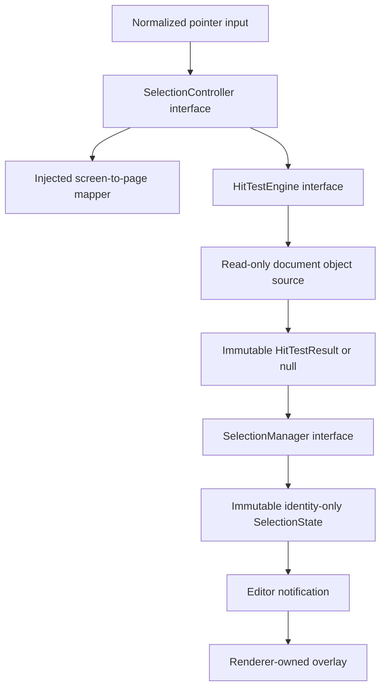

# @folio/selection

`@folio/selection` owns Folio's session-only object discovery and selection state. It queries immutable `@folio/document` objects but never copies or mutates them. Its only production package dependency is `@folio/document`; it has no production dependency on React, Electron, rendering, ink, history, persistence, shell, or toolbar code. `@folio/ink` is used only as a development dependency for realistic immutable test fixtures.

Concrete manager, controller, hit-test, and candidate-query implementations are private. Callers compose the package through factories returning public interfaces. The initial linear broad-phase strategy sits behind an internal candidate-query interface, allowing a spatial index to replace it without changing the hit-test or editor APIs.

## Package structure

```text
src/
|-- controller/     Pointer interpretation and workflow coordination
|-- hit-testing/    Bounds rejection and vector ink geometry queries
|-- interfaces/     Stable editor-facing contracts
|-- manager/        Immutable selection-state ownership
|-- model/          Coordinate-space and hit-result contracts
|-- state/          Immutable identity-only SelectionState
|-- __tests__/      Manager, controller, geometry, scale, and API coverage
`-- index.ts         Deliberate public API barrel
```

## Public API

- `createSelectionManager()` returns the sole owner of current selection state.
- `createHitTestEngine()` returns a pure, deterministic page-space query engine.
- `createSelectionController()` composes pointer clicks, coordinate mapping, hit testing, state replacement, and notifications.
- `SelectionState` stores `selectedObjectId`, a future-ready immutable identifier list, type, timestamp, and monotonic version. It never stores a `PageObject`.
- `HitTestResult` returns the canonical immutable object reference for immediate inspection while selection state retains only its identity.
- `SelectionCoordinateMapper` injects the editor's existing screen-to-page transformation without creating a rendering dependency.
- `SelectionObjectSource` provides read-only access to the active page and is the future spatial-index seam.

## Interaction architecture



## Hit-testing pipeline


Ink testing measures distance to line segments and single-point stroke circles. Line, Rectangle, and Ellipse testing measures distance to their actual visible outline, including stroke width and a forgiving configurable tolerance; an optional future fill is treated as hittable interior geometry. Every path inverse-transforms the page point into the immutable object's local coordinate frame, while broad-phase rejection uses transformed cached bounds. No pixels, canvas readback, rasterization, or rendering package dependency is required.

## Coordinate ownership

`ScreenPoint`, `ViewportPoint`, and `PagePoint` carry an explicit coordinate-space discriminator. The controller accepts screen points, delegates conversion to an injected mapper, and sends only page points to the hit-test engine. Points outside the active page resolve to no hit.

## Selection invariants

- Repeated selection of the same ID returns the same `SelectionState` reference and emits no notification.
- Empty-space clicks clear selection.
- Dragged, cancelled, secondary, and non-primary pointer sequences do not select.
- Invalid object IDs and empty pages return existing/empty state rather than throwing.
- Selection changes never alter document objects, history, persistence, or notebook files.
- Editor synchronization clears an identity removed by document replacement and selects the newly created duplicate after the initiating lifecycle action; Selection itself remains document-read-only.
- Session destruction releases transient pointer state; a new session begins empty.

## Performance and future extension

- Bounding-box rejection precedes object-specific geometry work.
- `hitTest()` tracks only the current top-most result and does not copy collections.
- Cached object bounds and immutable ink/vector geometry are reused directly.
- The current linear broad-phase strategy is private behind `HitTestEngine`; a quadtree, R-tree, or spatial hash can replace it without changing callers.
- `selectedObjectIds` and interface-oriented APIs reserve a direct path to multi-selection, lasso, grouping, and transforms without implementing them in Phase 9.

## Testing

Focused tests cover immutable state, notifications, repeated clicks, clear/replace behavior, coordinate mapping, transformed geometry, bounds rejection, vector tolerance, point strokes, visibility, locked objects, z-order, nearby queries, deterministic results, invalid inputs, destroyed controllers, public exports, and a 5,000-object query. Electron coverage verifies transform routing, lifecycle selection synchronization, overlay invalidation, empty-space clearing, resize, retained canvas identity, session reset, and document counts.
